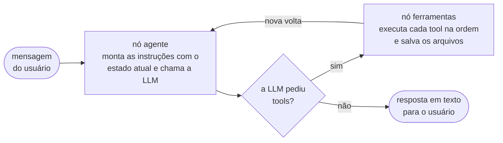
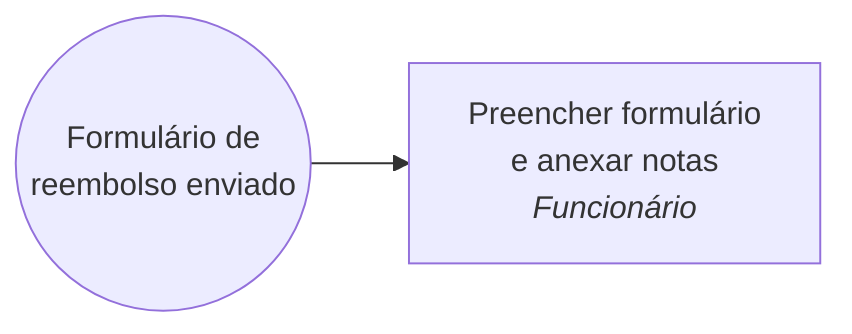
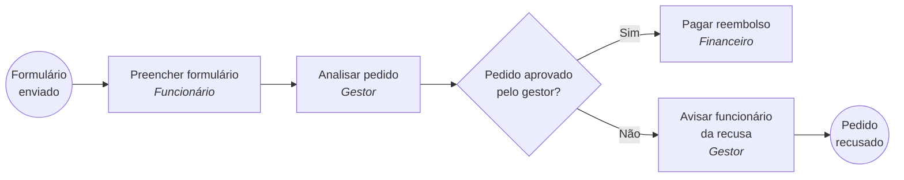
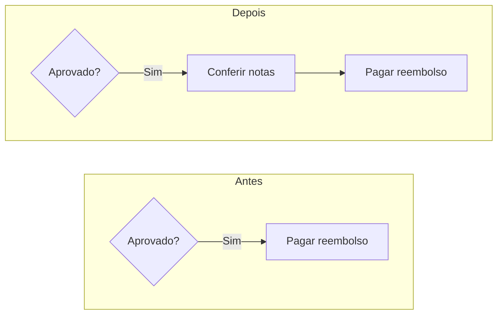
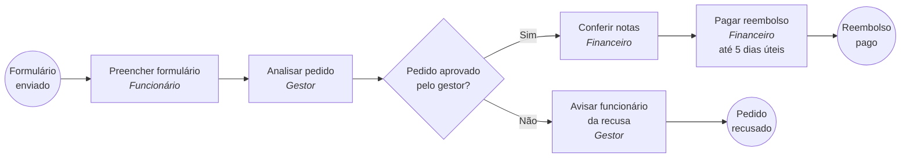
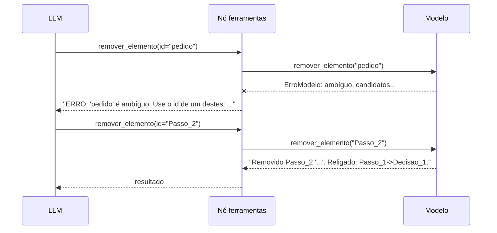

# Passo a passo de uma conversa

Este documento acompanha uma conversa inteira, mensagem por mensagem, mostrando o que cada
peça da aplicação fez. Os dados são de uma conversa real, feita em 10/10/2026 com o modelo
`claude-haiku-5-5`: os pedidos de tool, os resultados e as respostas estão transcritos
como aconteceram. A única parte montada à mão é a seção 9, sobre erros, e ela está
marcada.

Uma LLM não responde sempre igual. Se você repetir a conversa, os nomes dos passos e a
divisão em chamadas podem mudar. O que **não** muda é o caminho que cada mensagem percorre
dentro da aplicação, e é isso que importa aqui.

Termos técnicos estão no [glossário](docs/glossario.md). A visão geral está em
[docs/README.md](docs/README.md) e o detalhe de cada arquivo em [docs/pecas/](docs/pecas/).

## Como ler

Cada mensagem do usuário abre um **turno**. Dentro do turno a aplicação dá uma ou mais
**voltas** neste laço:



Quem é quem nas tabelas (caminhos a partir de `src/bpmn_agent/`):

| Nome | Arquivo | Papel |
|---|---|---|
| Interface | `visao/web.py` ou `visao/terminal.py` | Recebe o texto e mostra a resposta. |
| `Sessao` | `app/sessao.py` | Dona da conversa; roda o turno. |
| Nó `agente` | `app/agente/grafo.py` | Chama a LLM. |
| Nó `ferramentas` | `app/agente/grafo.py` | Executa as tools pedidas. |
| Tool | `app/agente/ferramentas.py` | Repassa o pedido ao modelo. |
| Modelo | `app/dominio/modelo.py` | Altera o processo de verdade. |
| Exportador | `app/exportacao/exportar_bpmn.py` | Gera o arquivo `.bpmn`. |
| Visualizador | `visao/visualizador.py` | Gera a página que desenha. |
| Persistência | `app/persistencia.py` | Grava os arquivos em disco. |

---

## 0. Antes da primeira mensagem

O usuário abre a página web. Nenhuma LLM é chamada ainda.

| # | Quem | O que faz |
|---|---|---|
| 1 | Interface | Lê o `.env` e chama `criar_llm()`. |
| 2 | `llm.py` | Vê `LLM_PROVEDOR=anthropic`, pega o modelo padrão e a chave, devolve um `ChatAnthropic`. |
| 3 | Interface | Cria `Sessao(llm)`. |
| 4 | `Sessao` | Sorteia um id (`1da7e80f`), cria um `ModeloProcesso` vazio e chama `construir_grafo`. |
| 5 | `construir_grafo` | Chama `criar_ferramentas(sessao)`, entrega as 17 tools à LLM (`bind_tools`) e monta o grafo de dois nós. |
| 6 | `Sessao` | Grava a `SAUDACAO` como primeira mensagem da conversa. |
| 7 | Interface | Mostra a saudação. |

> **Agente:** Oi! 👋 Vou te ajudar a desenhar um processo de trabalho, passo a passo. [...]
> Pra começar: **qual processo você quer documentar?**

A saudação é um texto fixo de `prompt.py`. Processo neste momento: vazio.

---

## 1. "reembolso de despesas de viagem"

### O caminho da mensagem

| # | Quem | O que faz |
|---|---|---|
| 1 | Interface | Chama `sessao.enviar("reembolso de despesas de viagem")`. |
| 2 | `Sessao.enviar` | Guarda uma "foto" dos elementos e conexões (para saber depois o que mudou) e inicia o grafo. |
| 3 | Nó `agente` | Pede `modelo.resumo()`. Recebe `Processo: Novo processo / Diagrama vazio.` e encaixa no `SYSTEM_PROMPT`. |
| 4 | Nó `agente` | A conversa começa com a saudação (fala do agente), então coloca `"(início da conversa)"` na frente. Envia tudo à LLM. |

### Volta 1: a LLM pede uma tool

A LLM não escreve texto. Pede:

```text
definir_processo(nome="Reembolso de despesas de viagem",
                 descricao="Devolver ao colaborador os gastos feitos em viagem a trabalho.")
```

| # | Quem | O que faz |
|---|---|---|
| 5 | `rotear` | Vê que há pedido de tool e manda para o nó `ferramentas`. |
| 6 | Nó `ferramentas` | Acha a tool `definir_processo` e a executa. |
| 7 | Tool `definir_processo` | Chama `modelo.definir_processo(nome, descricao)`. |
| 8 | Modelo | Tira a cópia para o desfazer, grava nome e descrição, devolve `Processo agora se chama 'Reembolso de despesas de viagem'.` |
| 9 | Nó `ferramentas` | Embrulha o texto em uma `ToolMessage` e chama `sessao.salvar()`. |
| 10 | `Sessao.salvar` | Chama `persistencia.salvar_artefatos`, que grava `processo.json`, `processo.bpmn` (via exportador) e `processo.md` em `sessoes/1da7e80f/`. |

### Volta 2: a LLM responde

O nó `agente` roda de novo. O resumo agora já traz o nome novo. A LLM vê o resultado da
tool e responde só com texto; `rotear` encerra o turno.

> **Agente:** Ótimo, anotei: **reembolso de despesas de viagem**, para devolver ao
> colaborador os gastos que ele teve em uma viagem a trabalho.
>
> Para começar o desenho: **o que dá início a esse processo?** Por exemplo, o colaborador
> envia uma solicitação, ele volta da viagem e entrega as notas, ou alguma outra coisa?

### O que volta para a interface

| Campo de `RespostaTurno` | Valor |
|---|---|
| `texto` | A fala acima. |
| `acoes` | `definir_processo: Processo agora se chama '...'.` |
| `alterados` | vazio (nenhum elemento ou conexão mudou; nada a destacar) |

**Resumo do turno:** 2 chamadas à LLM, 1 tool, 1 cópia para o desfazer.

---

## 2. "o funcionário preenche um formulário e anexa as notas"

### Volta 1: dois pedidos na mesma resposta

```text
adicionar_elemento(tipo="inicio", nome="Formulário de reembolso enviado")
adicionar_elemento(tipo="tarefa_pessoa", nome="Preencher formulário e anexar notas",
                   responsavel="Funcionário", depois_de="Formulário de reembolso enviado")
```

O nó `ferramentas` executa **na ordem**:

| Tool | O que o modelo fez | Resultado |
|---|---|---|
| 1ª `adicionar_elemento` | Não há `depois_de`. Cria o elemento solto, com o id `Inicio_1`. | `Criado Inicio_1 'Formulário de reembolso enviado'.` |
| 2ª `adicionar_elemento` | `resolver()` procura "Formulário de reembolso enviado": não é um id, mas é o nome exato de `Inicio_1`. O responsável "Funcionário" não existia e é cadastrado como participante. Cria `Passo_1` e a conexão `Fluxo_1` (`Inicio_1 ➜ Passo_1`). | `Criado Passo_1 '...' depois de Inicio_1.` |

Dois detalhes que este turno mostra:

- **A ordem importa.** Se as tools rodassem ao mesmo tempo, a segunda poderia não achar o
  início que a primeira ainda estava criando.
- **A LLM usou o nome em vez do id.** Ela pediu as duas tools de uma vez, então ainda não
  sabia que o início se chamaria `Inicio_1`. O `resolver()` aceita nomes exatamente para
  casos assim.

### Volta 2: resposta

> **Agente:** Entendi: o funcionário preenche o formulário e anexa as notas. E depois que
> ele envia, **o que acontece?** Quem recebe esse formulário e o que faz com ele?

### Estado depois do turno



| | |
|---|---|
| `alterados` | `Inicio_1`, `Passo_1`, `Fluxo_1` (os três aparecem em verde no desenho) |
| Pontos em aberto (`modelo.problemas()`) | "Ainda não sabemos como o processo termina (nenhum fim)." e "Passo_1 '...': não sabemos o que acontece depois." |

Os pontos em aberto entram no resumo que a LLM recebe na próxima chamada. É assim que ela
sabe que deve perguntar "o que acontece depois?".

O início não tem responsável, mas não é cobrado por isso. No desenho, ele aparece na raia
do Funcionário, porque `modelo.raia_de("Inicio_1")` herda a raia do passo seguinte.

**Resumo do turno:** 2 chamadas à LLM, 2 tools, 2 cópias para o desfazer.

---

## 3. "aí o gestor dele analisa. se aprovar vai pro financeiro pagar, se não aprovar o funcionário é avisado e acabou"

O usuário deu muita informação de uma vez. A LLM dividiu o trabalho em quatro voltas com
tools e só então respondeu. Em cada volta ela recebeu o resumo atualizado, com os ids
recém-criados.

| Volta | Pedido da LLM | O que o modelo fez | Resultado |
|---|---|---|---|
| 1 | `adicionar_elemento(tipo="tarefa_pessoa", nome="Analisar pedido de reembolso", responsavel="Gestor do funcionário", depois_de="Passo_1")` | `Passo_1` é um passo comum sem saída: liga `Passo_1 ➜ Passo_2`. Cadastra o participante "Gestor do funcionário". | `Criado Passo_2 '...' depois de Passo_1.` |
| 2 | `adicionar_elemento(tipo="decisao", nome="Pedido aprovado pelo gestor?", depois_de="Passo_2")` | Liga `Passo_2 ➜ Decisao_1`. Sem responsável. | `Criado Decisao_1 '...' depois de Passo_2.` |
| 3 | `adicionar_elemento(tipo="tarefa_pessoa", nome="Pagar reembolso", responsavel="Financeiro", depois_de="Decisao_1", rotulo_conexao="Sim")` | O anterior é uma decisão: cria um **novo caminho** `Decisao_1 ➜ Passo_3` com o rótulo "Sim". | `Criado Passo_3 '...' depois de Decisao_1.` |
| 3 | `adicionar_elemento(tipo="envio", nome="Avisar funcionário da recusa", responsavel="Gestor do funcionário", depois_de="Decisao_1", rotulo_conexao="Não")` | Outro novo caminho: `Decisao_1 ➜ Passo_4` com o rótulo "Não". | `Criado Passo_4 '...' depois de Decisao_1.` |
| 4 | `adicionar_elemento(tipo="fim", nome="Pedido recusado", depois_de="Passo_4")` | Liga `Passo_4 ➜ Fim_1`. | `Criado Fim_1 '...' depois de Passo_4.` |
| 5 | (só texto) | | |

O ponto central deste turno é o comportamento de `depois_de`:

- depois de um **passo comum**, o novo elemento entra **em seguida** dele;
- depois de uma **decisão**, cada novo elemento abre **um caminho novo**, e o
  `rotulo_conexao` vira a resposta escrita na seta.

Ao fim de cada volta com tools, o nó `ferramentas` chamou `sessao.salvar()`: os arquivos
foram regravados quatro vezes neste turno.

> **Agente:** Entendi: o gestor analisa o pedido. Se aprovar, vai para o financeiro pagar.
> Se não aprovar, o funcionário é avisado e o processo termina. Já desenhei isso.
>
> Agora, **depois que o financeiro paga o reembolso, o que acontece?** O processo termina
> ali ou existe mais algum passo?

### Estado depois do turno



| | |
|---|---|
| `alterados` | `Passo_2`, `Decisao_1`, `Passo_3`, `Passo_4`, `Fim_1`, `Fluxo_2` a `Fluxo_6` |
| Pontos em aberto | "Passo_3 'Pagar reembolso': não sabemos o que acontece depois." |

A pergunta que o agente fez ("depois que o financeiro paga, o que acontece?") corresponde
exatamente ao único ponto em aberto.

**Resumo do turno:** 5 chamadas à LLM, 5 tools, 5 cópias para o desfazer.

---

## 4. "depois que o financeiro paga acabou. o pagamento tem que sair em até 5 dias úteis"

### Volta 1

```text
adicionar_elemento(tipo="fim", nome="Reembolso pago", depois_de="Passo_3")
adicionar_regra(id="Passo_3", regra="O pagamento deve ser feito em até 5 dias úteis.")
```

| Tool | O que o modelo fez | Resultado |
|---|---|---|
| `adicionar_elemento` | Liga `Passo_3 ➜ Fim_2` (`Fluxo_7`). | `Criado Fim_2 'Reembolso pago' depois de Passo_3.` |
| `adicionar_regra` | Acrescenta o texto à lista `regras` de `Passo_3`. | `Regra registrada em Passo_3 (agora são 1).` |

A regra não muda o desenho, mas vai para três lugares: o resumo que a LLM lê, a descrição
em texto (`processo.md`) e o campo de documentação do passo dentro do `.bpmn`.

### Volta 2

> **Agente:** Pronto, coloquei o prazo de **até 5 dias úteis** no pagamento, e o fim
> "Reembolso pago" depois dele.
>
> Agora uma dúvida sobre o gestor: **se ele achar que falta uma nota ou que algo está
> errado no pedido, o que acontece?** Ele recusa direto ou devolve para o funcionário
> ajustar e reenviar?

| | |
|---|---|
| `alterados` | `Passo_3` (ganhou uma regra), `Fim_2`, `Fluxo_7` |
| Pontos em aberto | nenhum |

Sem pontos em aberto, a LLM passou para a etapa 6 do roteiro em `prompt.py`: perguntar
sobre exceções e retrabalho.

**Resumo do turno:** 2 chamadas à LLM, 2 tools, 2 cópias para o desfazer.

---

## 5. "esqueci: antes de pagar o financeiro confere as notas"

O usuário ignora a pergunta e pede uma **inserção no meio** do que já existe. É o tipo de
pedido de alteração que a aplicação precisa atender a qualquer momento.

Não existe uma operação "inserir antes de". A LLM resolveu com três operações, em duas
voltas:

| Volta | Pedido da LLM | O que o modelo fez | Resultado |
|---|---|---|---|
| 1 | `adicionar_elemento(tipo="tarefa_pessoa", nome="Conferir notas", responsavel="Financeiro", depois_de="Decisao_1", rotulo_conexao="Sim")` | Novo caminho `Decisao_1 ➜ Passo_5` com rótulo "Sim". Por um instante a decisão tem **dois** caminhos "Sim". | `Criado Passo_5 'Conferir notas' depois de Decisao_1.` |
| 2 | `desconectar(origem="Decisao_1", destino="Passo_3")` | Remove o "Sim" antigo, que ia direto para o pagamento. | `Conexão Decisao_1 -> Passo_3 removida.` |
| 2 | `conectar(origem="Passo_5", destino="Passo_3")` | Cria `Passo_5 ➜ Passo_3` (`Fluxo_9`). | `Conectado Passo_5 -> Passo_3.` |
| 3 | (só texto) | | |



Depois da volta 1 o processo estava em um estado intermediário esquisito, e isso é
aceitável: o modelo garante que cada operação é válida, não que cada estado intermediário
faz sentido. O que conta é o estado ao fim do turno, e a lista de pontos em aberto mostra
se sobrou algo.

> **Agente:** Pronto, coloquei **Conferir notas** (também pelo financeiro) logo antes do
> pagamento.
>
> Voltando à dúvida de antes: **se o gestor achar que falta uma nota ou que algo está
> errado no pedido, o que acontece?** [...]

O agente retomou a pergunta que ficou sem resposta. Ele consegue porque a pergunta está no
histórico da conversa, que o nó `agente` reenvia a cada chamada.

| | |
|---|---|
| `alterados` | `Passo_5`, `Fluxo_8`, `Fluxo_9` |
| Pontos em aberto | nenhum |

**Resumo do turno:** 3 chamadas à LLM, 3 tools, 3 cópias para o desfazer.

---

## 6. "na verdade quem avisa o funcionário da recusa é o RH"

### Volta 1

```text
atualizar_elemento(id="Passo_4", responsavel="RH")
```

| # | Quem | O que faz |
|---|---|---|
| 1 | Modelo | `resolver("Passo_4")` acha o elemento pelo id. |
| 2 | Modelo | Tira a cópia para o desfazer. |
| 3 | Modelo | "RH" não existe como participante: é cadastrado. O `responsavel` de `Passo_4` muda. Nome, tipo e descrição vieram vazios e ficam como estavam. |
| 4 | Modelo | Devolve `Passo_4 atualizado (responsável).` |

No desenho, isso cria uma raia nova ("RH") e move o passo para ela. Nada disso foi pedido
pela LLM: é consequência do cálculo de layout, que o exportador refaz do zero a cada
salvamento.

A LLM descobriu que "o aviso da recusa" era `Passo_4` lendo o resumo, que lista cada
elemento com id, nome e responsável.

### Volta 2

> **Agente:** Pronto, quem avisa o funcionário da recusa agora é o RH. [...]

| | |
|---|---|
| `alterados` | `Passo_4` |

**Resumo do turno:** 2 chamadas à LLM, 1 tool, 1 cópia para o desfazer.

---

## 7. "desfaz essa última mudança"

### Volta 1

```text
desfazer()
```

| # | Quem | O que faz |
|---|---|---|
| 1 | Tool `desfazer` | Chama `modelo.desfazer()`. |
| 2 | Modelo | Tira a última cópia da pilha `_historico` e a coloca no lugar do processo atual. Devolve `Última alteração desfeita.` |

A cópia restaurada é a que foi tirada no passo 2 do turno anterior, **antes** de o "RH"
ser cadastrado. Por isso o desfazer reverteu as duas coisas: o responsável do passo e a
existência do participante.

### Volta 2

> **Agente:** Feito, voltei o aviso da recusa para o **gestor do funcionário**. [...]

A resposta da tool dizia só "Última alteração desfeita". A LLM soube dizer o que voltou
porque, na volta 2, o resumo já mostrava `Passo_4` com o responsável antigo.

| | |
|---|---|
| `alterados` | `Passo_4` (comparado com a "foto" do início do turno, o responsável mudou) |

**Atenção:** o desfazer volta **uma operação**. Aqui coincidiu com o turno inteiro porque
o turno 6 teve uma operação só. Para desfazer o turno 5 (três operações), seriam
necessários três desfazeres.

**Resumo do turno:** 2 chamadas à LLM, 1 tool, nenhuma cópia nova (o desfazer consome uma).

---

## 8. Como ficou

O resumo do modelo ao fim da conversa, exatamente como a LLM o recebe:

```text
Processo: Reembolso de despesas de viagem
Descrição: Devolver ao colaborador os gastos feitos em viagem a trabalho.
Participantes: Funcionário, Gestor do funcionário, Financeiro
Elementos:
- Inicio_1 [inicio] 'Formulário de reembolso enviado'
- Passo_1 [tarefa_pessoa] 'Preencher formulário e anexar notas' | quem: Funcionário
- Passo_2 [tarefa_pessoa] 'Analisar pedido de reembolso' | quem: Gestor do funcionário
- Decisao_1 [decisao] 'Pedido aprovado pelo gestor?'
- Passo_3 [tarefa_pessoa] 'Pagar reembolso' | quem: Financeiro
    regra 1: O pagamento deve ser feito em até 5 dias úteis.
- Passo_4 [envio] 'Avisar funcionário da recusa' | quem: Gestor do funcionário
- Fim_1 [fim] 'Pedido recusado'
- Fim_2 [fim] 'Reembolso pago'
- Passo_5 [tarefa_pessoa] 'Conferir notas' | quem: Financeiro
Conexões:
- Inicio_1 -> Passo_1
- Passo_1 -> Passo_2
- Passo_2 -> Decisao_1
- Decisao_1 -> Passo_4 [Não]
- Passo_4 -> Fim_1
- Passo_3 -> Fim_2
- Decisao_1 -> Passo_5 [Sim]
- Passo_5 -> Passo_3
```

Os elementos aparecem na ordem em que foram criados, não na ordem do fluxo. A ordem do
fluxo é dada pelas conexões.



### A conversa em números

| Turno | Mensagem (resumida) | Chamadas à LLM | Tools |
|---|---|---|---|
| 1 | nome do processo | 2 | 1 |
| 2 | primeiro passo | 2 | 2 |
| 3 | análise, decisão e dois caminhos | 5 | 5 |
| 4 | fim e prazo | 2 | 2 |
| 5 | inserir conferência antes do pagamento | 3 | 3 |
| 6 | trocar o responsável | 2 | 1 |
| 7 | desfazer | 2 | 1 |
| **Total** | | **18** | **15** |

Nenhuma tool devolveu erro. Cada chamada à LLM reenvia as instruções completas com o
resumo, então o custo de um turno cresce com o número de voltas.

---

## 9. E quando a LLM erra? (exemplo construído)

Na conversa acima não houve erro de tool. Esta seção mostra o que **aconteceria**, usando
o processo final como ponto de partida. As mensagens de erro são as que o código produz;
o comportamento da LLM é o esperado, não uma transcrição.

Suponha que o usuário diga "tira o passo do pedido" e a LLM peça:

```text
remover_elemento(id="pedido")
```

| # | Quem | O que faz |
|---|---|---|
| 1 | Nó `ferramentas` | Executa a tool `remover_elemento`. |
| 2 | Modelo | `resolver("pedido")`: não é um id; nenhum nome é exatamente "pedido"; três nomes **contêm** "pedido". Lança `ErroModelo`. Nenhuma cópia é tirada e nada é alterado. |
| 3 | Nó `ferramentas` | Captura o erro e devolve, como resultado da tool: `ERRO: 'pedido' é ambíguo. Use o id de um destes: Passo_2 (Analisar pedido de reembolso); Decisao_1 (Pedido aprovado pelo gestor?); Fim_1 (Pedido recusado).` |
| 4 | Nó `agente` | Nova volta. A LLM lê o erro com os candidatos. |

A partir daí há dois desfechos esperados, ambos previstos nas instruções de `prompt.py`:

- se o contexto deixar claro qual é o passo, a LLM repete o pedido com o id certo, sem
  incomodar o usuário;
- se não der para saber, ela pergunta: "Qual passo você quer tirar: a análise do pedido
  pelo gestor ou...?".



Três tipos de falha recebem esse mesmo tratamento: tool que não existe, pedido recusado
pelo modelo (`ErroModelo`) e argumentos inválidos. Em nenhum deles o turno é interrompido.
O único freio é o limite de 60 passos do grafo por turno (`LIMITE_PASSOS_GRAFO`).

---

## 10. O que levar deste passo a passo

1. **Toda alteração no processo passa pelo mesmo funil:** LLM pede ➜ nó `ferramentas`
   executa ➜ tool repassa ➜ modelo valida, copia e altera.
2. **A LLM enxerga o processo pelo resumo**, refeito a cada chamada. É por ele que ela
   conhece os ids, sabe o que falta e percebe o efeito do que acabou de fazer.
3. **Os "pontos em aberto" guiam a entrevista.** Quando a lista esvazia, o agente passa a
   perguntar sobre exceções e a revisar.
4. **O desenho é sempre recalculado do zero** a partir do modelo. Ninguém "move" caixas:
   muda-se o processo, e o layout é consequência.
5. **Para investigar um resultado estranho**, ligue a depuração (`--debug` no terminal ou
   "Mostrar o que o agente fez" na página web) e veja a lista de tools: o problema está no pedido
   da LLM ou no que o modelo fez com ele.
