# Passo a passo: cinco mensagens, do texto ao desenho

Este documento acompanha uma conversa real de cinco mensagens e mostra, para cada uma:

1. **o caminho da mensagem** dentro da aplicação, peça por peça;
2. **o que foi enviado à LLM** e o que ela pediu de volta;
3. **cada tool executada** e o resultado;
4. **como o JSON do processo ficou**;
5. **como o desenho ficou**;
6. **o que a LLM passou a saber** para a mensagem seguinte.

Tudo aqui foi gravado de uma conversa feita em 10/10/2026 com o modelo `claude-haiku-5-5`
(sessão `e1232735`): pedidos de tool, resultados, JSON, imagens e respostas são os que
aconteceram, sem edição. Inclusive um erro da LLM na mensagem 2, que ela mesma corrigiu.

**Sobre a gravação.** A conversa foi gravada chamando `Sessao.enviar()` diretamente, por
um script. Tudo o que acontece da `Sessao` para dentro (LLM, tools, JSON, desenho) é o
que foi gravado. O trecho entre a página web e a `Sessao` (o `cliente.py` e a API) é
mostrado como a aplicação funciona hoje; ele só transporta o texto e a resposta, sem
mudar nada do conteúdo. Pelo terminal (`terminal.py`) o caminho é idêntico.

Uma LLM não responde sempre igual. Se você repetir a conversa, os nomes dos passos e a
divisão em voltas podem mudar. O que **não** muda é o caminho que cada mensagem percorre,
e é isso que importa aqui.

Termos técnicos estão no [glossário](docs/glossario.md). A visão geral está em
[docs/README.md](docs/README.md) e o detalhe de cada arquivo em [docs/pecas/](docs/pecas/).

---

## Antes de começar: o caminho que toda mensagem faz

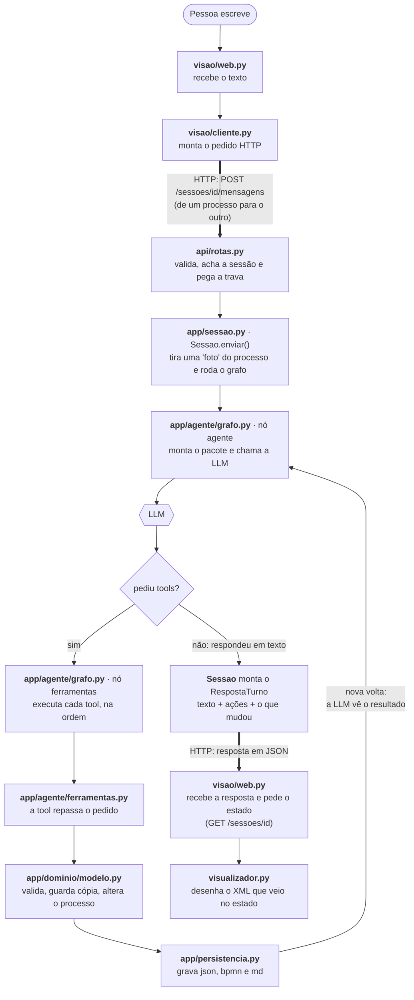

A página web (ou o terminal) e o serviço são **dois programas separados**. As setas
grossas são os únicos pontos em que eles se falam, sempre por HTTP. O XML do desenho é
gerado no serviço (`exportar_bpmn.py`) e viaja dentro do estado; a visão só o desenha.

Cada passagem pelo trecho `nó agente → LLM → nó ferramentas` é uma **volta**. Um turno
tem no mínimo uma volta (a LLM responde direto) e normalmente duas ou mais.

### Quem envia para a LLM, e o que vai no pacote

Só uma peça fala com a LLM: o **nó `agente`**, em `app/agente/grafo.py`. A cada volta ele
monta um pacote com três partes e faz uma única chamada (`llm.invoke(...)`). A biblioteca
LangChain transforma essa chamada em uma requisição pela internet para o provedor.

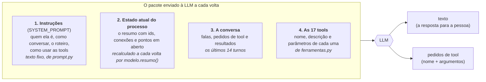

As partes 1 e 2 viajam juntas, como um texto só (as "instruções de sistema"). Na primeira
chamada desta conversa esse texto tinha 4847 caracteres, e a parte 2 era apenas:

```text
Processo: Novo processo
Diagrama vazio.
```

A LLM **não executa nada**. Ela devolve texto, ou devolve pedidos do tipo "chame
`adicionar_elemento` com estes argumentos". Quem executa é o nó `ferramentas`.

### Como ler cada mensagem abaixo

- **Diagrama de sequência**: leia de cima para baixo. Cada seta é uma chamada entre duas
  peças. As faixas "volta 1", "volta 2" marcam cada ida à LLM.
- **Tabela de tools**: ✅ deu certo, ❌ o modelo recusou.
- **Bloco `diff` do JSON**: `+` é o que entrou, `-` o que saiu, `~` o que foi alterado.
- **Imagem**: o desenho como a pessoa vê. O que mudou no turno aparece com contorno verde.

### O ponto de partida

O serviço já está no ar: ao subir, `api/servidor.py` leu o `.env` com o provedor, o modelo
e a chave.

A pessoa abre a página web. `web.py` pede uma conversa nova (`POST /sessoes`). No serviço,
`llm.py` cria a conexão com o provedor e uma `Sessao` nasce com um processo vazio e a
saudação (texto fixo de `prompt.py`) como primeira mensagem. Nenhuma LLM é chamada ainda.
A página recebe de volta o id da sessão e o estado, e mostra a saudação.

> Oi! 👋 Vou te ajudar a desenhar um processo de trabalho, passo a passo. [...]
> Pra começar: **qual processo você quer documentar?**

O `processo.json` neste momento:

```json
{"nome": "Novo processo", "descricao": "", "participantes": [], "elementos": {}, "fluxos": [], "pendencias": [], "contadores": {}}
```

---

## Mensagem 1: "reembolso de despesas de viagem"

A pessoa só disse o assunto. A LLM registra o nome e o objetivo, e pergunta por onde o processo começa.

| Chamadas à LLM | Tools executadas | Tools com erro | Elementos | Conexões | Participantes | Regras |
|---|---|---|---|---|---|---|
| 2 | 1 | 0 | 0 | 0 | 0 | 0 |

### O caminho da mensagem

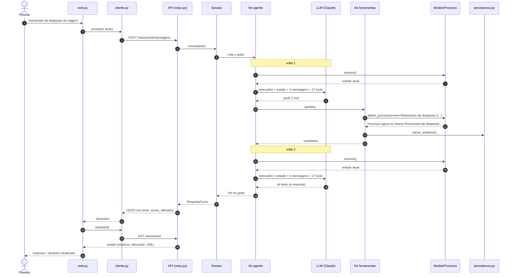

### As tools, uma a uma

| Volta | Pedido da LLM | Resultado devolvido à LLM |
|---|---|---|
| 1 | `definir_processo(nome="Reembolso de despesas de viagem", descricao="Devolver ao funcionário os gastos feitos em viagem a trabalho.")` | ✅ `Processo agora se chama 'Reembolso de despesas de viagem'.` |
| 2 | (nenhum: respondeu em texto) | |

A tool `definir_processo` repassou o pedido a `ModeloProcesso.definir_processo`, que guardou uma cópia para o desfazer e gravou o nome e a descrição. A descrição não foi dita pela pessoa com essas palavras: a LLM a redigiu a partir do assunto.

Na volta 2, a LLM recebeu o mesmo pacote, agora com o resultado da tool na conversa e o nome novo no estado, e respondeu só com texto. O turno acabou.

### Como o JSON ficou

O que mudou em `processo.json` neste turno (`+` entrou, `-` saiu, `~` foi alterado):

```diff
+ "nome": "Reembolso de despesas de viagem"
+ "descricao": "Devolver ao funcionário os gastos feitos em viagem a trabalho."
```

<details>
<summary>Ver o <code>processo.json</code> completo depois desta mensagem</summary>

```json
{
  "nome": "Reembolso de despesas de viagem",
  "descricao": "Devolver ao funcionário os gastos feitos em viagem a trabalho.",
  "participantes": [],
  "elementos": {},
  "fluxos": [],
  "pendencias": [],
  "contadores": {}
}
```

</details>

Só os dois campos de texto mudaram. Ainda não há elementos, conexões nem participantes.

### Como o desenho ficou

Ainda não há desenho: o processo tem nome, mas nenhum elemento. A página web mostra o aviso "O desenho vai aparecer aqui conforme você conta como o processo funciona".

### O que a LLM passa a saber

Este é o bloco "estado atual" que o nó `agente` vai colar nas instruções na **próxima** chamada:

```text
Processo: Reembolso de despesas de viagem
Descrição: Devolver ao funcionário os gastos feitos em viagem a trabalho.
Diagrama vazio.
```

A última linha, "Diagrama vazio", é o que leva a LLM a perguntar pelo começo do processo, como manda o roteiro em `prompt.py`.

### A resposta que a pessoa vê

> Anotado: reembolso de despesas de viagem, para devolver ao funcionário o que ele gastou em viagem a trabalho. 👍
>
> Pra começar o desenho: **o que dá início a esse processo?** Por exemplo, o funcionário envia os comprovantes, ou ele preenche um formulário depois de voltar da viagem?

---

## Mensagem 2: "o funcionário preenche um formulário e anexa as notas"

Aqui a LLM **errou na primeira tentativa** e se corrigiu sozinha. A pessoa não viu nada disso: para ela, veio só a resposta final.

| Chamadas à LLM | Tools executadas | Tools com erro | Elementos | Conexões | Participantes | Regras |
|---|---|---|---|---|---|---|
| 4 | 4 | 2 | 2 | 1 | 1 | 0 |

### O caminho da mensagem

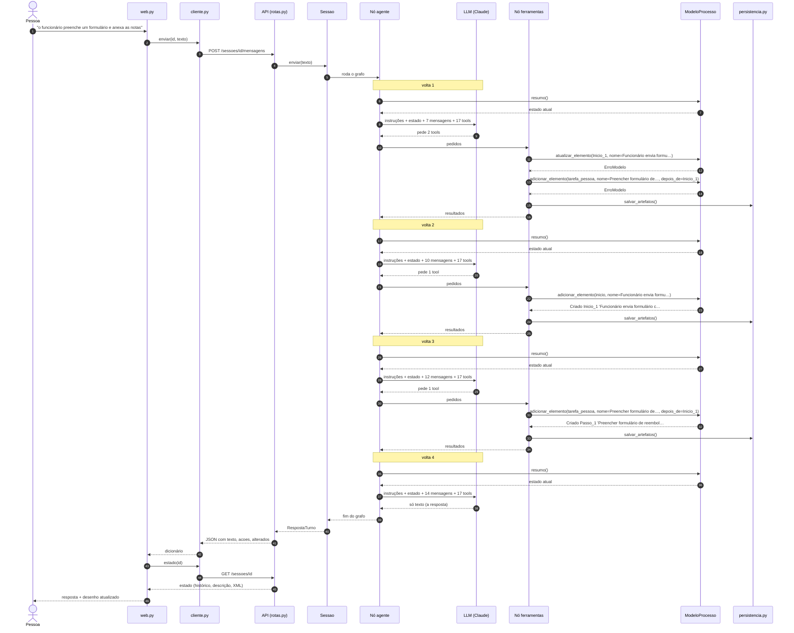

### As tools, uma a uma

| Volta | Pedido da LLM | Resultado devolvido à LLM |
|---|---|---|
| 1 | `atualizar_elemento(id="Inicio_1", nome="Funcionário envia formulário com notas")` | ❌ `ERRO: Não encontrei nenhum elemento 'Inicio_1'. Consulte os ids no estado atual.` |
| 1 | `adicionar_elemento(tipo="tarefa_pessoa", nome="Preencher formulário de reembolso", responsavel="Funcionário", depois_de="Inicio_1")` | ❌ `ERRO: Não encontrei nenhum elemento 'Inicio_1'. Consulte os ids no estado atual.` |
| 2 | `adicionar_elemento(tipo="inicio", nome="Funcionário envia formulário com notas")` | ✅ `Criado Inicio_1 'Funcionário envia formulário com notas'.` |
| 3 | `adicionar_elemento(tipo="tarefa_pessoa", nome="Preencher formulário de reembolso", responsavel="Funcionário", depois_de="Inicio_1")` | ✅ `Criado Passo_1 'Preencher formulário de reembolso' depois de Inicio_1.` |
| 4 | (nenhum: respondeu em texto) | |

O que aconteceu, volta a volta:

- **Volta 1.** A LLM supôs que já existia um início chamado `Inicio_1` e pediu para renomeá-lo e para criar um passo depois dele. Não existia. Nas duas tools, `ModeloProcesso.resolver()` não achou o elemento e lançou `ErroModelo`. O nó `ferramentas` capturou os erros e os devolveu como texto, com o prefixo `ERRO:`. **Nada foi alterado**: a validação acontece antes de o modelo mexer em qualquer coisa.
- **Volta 2.** A LLM leu os dois erros e mudou de plano: criou o início explicitamente.
- **Volta 3.** Com `Inicio_1` existindo de verdade, repetiu o pedido do passo, que agora deu certo. O responsável "Funcionário" não estava cadastrado; o modelo o cadastrou como participante na mesma operação.
- **Volta 4.** Respondeu em texto.

A mensagem de erro foi escrita para a LLM ("Consulte os ids no estado atual"), e funcionou: ela não precisou perguntar nada à pessoa. Com a depuração ligada, as duas linhas de `ERRO` aparecem na lista de ações do turno.

### Como o JSON ficou

O que mudou em `processo.json` neste turno (`+` entrou, `-` saiu, `~` foi alterado):

```diff
+ participantes: "Funcionário"
+ elementos["Inicio_1"]: {"id": "Inicio_1", "tipo": "startEvent", "nome": "Funcionário envia formulário com notas"}
+ elementos["Passo_1"]: {"id": "Passo_1", "tipo": "userTask", "nome": "Preencher formulário de reembolso", "responsavel": "Funcionário"}
+ fluxos: {"id": "Fluxo_1", "origem": "Inicio_1", "destino": "Passo_1"}
~ contadores: {"Inicio": 1, "Passo": 1, "Fluxo": 1}
```

<details>
<summary>Ver o <code>processo.json</code> completo depois desta mensagem</summary>

```json
{
  "nome": "Reembolso de despesas de viagem",
  "descricao": "Devolver ao funcionário os gastos feitos em viagem a trabalho.",
  "participantes": [
    "Funcionário"
  ],
  "elementos": {
    "Inicio_1": {
      "id": "Inicio_1",
      "tipo": "startEvent",
      "nome": "Funcionário envia formulário com notas",
      "responsavel": "",
      "descricao": "",
      "regras": []
    },
    "Passo_1": {
      "id": "Passo_1",
      "tipo": "userTask",
      "nome": "Preencher formulário de reembolso",
      "responsavel": "Funcionário",
      "descricao": "",
      "regras": []
    }
  },
  "fluxos": [
    {
      "id": "Fluxo_1",
      "origem": "Inicio_1",
      "destino": "Passo_1",
      "rotulo": ""
    }
  ],
  "pendencias": [],
  "contadores": {
    "Inicio": 1,
    "Passo": 1,
    "Fluxo": 1
  }
}
```

</details>

Entraram o primeiro participante, os dois primeiros elementos e a primeira conexão. Repare em três coisas:

- o início **não tem** `responsavel` no JSON (campo vazio, omitido acima);
- `contadores` guarda o último número usado em cada tipo de id, para nunca repetir;
- as duas tools que falharam não deixaram rastro nenhum.

### Como o desenho ficou

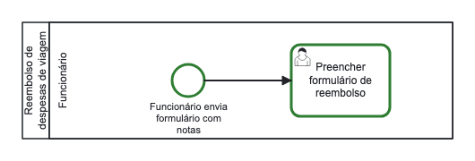

O exportador criou uma raia para o único participante. O início foi desenhado dentro da raia do Funcionário mesmo sem ter responsável: `modelo.raia_de()` faz início, fim e decisão herdarem a raia do passo vizinho. Isso é calculado na hora de desenhar e não fica gravado no JSON.

### O que a LLM passa a saber

Este é o bloco "estado atual" que o nó `agente` vai colar nas instruções na **próxima** chamada:

```text
Processo: Reembolso de despesas de viagem
Descrição: Devolver ao funcionário os gastos feitos em viagem a trabalho.
Participantes: Funcionário
Elementos:
- Inicio_1 [inicio] 'Funcionário envia formulário com notas'
- Passo_1 [tarefa_pessoa] 'Preencher formulário de reembolso' | quem: Funcionário
Conexões:
- Inicio_1 -> Passo_1
Pontos em aberto no diagrama:
- Ainda não sabemos como o processo termina (nenhum fim).
- Passo_1 'Preencher formulário de reembolso': não sabemos o que acontece depois.
```

Apareceu a seção "Pontos em aberto", calculada por `analise.problemas()`. É ela que diz à LLM o que perguntar: o passo não tem continuação e o processo não tem fim. A pergunta que o agente fez em seguida ("depois que ele envia, o que acontece?") responde exatamente a isso.

### A resposta que a pessoa vê

> Entendi: o funcionário preenche o formulário e anexa as notas. Desenhei isso como o primeiro passo do processo.
>
> Depois que ele envia, **o que acontece?** Quem confere esse pedido, e como costuma ser: um gestor aprova, o financeiro confere, ou outra pessoa?

---

## Mensagem 3: "aí o gestor dele analisa. se aprovar vai pro financeiro pagar, se não aprovar o funcionário é avisado e acabou"

A pessoa deu muita informação de uma vez: um passo, uma decisão, dois caminhos e um final. A LLM dividiu o trabalho em quatro voltas com tools antes de responder.

| Chamadas à LLM | Tools executadas | Tools com erro | Elementos | Conexões | Participantes | Regras |
|---|---|---|---|---|---|---|
| 5 | 6 | 0 | 8 | 7 | 3 | 0 |

### O caminho da mensagem

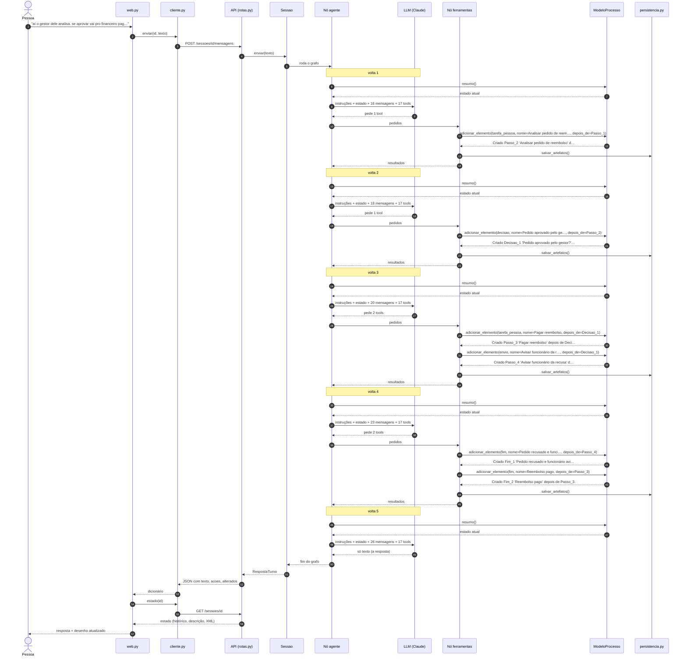

### As tools, uma a uma

| Volta | Pedido da LLM | Resultado devolvido à LLM |
|---|---|---|
| 1 | `adicionar_elemento(tipo="tarefa_pessoa", nome="Analisar pedido de reembolso", responsavel="Gestor", depois_de="Passo_1")` | ✅ `Criado Passo_2 'Analisar pedido de reembolso' depois de Passo_1.` |
| 2 | `adicionar_elemento(tipo="decisao", nome="Pedido aprovado pelo gestor?", depois_de="Passo_2")` | ✅ `Criado Decisao_1 'Pedido aprovado pelo gestor?' depois de Passo_2.` |
| 3 | `adicionar_elemento(tipo="tarefa_pessoa", nome="Pagar reembolso", responsavel="Financeiro", depois_de="Decisao_1", rotulo_conexao="Sim")` | ✅ `Criado Passo_3 'Pagar reembolso' depois de Decisao_1.` |
| 3 | `adicionar_elemento(tipo="envio", nome="Avisar funcionário da recusa", responsavel="Gestor", depois_de="Decisao_1", rotulo_conexao="Não")` | ✅ `Criado Passo_4 'Avisar funcionário da recusa' depois de Decisao_1.` |
| 4 | `adicionar_elemento(tipo="fim", nome="Pedido recusado e funcionário avisado", depois_de="Passo_4")` | ✅ `Criado Fim_1 'Pedido recusado e funcionário avisado' depois de Passo_4.` |
| 4 | `adicionar_elemento(tipo="fim", nome="Reembolso pago", depois_de="Passo_3")` | ✅ `Criado Fim_2 'Reembolso pago' depois de Passo_3.` |
| 5 | (nenhum: respondeu em texto) | |

O parâmetro `depois_de` muda de comportamento conforme o que vem antes, e este turno mostra os dois casos:

- **depois de um passo comum** (voltas 1 e 2): o novo elemento entra em seguida dele;
- **depois de uma decisão** (volta 3): cada novo elemento abre **um caminho novo**, e `rotulo_conexao` vira a resposta escrita na seta ("Sim", "Não").

Na volta 3 a LLM pediu duas tools de uma vez. O nó `ferramentas` as executou uma depois da outra, na ordem recebida. A cada volta a LLM recebeu o estado atualizado, com os ids recém-criados, e por isso pôde usar `Decisao_1`, `Passo_3` e `Passo_4` nas voltas seguintes.

A decisão e os dois finais foram criados sem `responsavel`, como as instruções orientam: não são trabalho de ninguém.

### Como o JSON ficou

O que mudou em `processo.json` neste turno (`+` entrou, `-` saiu, `~` foi alterado):

```diff
+ participantes: "Gestor"
+ participantes: "Financeiro"
+ elementos["Passo_2"]: {"id": "Passo_2", "tipo": "userTask", "nome": "Analisar pedido de reembolso", "responsavel": "Gestor"}
+ elementos["Decisao_1"]: {"id": "Decisao_1", "tipo": "exclusiveGateway", "nome": "Pedido aprovado pelo gestor?"}
+ elementos["Passo_3"]: {"id": "Passo_3", "tipo": "userTask", "nome": "Pagar reembolso", "responsavel": "Financeiro"}
+ elementos["Passo_4"]: {"id": "Passo_4", "tipo": "sendTask", "nome": "Avisar funcionário da recusa", "responsavel": "Gestor"}
+ elementos["Fim_1"]: {"id": "Fim_1", "tipo": "endEvent", "nome": "Pedido recusado e funcionário avisado"}
+ elementos["Fim_2"]: {"id": "Fim_2", "tipo": "endEvent", "nome": "Reembolso pago"}
+ fluxos: {"id": "Fluxo_2", "origem": "Passo_1", "destino": "Passo_2"}
+ fluxos: {"id": "Fluxo_3", "origem": "Passo_2", "destino": "Decisao_1"}
+ fluxos: {"id": "Fluxo_4", "origem": "Decisao_1", "destino": "Passo_3", "rotulo": "Sim"}
+ fluxos: {"id": "Fluxo_5", "origem": "Decisao_1", "destino": "Passo_4", "rotulo": "Não"}
+ fluxos: {"id": "Fluxo_6", "origem": "Passo_4", "destino": "Fim_1"}
+ fluxos: {"id": "Fluxo_7", "origem": "Passo_3", "destino": "Fim_2"}
~ contadores: {"Inicio": 1, "Passo": 4, "Fluxo": 7, "Decisao": 1, "Fim": 2}
```

<details>
<summary>Ver o <code>processo.json</code> completo depois desta mensagem</summary>

```json
{
  "nome": "Reembolso de despesas de viagem",
  "descricao": "Devolver ao funcionário os gastos feitos em viagem a trabalho.",
  "participantes": [
    "Funcionário",
    "Gestor",
    "Financeiro"
  ],
  "elementos": {
    "Inicio_1": {
      "id": "Inicio_1",
      "tipo": "startEvent",
      "nome": "Funcionário envia formulário com notas",
      "responsavel": "",
      "descricao": "",
      "regras": []
    },
    "Passo_1": {
      "id": "Passo_1",
      "tipo": "userTask",
      "nome": "Preencher formulário de reembolso",
      "responsavel": "Funcionário",
      "descricao": "",
      "regras": []
    },
    "Passo_2": {
      "id": "Passo_2",
      "tipo": "userTask",
      "nome": "Analisar pedido de reembolso",
      "responsavel": "Gestor",
      "descricao": "",
      "regras": []
    },
    "Decisao_1": {
      "id": "Decisao_1",
      "tipo": "exclusiveGateway",
      "nome": "Pedido aprovado pelo gestor?",
      "responsavel": "",
      "descricao": "",
      "regras": []
    },
    "Passo_3": {
      "id": "Passo_3",
      "tipo": "userTask",
      "nome": "Pagar reembolso",
      "responsavel": "Financeiro",
      "descricao": "",
      "regras": []
    },
    "Passo_4": {
      "id": "Passo_4",
      "tipo": "sendTask",
      "nome": "Avisar funcionário da recusa",
      "responsavel": "Gestor",
      "descricao": "",
      "regras": []
    },
    "Fim_1": {
      "id": "Fim_1",
      "tipo": "endEvent",
      "nome": "Pedido recusado e funcionário avisado",
      "responsavel": "",
      "descricao": "",
      "regras": []
    },
    "Fim_2": {
      "id": "Fim_2",
      "tipo": "endEvent",
      "nome": "Reembolso pago",
      "responsavel": "",
      "descricao": "",
      "regras": []
    }
  },
  "fluxos": [
    {
      "id": "Fluxo_1",
      "origem": "Inicio_1",
      "destino": "Passo_1",
      "rotulo": ""
    },
    {
      "id": "Fluxo_2",
      "origem": "Passo_1",
      "destino": "Passo_2",
      "rotulo": ""
    },
    {
      "id": "Fluxo_3",
      "origem": "Passo_2",
      "destino": "Decisao_1",
      "rotulo": ""
    },
    {
      "id": "Fluxo_4",
      "origem": "Decisao_1",
      "destino": "Passo_3",
      "rotulo": "Sim"
    },
    {
      "id": "Fluxo_5",
      "origem": "Decisao_1",
      "destino": "Passo_4",
      "rotulo": "Não"
    },
    {
      "id": "Fluxo_6",
      "origem": "Passo_4",
      "destino": "Fim_1",
      "rotulo": ""
    },
    {
      "id": "Fluxo_7",
      "origem": "Passo_3",
      "destino": "Fim_2",
      "rotulo": ""
    }
  ],
  "pendencias": [],
  "contadores": {
    "Inicio": 1,
    "Passo": 4,
    "Fluxo": 7,
    "Decisao": 1,
    "Fim": 2
  }
}
```

</details>

Dois participantes novos (cadastrados sozinhos, pelo campo `responsavel`), seis elementos e seis conexões. As duas conexões que saem de `Decisao_1` são as únicas com `rotulo`.

### Como o desenho ficou

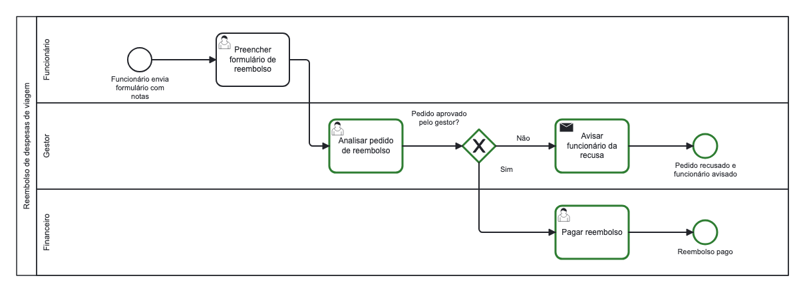

Agora há três raias, na ordem em que os participantes foram cadastrados. A decisão ficou na raia do Gestor e cada final na raia do passo que leva até ele, tudo por herança. As colunas seguem a ordem do fluxo: cada elemento fica à direita de tudo o que leva até ele.

### O que a LLM passa a saber

Este é o bloco "estado atual" que o nó `agente` vai colar nas instruções na **próxima** chamada:

```text
Processo: Reembolso de despesas de viagem
Descrição: Devolver ao funcionário os gastos feitos em viagem a trabalho.
Participantes: Funcionário, Gestor, Financeiro
Elementos:
- Inicio_1 [inicio] 'Funcionário envia formulário com notas'
- Passo_1 [tarefa_pessoa] 'Preencher formulário de reembolso' | quem: Funcionário
- Passo_2 [tarefa_pessoa] 'Analisar pedido de reembolso' | quem: Gestor
- Decisao_1 [decisao] 'Pedido aprovado pelo gestor?'
- Passo_3 [tarefa_pessoa] 'Pagar reembolso' | quem: Financeiro
- Passo_4 [envio] 'Avisar funcionário da recusa' | quem: Gestor
- Fim_1 [fim] 'Pedido recusado e funcionário avisado'
- Fim_2 [fim] 'Reembolso pago'
Conexões:
- Inicio_1 -> Passo_1
- Passo_1 -> Passo_2
- Passo_2 -> Decisao_1
- Decisao_1 -> Passo_3 [Sim]
- Decisao_1 -> Passo_4 [Não]
- Passo_4 -> Fim_1
- Passo_3 -> Fim_2
```

Não há mais "Pontos em aberto": todo caminho chega a um fim e a decisão tem as duas respostas. Sem nada pendente no desenho, a LLM passou para a etapa do roteiro que procura exceções e perguntou sobre a recusa.

### A resposta que a pessoa vê

> Entendi: o gestor analisa o pedido. Se aprovar, o financeiro paga o reembolso. Se recusar, o funcionário é avisado e o processo termina. Já desenhei esse caminho.
>
> Uma dúvida: **quando o gestor recusa, o funcionário só é avisado, ou ele pode corrigir o pedido e enviar de novo?** Por exemplo, se faltou uma nota.

---

## Mensagem 4: "depois que o financeiro paga acabou. o pagamento tem que sair em até 5 dias úteis"

A pessoa não respondeu à pergunta do agente: confirmou o final e acrescentou um prazo. A LLM viu no estado que o final "Reembolso pago" já existia e registrou só o que era novo.

| Chamadas à LLM | Tools executadas | Tools com erro | Elementos | Conexões | Participantes | Regras |
|---|---|---|---|---|---|---|
| 2 | 1 | 0 | 8 | 7 | 3 | 1 |

### O caminho da mensagem

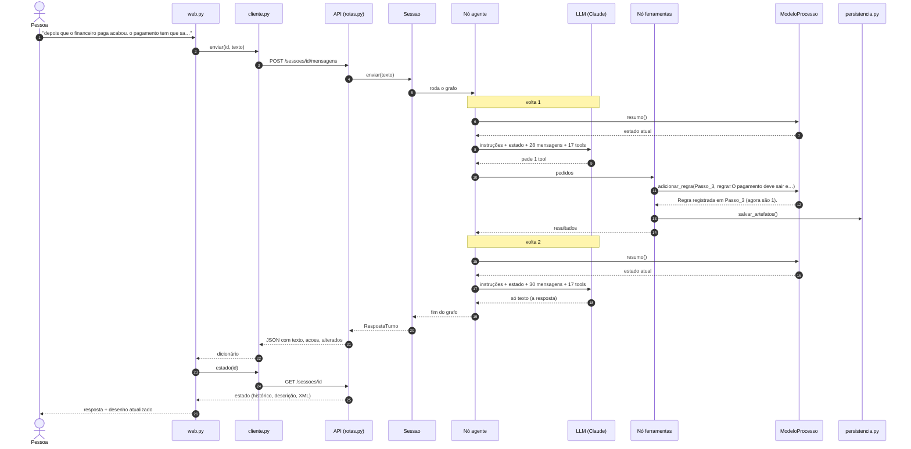

### As tools, uma a uma

| Volta | Pedido da LLM | Resultado devolvido à LLM |
|---|---|---|
| 1 | `adicionar_regra(id="Passo_3", regra="O pagamento deve sair em até 5 dias úteis.")` | ✅ `Regra registrada em Passo_3 (agora são 1).` |
| 2 | (nenhum: respondeu em texto) | |

Uma única tool. `adicionar_regra` acrescentou o texto à lista `regras` do passo `Passo_3`. A LLM soube que "o pagamento" era `Passo_3` lendo o estado, que lista cada elemento com id, nome e responsável.

### Como o JSON ficou

O que mudou em `processo.json` neste turno (`+` entrou, `-` saiu, `~` foi alterado):

```diff
~ elementos["Passo_3"]: {"regras": ["O pagamento deve sair em até 5 dias úteis."]}
```

<details>
<summary>Ver o <code>processo.json</code> completo depois desta mensagem</summary>

```json
{
  "nome": "Reembolso de despesas de viagem",
  "descricao": "Devolver ao funcionário os gastos feitos em viagem a trabalho.",
  "participantes": [
    "Funcionário",
    "Gestor",
    "Financeiro"
  ],
  "elementos": {
    "Inicio_1": {
      "id": "Inicio_1",
      "tipo": "startEvent",
      "nome": "Funcionário envia formulário com notas",
      "responsavel": "",
      "descricao": "",
      "regras": []
    },
    "Passo_1": {
      "id": "Passo_1",
      "tipo": "userTask",
      "nome": "Preencher formulário de reembolso",
      "responsavel": "Funcionário",
      "descricao": "",
      "regras": []
    },
    "Passo_2": {
      "id": "Passo_2",
      "tipo": "userTask",
      "nome": "Analisar pedido de reembolso",
      "responsavel": "Gestor",
      "descricao": "",
      "regras": []
    },
    "Decisao_1": {
      "id": "Decisao_1",
      "tipo": "exclusiveGateway",
      "nome": "Pedido aprovado pelo gestor?",
      "responsavel": "",
      "descricao": "",
      "regras": []
    },
    "Passo_3": {
      "id": "Passo_3",
      "tipo": "userTask",
      "nome": "Pagar reembolso",
      "responsavel": "Financeiro",
      "descricao": "",
      "regras": [
        "O pagamento deve sair em até 5 dias úteis."
      ]
    },
    "Passo_4": {
      "id": "Passo_4",
      "tipo": "sendTask",
      "nome": "Avisar funcionário da recusa",
      "responsavel": "Gestor",
      "descricao": "",
      "regras": []
    },
    "Fim_1": {
      "id": "Fim_1",
      "tipo": "endEvent",
      "nome": "Pedido recusado e funcionário avisado",
      "responsavel": "",
      "descricao": "",
      "regras": []
    },
    "Fim_2": {
      "id": "Fim_2",
      "tipo": "endEvent",
      "nome": "Reembolso pago",
      "responsavel": "",
      "descricao": "",
      "regras": []
    }
  },
  "fluxos": [
    {
      "id": "Fluxo_1",
      "origem": "Inicio_1",
      "destino": "Passo_1",
      "rotulo": ""
    },
    {
      "id": "Fluxo_2",
      "origem": "Passo_1",
      "destino": "Passo_2",
      "rotulo": ""
    },
    {
      "id": "Fluxo_3",
      "origem": "Passo_2",
      "destino": "Decisao_1",
      "rotulo": ""
    },
    {
      "id": "Fluxo_4",
      "origem": "Decisao_1",
      "destino": "Passo_3",
      "rotulo": "Sim"
    },
    {
      "id": "Fluxo_5",
      "origem": "Decisao_1",
      "destino": "Passo_4",
      "rotulo": "Não"
    },
    {
      "id": "Fluxo_6",
      "origem": "Passo_4",
      "destino": "Fim_1",
      "rotulo": ""
    },
    {
      "id": "Fluxo_7",
      "origem": "Passo_3",
      "destino": "Fim_2",
      "rotulo": ""
    }
  ],
  "pendencias": [],
  "contadores": {
    "Inicio": 1,
    "Passo": 4,
    "Fluxo": 7,
    "Decisao": 1,
    "Fim": 2
  }
}
```

</details>

A única mudança em todo o JSON é a lista `regras` de um elemento.

### Como o desenho ficou

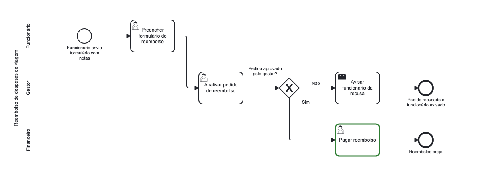

O desenho é o mesmo do turno anterior: uma regra não cria símbolo nenhum. O contorno verde em "Pagar reembolso" indica que o passo foi alterado. A regra vai para três lugares: o estado que a LLM lê (abaixo), a descrição em texto (`processo.md`) e o campo de documentação do passo dentro do `.bpmn`.

### O que a LLM passa a saber

Este é o bloco "estado atual" que o nó `agente` vai colar nas instruções na **próxima** chamada:

```text
Processo: Reembolso de despesas de viagem
Descrição: Devolver ao funcionário os gastos feitos em viagem a trabalho.
Participantes: Funcionário, Gestor, Financeiro
Elementos:
- Inicio_1 [inicio] 'Funcionário envia formulário com notas'
- Passo_1 [tarefa_pessoa] 'Preencher formulário de reembolso' | quem: Funcionário
- Passo_2 [tarefa_pessoa] 'Analisar pedido de reembolso' | quem: Gestor
- Decisao_1 [decisao] 'Pedido aprovado pelo gestor?'
- Passo_3 [tarefa_pessoa] 'Pagar reembolso' | quem: Financeiro
    regra 1: O pagamento deve sair em até 5 dias úteis.
- Passo_4 [envio] 'Avisar funcionário da recusa' | quem: Gestor
- Fim_1 [fim] 'Pedido recusado e funcionário avisado'
- Fim_2 [fim] 'Reembolso pago'
Conexões:
- Inicio_1 -> Passo_1
- Passo_1 -> Passo_2
- Passo_2 -> Decisao_1
- Decisao_1 -> Passo_3 [Sim]
- Decisao_1 -> Passo_4 [Não]
- Passo_4 -> Fim_1
- Passo_3 -> Fim_2
```

A regra aparece logo abaixo do passo. Na resposta, o agente **voltou à pergunta que tinha ficado sem resposta**. Ele consegue porque a pergunta está na conversa, que o nó `agente` reenvia a cada volta.

### A resposta que a pessoa vê

> Anotado: o pagamento tem que sair em até 5 dias úteis, e depois dele o processo termina.
>
> Voltando à recusa que ficou em aberto: **quando o gestor recusa, o funcionário só é avisado ou ele pode corrigir o pedido e enviar de novo?**

---

## Mensagem 5: "esqueci: antes de pagar o financeiro confere as notas"

Um pedido de alteração: inserir um passo **no meio** do que já existe. Não há uma operação "inserir antes de"; a LLM resolveu combinando três operações simples.

| Chamadas à LLM | Tools executadas | Tools com erro | Elementos | Conexões | Participantes | Regras |
|---|---|---|---|---|---|---|
| 3 | 3 | 0 | 9 | 8 | 3 | 1 |

### O caminho da mensagem

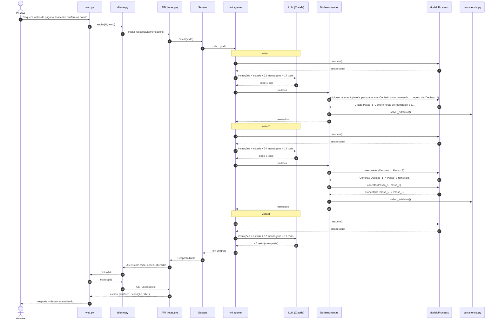

### As tools, uma a uma

| Volta | Pedido da LLM | Resultado devolvido à LLM |
|---|---|---|
| 1 | `adicionar_elemento(tipo="tarefa_pessoa", nome="Conferir notas do reembolso", responsavel="Financeiro", depois_de="Decisao_1", rotulo_conexao="Sim")` | ✅ `Criado Passo_5 'Conferir notas do reembolso' depois de Decisao_1.` |
| 2 | `desconectar(origem="Decisao_1", destino="Passo_3")` | ✅ `Conexão Decisao_1 -> Passo_3 removida.` |
| 2 | `conectar(origem="Passo_5", destino="Passo_3")` | ✅ `Conectado Passo_5 -> Passo_3.` |
| 3 | (nenhum: respondeu em texto) | |

- **Volta 1.** Criou "Conferir notas" como um novo caminho "Sim" saindo da decisão. Por um instante a decisão ficou com **dois** caminhos "Sim": um para o pagamento, outro para a conferência.
- **Volta 2.** Removeu o "Sim" antigo (`desconectar`) e ligou a conferência ao pagamento (`conectar`).

O estado depois da volta 1 não fazia sentido como processo, e isso é aceitável: o modelo garante que cada operação é válida, não que cada estado intermediário é coerente. O que conta é o estado ao fim do turno.

### Como o JSON ficou

O que mudou em `processo.json` neste turno (`+` entrou, `-` saiu, `~` foi alterado):

```diff
+ elementos["Passo_5"]: {"id": "Passo_5", "tipo": "userTask", "nome": "Conferir notas do reembolso", "responsavel": "Financeiro"}
- fluxos: {"id": "Fluxo_4", "origem": "Decisao_1", "destino": "Passo_3", "rotulo": "Sim"}
+ fluxos: {"id": "Fluxo_8", "origem": "Decisao_1", "destino": "Passo_5", "rotulo": "Sim"}
+ fluxos: {"id": "Fluxo_9", "origem": "Passo_5", "destino": "Passo_3"}
~ contadores: {"Inicio": 1, "Passo": 5, "Fluxo": 9, "Decisao": 1, "Fim": 2}
```

<details>
<summary>Ver o <code>processo.json</code> completo depois desta mensagem</summary>

```json
{
  "nome": "Reembolso de despesas de viagem",
  "descricao": "Devolver ao funcionário os gastos feitos em viagem a trabalho.",
  "participantes": [
    "Funcionário",
    "Gestor",
    "Financeiro"
  ],
  "elementos": {
    "Inicio_1": {
      "id": "Inicio_1",
      "tipo": "startEvent",
      "nome": "Funcionário envia formulário com notas",
      "responsavel": "",
      "descricao": "",
      "regras": []
    },
    "Passo_1": {
      "id": "Passo_1",
      "tipo": "userTask",
      "nome": "Preencher formulário de reembolso",
      "responsavel": "Funcionário",
      "descricao": "",
      "regras": []
    },
    "Passo_2": {
      "id": "Passo_2",
      "tipo": "userTask",
      "nome": "Analisar pedido de reembolso",
      "responsavel": "Gestor",
      "descricao": "",
      "regras": []
    },
    "Decisao_1": {
      "id": "Decisao_1",
      "tipo": "exclusiveGateway",
      "nome": "Pedido aprovado pelo gestor?",
      "responsavel": "",
      "descricao": "",
      "regras": []
    },
    "Passo_3": {
      "id": "Passo_3",
      "tipo": "userTask",
      "nome": "Pagar reembolso",
      "responsavel": "Financeiro",
      "descricao": "",
      "regras": [
        "O pagamento deve sair em até 5 dias úteis."
      ]
    },
    "Passo_4": {
      "id": "Passo_4",
      "tipo": "sendTask",
      "nome": "Avisar funcionário da recusa",
      "responsavel": "Gestor",
      "descricao": "",
      "regras": []
    },
    "Fim_1": {
      "id": "Fim_1",
      "tipo": "endEvent",
      "nome": "Pedido recusado e funcionário avisado",
      "responsavel": "",
      "descricao": "",
      "regras": []
    },
    "Fim_2": {
      "id": "Fim_2",
      "tipo": "endEvent",
      "nome": "Reembolso pago",
      "responsavel": "",
      "descricao": "",
      "regras": []
    },
    "Passo_5": {
      "id": "Passo_5",
      "tipo": "userTask",
      "nome": "Conferir notas do reembolso",
      "responsavel": "Financeiro",
      "descricao": "",
      "regras": []
    }
  },
  "fluxos": [
    {
      "id": "Fluxo_1",
      "origem": "Inicio_1",
      "destino": "Passo_1",
      "rotulo": ""
    },
    {
      "id": "Fluxo_2",
      "origem": "Passo_1",
      "destino": "Passo_2",
      "rotulo": ""
    },
    {
      "id": "Fluxo_3",
      "origem": "Passo_2",
      "destino": "Decisao_1",
      "rotulo": ""
    },
    {
      "id": "Fluxo_5",
      "origem": "Decisao_1",
      "destino": "Passo_4",
      "rotulo": "Não"
    },
    {
      "id": "Fluxo_6",
      "origem": "Passo_4",
      "destino": "Fim_1",
      "rotulo": ""
    },
    {
      "id": "Fluxo_7",
      "origem": "Passo_3",
      "destino": "Fim_2",
      "rotulo": ""
    },
    {
      "id": "Fluxo_8",
      "origem": "Decisao_1",
      "destino": "Passo_5",
      "rotulo": "Sim"
    },
    {
      "id": "Fluxo_9",
      "origem": "Passo_5",
      "destino": "Passo_3",
      "rotulo": ""
    }
  ],
  "pendencias": [],
  "contadores": {
    "Inicio": 1,
    "Passo": 5,
    "Fluxo": 9,
    "Decisao": 1,
    "Fim": 2
  }
}
```

</details>

Saiu a conexão `Fluxo_4` (decisão ➜ pagamento) e entraram `Fluxo_8` (decisão ➜ conferência) e `Fluxo_9` (conferência ➜ pagamento). O número 4 não será reaproveitado: `contadores` só cresce.

### Como o desenho ficou

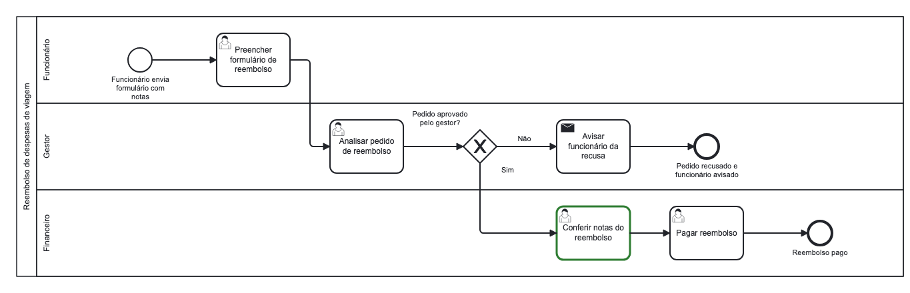

"Pagar reembolso" e o final "Reembolso pago" foram empurrados uma coluna para a direita, abrindo espaço para o passo novo. Ninguém pediu isso: o exportador recalcula todas as posições do zero a cada vez, a partir do JSON. Mudou o processo, o desenho se rearruma.

### O que a LLM passa a saber

Este é o bloco "estado atual" que o nó `agente` vai colar nas instruções na **próxima** chamada:

```text
Processo: Reembolso de despesas de viagem
Descrição: Devolver ao funcionário os gastos feitos em viagem a trabalho.
Participantes: Funcionário, Gestor, Financeiro
Elementos:
- Inicio_1 [inicio] 'Funcionário envia formulário com notas'
- Passo_1 [tarefa_pessoa] 'Preencher formulário de reembolso' | quem: Funcionário
- Passo_2 [tarefa_pessoa] 'Analisar pedido de reembolso' | quem: Gestor
- Decisao_1 [decisao] 'Pedido aprovado pelo gestor?'
- Passo_3 [tarefa_pessoa] 'Pagar reembolso' | quem: Financeiro
    regra 1: O pagamento deve sair em até 5 dias úteis.
- Passo_4 [envio] 'Avisar funcionário da recusa' | quem: Gestor
- Fim_1 [fim] 'Pedido recusado e funcionário avisado'
- Fim_2 [fim] 'Reembolso pago'
- Passo_5 [tarefa_pessoa] 'Conferir notas do reembolso' | quem: Financeiro
Conexões:
- Inicio_1 -> Passo_1
- Passo_1 -> Passo_2
- Passo_2 -> Decisao_1
- Decisao_1 -> Passo_4 [Não]
- Passo_4 -> Fim_1
- Passo_3 -> Fim_2
- Decisao_1 -> Passo_5 [Sim]
- Passo_5 -> Passo_3
```

A lista de conexões mostra o novo caminho. As conexões aparecem na ordem em que foram criadas, não na ordem do fluxo. E o agente, pela terceira vez, retoma a pergunta sobre a recusa.

### A resposta que a pessoa vê

> Pronto, coloquei a conferência das notas pelo financeiro logo depois da aprovação e antes do pagamento.
>
> Ainda falta uma coisa: **quando o gestor recusa, o funcionário só é avisado ou ele pode corrigir o pedido e enviar de novo?**

---

## A evolução do conhecimento

| Depois da mensagem | Elementos | Conexões | Participantes | Regras | Pontos em aberto | Chamadas à LLM | Tools |
|---|---|---|---|---|---|---|---|
| 1. reembolso de despesas de viagem | 0 | 0 | 0 | 0 | 0 | 2 | 1 |
| 2. o funcionário preenche um formulá… | 2 | 1 | 1 | 0 | 2 | 4 | 4 |
| 3. aí o gestor dele analisa. se apro… | 8 | 7 | 3 | 0 | 0 | 5 | 6 |
| 4. depois que o financeiro paga acab… | 8 | 7 | 3 | 1 | 0 | 2 | 1 |
| 5. esqueci: antes de pagar o finance… | 9 | 8 | 3 | 1 | 0 | 3 | 3 |
| **Total** | | | | | | **16** | **15** |


O número de elementos cresce a cada mensagem, e os pontos em aberto sobem e descem: sobem
quando entra algo incompleto (mensagem 2) e zeram quando a pessoa fecha os caminhos
(mensagem 3). É essa lista que conduz a entrevista.

O custo acompanha as voltas: cada chamada à LLM reenvia as instruções, o estado e a
conversa inteira. A mensagem 3, com cinco chamadas, custou mais que a 1 e a 4 juntas.

## Quando a LLM erra

A mensagem 2 mostrou o caso mais comum: a LLM cita um elemento que não existe. O mesmo
tratamento vale para três tipos de falha:

| O que aconteceu | O que volta para a LLM |
|---|---|
| O modelo recusou o pedido (`ErroModelo`): elemento inexistente, nome ambíguo, operação inválida | `ERRO: ` + uma mensagem que diz como corrigir |
| A LLM pediu uma tool que não existe | `ERRO: Ferramenta 'x' não existe.` |
| Argumentos inválidos (faltando, tipo errado) | `ERRO ao chamar x: ...` |

Em nenhum deles o turno é interrompido, e em nenhum deles o processo é alterado pela
metade. O único freio é o limite de 60 passos do grafo por turno (`LIMITE_PASSOS_GRAFO`).

## O que levar deste passo a passo

1. **A visão e o backend são dois programas.** A página só envia texto e recebe JSON; não
   conhece o modelo, as tools nem a LLM.
2. **Toda alteração passa pelo mesmo funil:** LLM pede ➜ nó `ferramentas` executa ➜ tool
   repassa ➜ modelo valida, copia e altera ➜ persistência grava.
3. **Só o nó `agente` fala com a LLM**, e sempre com o mesmo pacote: instruções, estado
   atual, conversa e tools.
4. **A LLM enxerga o processo pelo estado**, refeito a cada volta. É por ele que ela
   conhece os ids, sabe o que falta e percebe o efeito do que acabou de fazer.
5. **O JSON é a fonte da verdade.** O desenho, o `.bpmn` e a descrição em texto são
   sempre gerados a partir dele.
6. **O desenho é recalculado do zero** a cada alteração. Ninguém "move" caixas.
7. **Para investigar um resultado estranho**, ligue a depuração (`--debug` no terminal ou
   "Mostrar o que o agente fez" na página web) e veja a lista de tools: o problema está no
   pedido da LLM ou no que o modelo fez com ele.

## Como reproduzir

Em um terminal, o serviço:

```bash
.venv/bin/python -m bpmn_agent.api.servidor
```

Em outro, a conversa:

```bash
.venv/bin/python -m bpmn_agent.visao.terminal --debug
```

Digite as cinco mensagens acima. Os arquivos de cada sessão ficam em `sessoes/<id>/`. O
terminal imprime o endereço de um `visualizar.html` que mostra o desenho (recarregue a
página depois de cada resposta).
