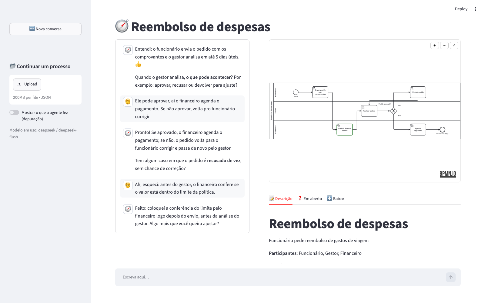

# 🧭 Desenhista de Processos — agente que entrevista e desenha BPMN

Protótipo de um agente (LangChain + LangGraph) que conversa com a pessoa, entende um
fluxo de trabalho com perguntas simples, uma de cada vez, e vai montando um diagrama
**BPMN 2.0** ao vivo. A pessoa pode pedir mudanças a qualquer momento ("tira esse passo",
"quem aprova é o financeiro", "troca a ordem", "desfaz") e o agente aplica na hora.



## Rodando

```bash
pip install -r requirements.txt
cp .env.example .env          # coloque a chave de um provedor
streamlit run src/bpmn_agent/visao/web.py     # interface web (chat + diagrama ao vivo)
# ou
python -m bpmn_agent.visao.terminal --debug         # terminal; gera sessoes/<id>/visualizar.html
python -m pytest              # testes (não usam API)
```

O `.bpmn` gerado abre no [bpmn.io](https://demo.bpmn.io), Camunda Modeler, Bizagi, Signavio etc.
Cada sessão também é salva em `sessoes/<id>/` (`processo.json`, `processo.bpmn`, `processo.md`);
o `.json` pode ser carregado depois para continuar a conversa.

## LLMs baratas ou gratuitas

Troque com `LLM_PROVEDOR` no `.env` ou na barra lateral do app (dá até para trocar no meio
da conversa e comparar). Preços e limites conferidos em outubro/2026 — mudam com frequência.

| Provedor | Modelo padrão | Custo | Observações |
|---|---|---|---|
| `deepseek` | `deepseek-flash` | ~US$ 0,30 entrada / 1,20 saída por 1M tokens (metade fora do horário de pico) | Melhor custo-benefício pago. Modo "pensamento" desligado de propósito (ver `llm.py`). |
| `gemini` | `gemini-3.8-flash` | Camada gratuita (Flash / Flash-Lite) | Na camada grátis o Google pode usar os dados para treino. Se faltar cota, use `gemini-3.5-flash-lite`. |
| `groq` | `openai/gpt-oss-120b` | Camada gratuita sem cartão | Muito rápido; limites por minuto/dia. |
| `openrouter` | `openrouter/free` | Gratuito (~50 req/dia sem créditos) | Escolhe um modelo grátis que suporte ferramentas; qualidade varia. |
| `anthropic` | `claude-haiku-5-5` | Pago | Use `claude-sonnet-5-5` para entrevistas mais caprichadas. |
| `ollama` | `qwen3:8b` | Grátis, local | Modelos pequenos erram mais nas ferramentas. |

Uma conversa típica (15–25 turnos) consome poucas centenas de milhares de tokens — centavos no DeepSeek.

## Arquitetura

```
src/bpmn_agent/
  visao/                   o que a pessoa vê
    web.py                 página web (Streamlit)
    terminal.py            conversa no terminal
    visualizador.py        HTML com bpmn-js para mostrar o diagrama
  app/                     backend (não depende da visão)
    sessao.py              Sessao: histórico, enviar, trocar modelo
    persistencia.py        gravar e ler arquivos
    agente/
      grafo.py             grafo LangGraph (nó agente + nó ferramentas)
      ferramentas.py       17 tools que o LLM chama para editar o diagrama
      prompt.py            personalidade e roteiro da entrevista
      llm.py               fábrica de LLMs (6 provedores)
    dominio/
      processo.py          dados: Processo, Elemento, Fluxo
      modelo.py            ModeloProcesso: operações de edição e desfazer
      analise.py           pontos em aberto, raias
      textos.py            resumo (para o LLM) e narrativa (para pessoas)
    exportacao/
      exportar_bpmn.py     BPMN 2.0 XML + layout automático (raias, colunas, rotas)
scripts/                   validar .bpmn (bpmn-moddle), renderizar PNG, gerar exemplo
docs/, PASSO_A_PASSO.md    documentação para desenvolvedores
CLAUDE.md, HANDOFF.md      contexto para continuar no Claude Code
```

```
START → agente ──(pediu ferramentas?)──► ferramentas ──► agente ──► … ──► END
```

Decisões de projeto que fazem diferença com modelos baratos:

- **O LLM nunca escreve XML.** Ele chama operações de alto nível (`adicionar_elemento`,
  `mover_elemento`, `conectar`…) sobre um modelo Python, que é a fonte da verdade. O XML e o
  layout são gerados de forma determinística — o diagrama nunca sai quebrado.
- **O estado do diagrama vai no prompt a cada chamada**, junto com os "pontos em aberto"
  (passos sem continuação, decisões sem resposta, ausência de fim). O agente usa isso para
  decidir a próxima pergunta, e o histórico pode ser cortado sem perder nada.
- **Inserção inteligente:** `adicionar_elemento(depois_de=X)` insere no meio do fluxo e
  religa sozinho; se X é uma decisão, cria um novo caminho rotulado. Isso reduz muito o
  número de chamadas (e de erros) do modelo.
- **Referência por nome ou id**, sem diferenciar acentos/maiúsculas; ambiguidade gera erro
  explicativo, que volta para o LLM se corrigir sem incomodar o usuário.
- **Desfazer ilimitado** (snapshot antes de cada operação), exposto ao agente e ao usuário.
- Ferramentas executadas **em sequência** (a ordem importa: criar e depois conectar).

## Ideias para evoluir

- Streaming da resposta token a token (`graph.stream(..., stream_mode="messages")`).
- `SqliteSaver` do LangGraph para retomar conversas após reiniciar o app.
- Subprocessos, eventos de mensagem entre piscinas, múltiplos participantes externos.
- Importar um `.bpmn` existente para o agente revisar com o usuário.
- Um nó "revisor" no grafo que, ao final, checa consistência e sugere melhorias.
