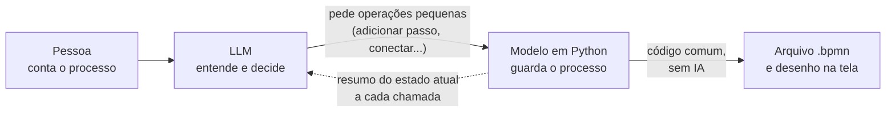
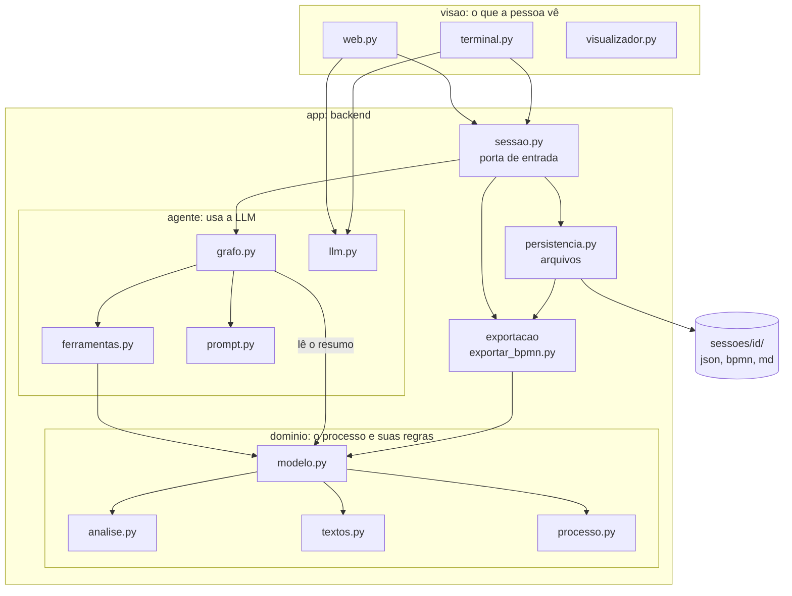
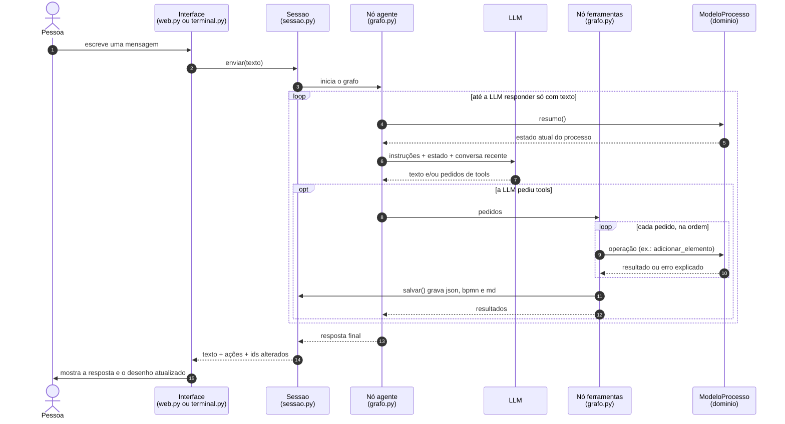
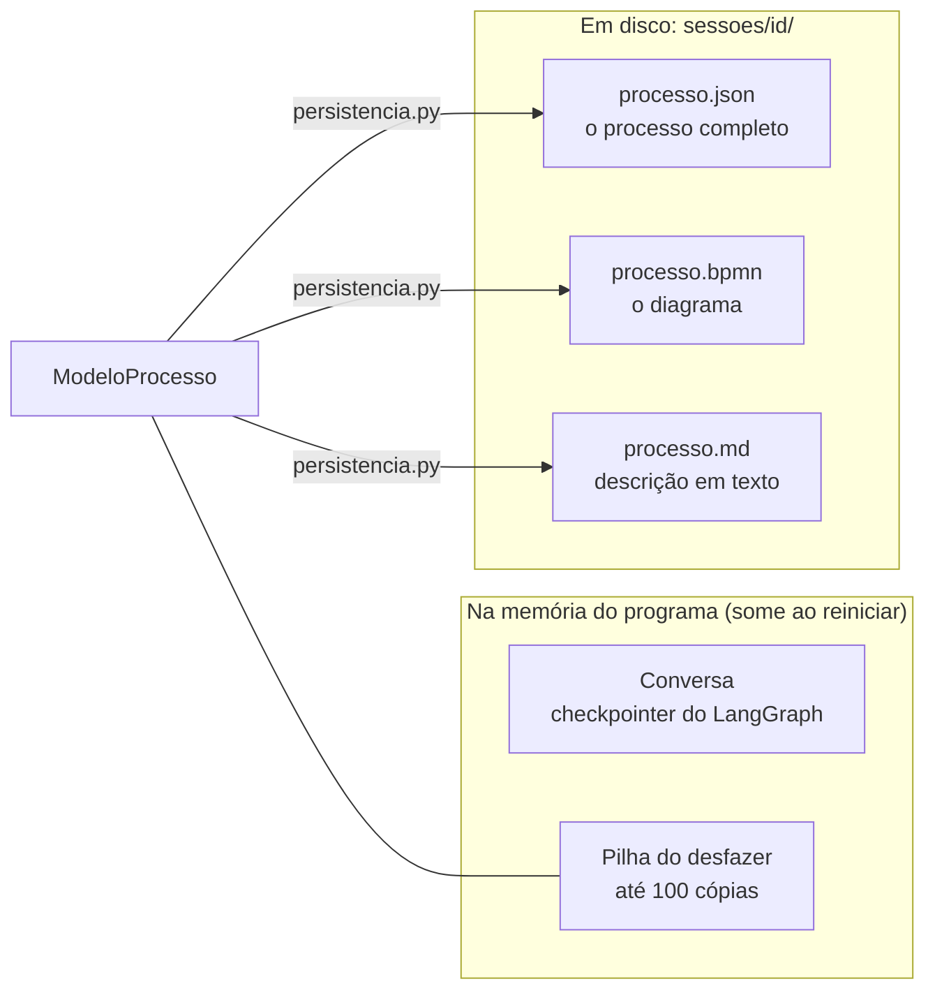

# Como o Desenhista de Processos funciona

Este documento dá a visão geral. Para o detalhe de cada arquivo, veja [pecas/](pecas/).
Para acompanhar uma conversa real mensagem por mensagem, veja
[PASSO_A_PASSO.md](../PASSO_A_PASSO.md). Termos técnicos estão no [glossário](glossario.md).

## 1. O que a aplicação faz

Uma pessoa descreve, com as próprias palavras, como um trabalho acontece. Um agente de IA
faz perguntas simples, uma de cada vez, e vai montando o desenho do processo ao lado da
conversa. No fim, a pessoa baixa um arquivo `.bpmn` que abre em qualquer ferramenta de
processos.

## 2. A ideia central

A LLM **conversa e decide**, mas **não desenha**.



Três consequências práticas:

1. **O desenho nunca fica inválido.** A LLM não escreve o arquivo; ela só pede operações
   como "adicione um passo depois deste". Cada operação é um método Python que confere os
   dados antes de alterar qualquer coisa.
2. **Funciona com modelos baratos.** Pedir "chame esta função com estes três textos" é
   muito mais fácil para uma LLM do que escrever centenas de linhas de XML sem errar.
3. **A LLM nunca trabalha com informação velha.** Antes de cada chamada, o código escreve
   o estado atual do processo dentro das instruções. Por isso o histórico da conversa pode
   ser cortado sem que ela "esqueça" o diagrama.

## 3. Como o código está organizado

Todo o código fica em `src/bpmn_agent/`, dividido em duas partes: **`visao`** (o que a
pessoa vê) e **`app`** (o backend, que funciona sem tela nenhuma).

```text
src/bpmn_agent/
  visao/                     O QUE A PESSOA VÊ
    web.py                   página web (Streamlit)
    terminal.py              conversa no terminal
    visualizador.py          página que desenha o diagrama
  app/                       BACKEND
    sessao.py                porta de entrada: uma conversa completa
    persistencia.py          gravar e ler arquivos
    agente/                  a parte que usa a LLM
      grafo.py               o laço "chama a LLM / executa as tools"
      ferramentas.py         as 17 tools
      prompt.py              instruções do entrevistador
      llm.py                 conexão com o provedor
    dominio/                 o processo e suas regras (sem LLM, sem tela, sem disco)
      processo.py            os dados
      modelo.py              as operações de edição e o desfazer
      analise.py             o que falta no processo; em que raia cada coisa fica
      textos.py              descrições em texto
    exportacao/
      exportar_bpmn.py       posições + arquivo .bpmn
tests/      testes automáticos
scripts/    utilitários de conferência
```

### As camadas e quem pode usar quem



As setas apontam sempre para baixo. As regras são:

| Camada | Pode usar | Nunca usa |
|---|---|---|
| `app/dominio` | Só o próprio domínio e a biblioteca padrão do Python. | LLM, tela, arquivos. |
| `app/exportacao` | `dominio`. | O resto. |
| `app/persistencia.py` | `dominio`, `exportacao`. | `agente`, `visao`. |
| `app/agente` | `dominio` e as bibliotecas de IA. | `exportacao`, `persistencia`, `sessao`, `visao`. |
| `app/sessao.py` | Tudo de `app`. | `visao`. |
| `visao` | `app`. | — |

Na prática: **`app` nunca importa `visao`**, nem Streamlit, nem lê o `.env`. É isso que
permite trocar a tela (ou rodar testes) sem tocar no backend.

### As peças, uma por uma

| Peça | Em uma frase | Detalhe |
|---|---|---|
| `visao/web.py` | Página web com o chat à esquerda e o desenho à direita. | [pecas/web.md](pecas/web.md) |
| `visao/terminal.py` | A mesma conversa, no terminal. | [pecas/terminal.md](pecas/terminal.md) |
| `visao/visualizador.py` | Gera a página que desenha o `.bpmn` no navegador. | [pecas/visualizador.md](pecas/visualizador.md) |
| `app/sessao.py` e `app/persistencia.py` | Uma conversa completa, e a gravação dos arquivos. | [pecas/sessao.md](pecas/sessao.md) |
| `app/agente/grafo.py` | O laço de um turno: chama a LLM, executa as tools. | [pecas/grafo.md](pecas/grafo.md) |
| `app/agente/ferramentas.py` | Apresenta as operações do modelo para a LLM. | [pecas/ferramentas.md](pecas/ferramentas.md) |
| `app/agente/prompt.py` | O texto que ensina a LLM a entrevistar. | [pecas/prompt.md](pecas/prompt.md) |
| `app/agente/llm.py` | Cria a conexão com o provedor escolhido. | [pecas/llm.md](pecas/llm.md) |
| `app/dominio/` | Guarda o processo e faz todas as alterações. | [pecas/modelo.md](pecas/modelo.md) |
| `app/exportacao/exportar_bpmn.py` | Calcula as posições e escreve o arquivo `.bpmn`. | [pecas/exportar_bpmn.md](pecas/exportar_bpmn.md) |
| `tests/` | Testes que rodam sem internet. | [pecas/testes.md](pecas/testes.md) |
| `scripts/` | Utilitários para gerar, validar e renderizar diagramas. | [pecas/scripts.md](pecas/scripts.md) |

### Quem depende de IA e quem não depende

| Depende da LLM | Não depende (dá sempre o mesmo resultado) |
|---|---|
| O que perguntar a seguir | Guardar e alterar o processo |
| Que tools chamar e com que dados | Conferir se uma alteração é válida |
| O texto da resposta | Detectar pontos em aberto |
| | Calcular posições e gerar o `.bpmn` |
| | Desfazer |

Se o desenho saiu errado, a pergunta para começar a investigar é: **a LLM pediu a operação
errada, ou a operação certa fez a coisa errada?** O painel "Mostrar o que o agente fez" da
página web e a opção `--debug` do terminal mostram a lista de operações pedidas e
respondem isso.

## 4. O que acontece em um turno



Pontos que merecem atenção:

- **Passo 5 se repete a cada volta do laço.** O resumo é recalculado sempre, então na
  segunda volta a LLM já enxerga o que as tools acabaram de fazer.
- **As tools rodam uma depois da outra, na ordem pedida.** A ordem importa: é preciso criar
  um passo antes de conectá-lo.
- **Erro de tool não derruba o turno.** Ele vira um texto começando por `ERRO:` e volta
  para a LLM, que normalmente corrige sozinha na volta seguinte.
- **Há um freio.** O grafo para depois de 60 passos (`LIMITE_PASSOS_GRAFO`) para a LLM não
  ficar em laço infinito.

## 5. Onde cada informação mora



| Informação | Onde fica | Sobrevive a reiniciar? |
|---|---|---|
| O processo (elementos, conexões, participantes, regras, pendências) | `processo.json` | Sim |
| O diagrama pronto para outras ferramentas | `processo.bpmn` | Sim |
| A descrição em texto corrido | `processo.md` | Sim |
| As mensagens da conversa | Memória (`MemorySaver`) | Não |
| O histórico do desfazer | Memória | Não |
| A chave de API | `.env` | Sim, e nunca vai para o git |

Para continuar um processo depois de fechar o programa, carrega-se o `processo.json`
(pela página web ou com `python -m bpmn_agent.visao.terminal --continuar <arquivo>`). O
desenho volta inteiro; a conversa começa do zero, mas a LLM enxerga o processo todo pelo
resumo.

## 6. Como rodar

Sempre a partir da raiz do projeto:

```bash
python3 -m venv .venv && .venv/bin/pip install -r requirements.txt
```

```bash
cp .env.example .env
```

Preencha o provedor e a chave no `.env`. Depois:

```bash
.venv/bin/python -m pytest -q
```

```bash
.venv/bin/streamlit run src/bpmn_agent/visao/web.py
```

```bash
.venv/bin/python -m bpmn_agent.visao.terminal --debug
```

O `pip install -r requirements.txt` instala o próprio projeto em "modo editável": o Python
passa a enxergar `src/bpmn_agent` de qualquer lugar, e mudanças no código valem na hora,
sem reinstalar. As dependências estão listadas em `pyproject.toml`.

## 7. Por onde começar a mexer

| Quero... | Mexa em... |
|---|---|
| Mudar o jeito de o agente falar ou perguntar | `app/agente/prompt.py` |
| Dar ao agente uma nova capacidade de edição | método em `app/dominio/modelo.py` + tool em `app/agente/ferramentas.py` + teste |
| Mudar o que conta como "ponto em aberto" | `app/dominio/analise.py` |
| Mudar o texto que a LLM recebe sobre o processo | `app/dominio/textos.py` |
| Mudar a posição das coisas no desenho | `app/exportacao/exportar_bpmn.py` |
| Mudar cores, zoom ou destaque do desenho | `visao/visualizador.py` |
| Adicionar um provedor de LLM | `PROVEDORES` em `app/agente/llm.py` |
| Mudar o laço do agente (limites, tratamento de erro) | `app/agente/grafo.py` |
| Mudar o que é gravado em disco | `app/persistencia.py` |
| Mudar a tela | `visao/web.py` ou `visao/terminal.py` |

Regras do projeto que valem para qualquer mudança estão em [CLAUDE.md](../CLAUDE.md).
