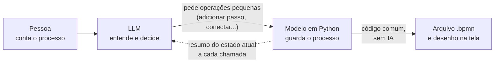
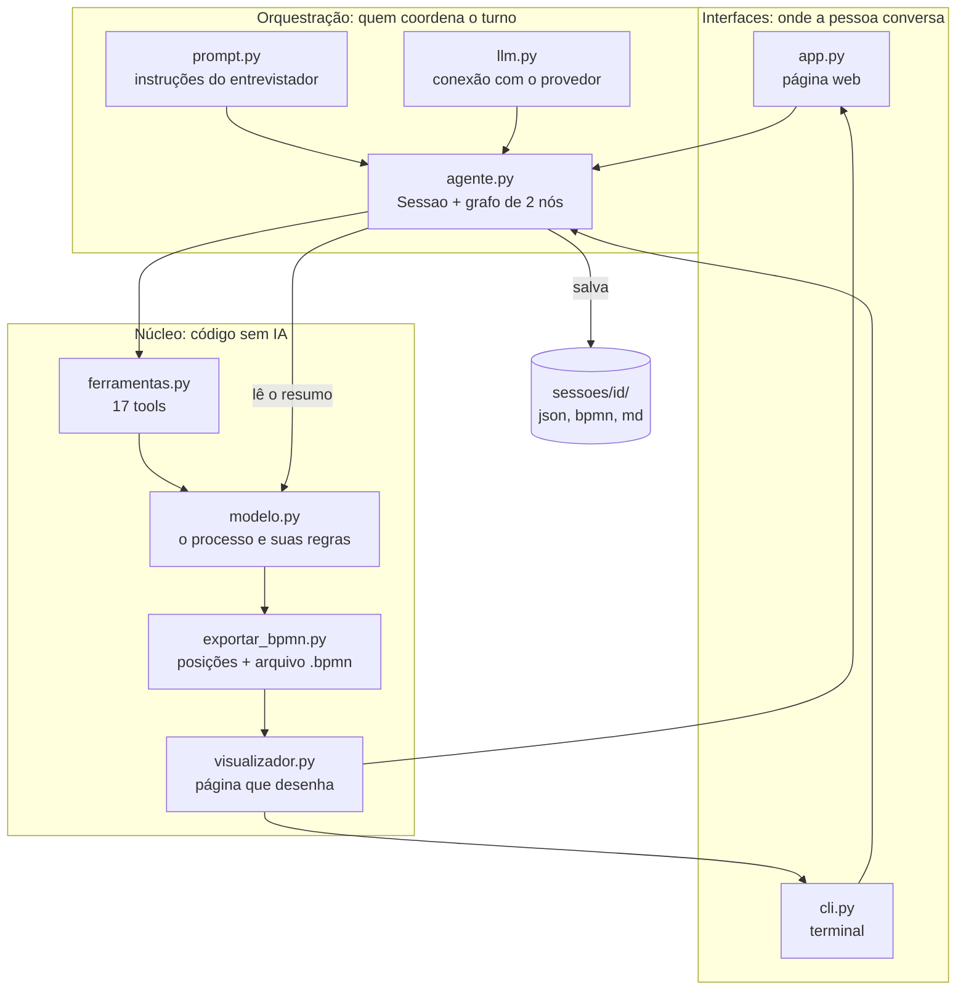
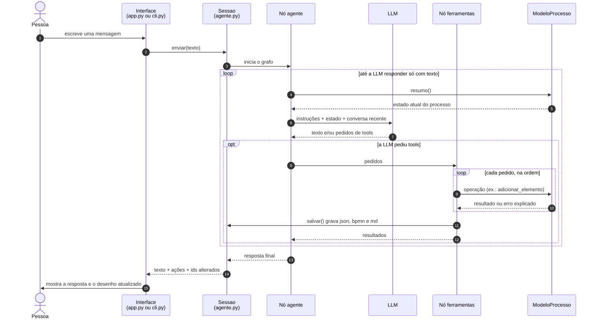
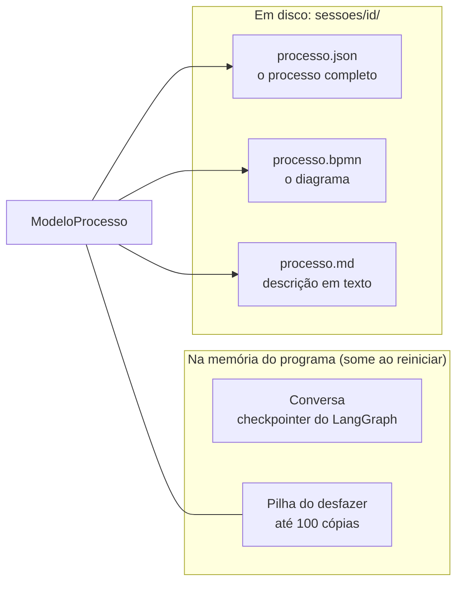

# Como o Desenhista de Processos funciona

Este documento dá a visão geral. Para o detalhe de cada arquivo, veja [pecas/](pecas/).
Para acompanhar uma conversa real mensagem por mensagem, veja
[PASSO_A_PASSO.md](../PASSO_A_PASSO.md). Termos técnicos estão no [glossário](glossario.md).

## 1. O que a aplicação faz

Uma pessoa descreve, com as próprias palavras, como um trabalho acontece. Um agente de IA
faz perguntas simples, uma de cada vez, e vai montando o desenho do processo ao lado da
conversa. No fim, a pessoa baixa um arquivo `.bpmn` que abre em qualquer ferramenta de
processos.

## 2. A ideia central

A LLM **conversa e decide**, mas **não desenha**.



Três consequências práticas:

1. **O desenho nunca fica inválido.** A LLM não escreve o arquivo; ela só pede operações
   como "adicione um passo depois deste". Cada operação é um método Python que confere os
   dados antes de alterar qualquer coisa.
2. **Funciona com modelos baratos.** Pedir "chame esta função com estes três textos" é
   muito mais fácil para uma LLM do que escrever centenas de linhas de XML sem errar.
3. **A LLM nunca trabalha com informação velha.** Antes de cada chamada, o código escreve
   o estado atual do processo dentro das instruções. Por isso o histórico da conversa pode
   ser cortado sem que ela "esqueça" o diagrama.

## 3. As peças



| Peça | Em uma frase | Detalhe |
|---|---|---|
| `app.py` | Página web com o chat à esquerda e o desenho à direita. | [pecas/app.md](pecas/app.md) |
| `cli.py` | A mesma conversa, no terminal. | [pecas/cli.md](pecas/cli.md) |
| `bpmn_agent/agente.py` | Coordena um turno: chama a LLM, executa as tools, salva. | [pecas/agente.md](pecas/agente.md) |
| `bpmn_agent/prompt.py` | O texto que ensina a LLM a entrevistar. | [pecas/prompt.md](pecas/prompt.md) |
| `bpmn_agent/llm.py` | Cria a conexão com o provedor escolhido. | [pecas/llm.md](pecas/llm.md) |
| `bpmn_agent/ferramentas.py` | Apresenta as operações do modelo para a LLM. | [pecas/ferramentas.md](pecas/ferramentas.md) |
| `bpmn_agent/modelo.py` | Guarda o processo e faz todas as alterações. | [pecas/modelo.md](pecas/modelo.md) |
| `bpmn_agent/exportar_bpmn.py` | Calcula as posições e escreve o arquivo `.bpmn`. | [pecas/exportar_bpmn.md](pecas/exportar_bpmn.md) |
| `bpmn_agent/visualizador.py` | Gera a página que desenha o `.bpmn` no navegador. | [pecas/visualizador.md](pecas/visualizador.md) |
| `tests/` | Testes que rodam sem internet. | [pecas/testes.md](pecas/testes.md) |
| `scripts/` | Utilitários para gerar, validar e renderizar diagramas. | [pecas/scripts.md](pecas/scripts.md) |

### Quem depende de IA e quem não depende

| Depende da LLM | Não depende (dá sempre o mesmo resultado) |
|---|---|
| O que perguntar a seguir | Guardar e alterar o processo |
| Que tools chamar e com que dados | Conferir se uma alteração é válida |
| O texto da resposta | Detectar pontos em aberto |
| | Calcular posições e gerar o `.bpmn` |
| | Desfazer |

Se o desenho saiu errado, a pergunta para começar a investigar é: **a LLM pediu a operação
errada, ou a operação certa fez a coisa errada?** O painel "Mostrar o que o agente fez" do
app e a opção `--debug` do terminal mostram a lista de operações pedidas e respondem isso.

## 4. O que acontece em um turno



Pontos que merecem atenção:

- **Passo 5 se repete a cada volta do laço.** O resumo é recalculado sempre, então na
  segunda volta a LLM já enxerga o que as tools acabaram de fazer.
- **As tools rodam uma depois da outra, na ordem pedida.** A ordem importa: é preciso criar
  um passo antes de conectá-lo.
- **Erro de tool não derruba o turno.** Ele vira um texto começando por `ERRO:` e volta
  para a LLM, que normalmente corrige sozinha na volta seguinte.
- **Há um freio.** O grafo para depois de 60 passos (`LIMITE_PASSOS_GRAFO`) para a LLM não
  ficar em laço infinito.

## 5. Onde cada informação mora



| Informação | Onde fica | Sobrevive a reiniciar? |
|---|---|---|
| O processo (elementos, conexões, participantes, regras, pendências) | `processo.json` | Sim |
| O diagrama pronto para outras ferramentas | `processo.bpmn` | Sim |
| A descrição em texto corrido | `processo.md` | Sim |
| As mensagens da conversa | Memória (`MemorySaver`) | Não |
| O histórico do desfazer | Memória | Não |
| A chave de API | `.env` | Sim, e nunca vai para o git |

Para continuar um processo depois de fechar o programa, carrega-se o `processo.json`
(pelo app ou com `python cli.py --continuar <arquivo>`). O desenho volta inteiro; a
conversa começa do zero, mas a LLM enxerga o processo todo pelo resumo.

## 6. Como rodar

```bash
python3 -m venv .venv && .venv/bin/pip install -r requirements.txt
cp .env.example .env            # depois preencha o provedor e a chave
.venv/bin/python -m pytest -q   # testes, sem internet
.venv/bin/streamlit run app.py  # página web
.venv/bin/python cli.py --debug # terminal, mostrando as operações
```

## 7. Por onde começar a mexer

| Quero... | Mexa em... |
|---|---|
| Mudar o jeito de o agente falar ou perguntar | `prompt.py` |
| Dar ao agente uma nova capacidade de edição | método em `modelo.py` + tool em `ferramentas.py` + teste |
| Mudar a aparência ou a posição das coisas no desenho | `exportar_bpmn.py` (posições) ou `visualizador.py` (cores, zoom) |
| Adicionar um provedor de LLM | `PROVEDORES` em `llm.py` |
| Mudar o que o laço do agente faz (limites, tratamento de erro) | `agente.py` |
| Mudar a tela | `app.py` |

Regras do projeto que valem para qualquer mudança estão em [CLAUDE.md](../CLAUDE.md).
