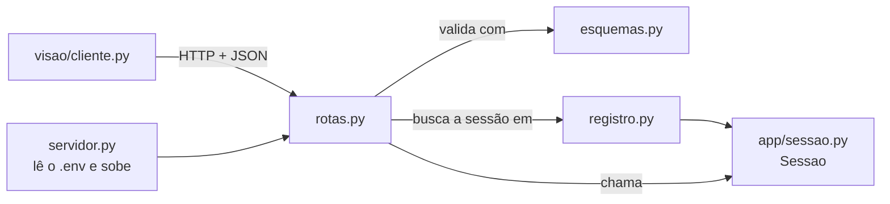
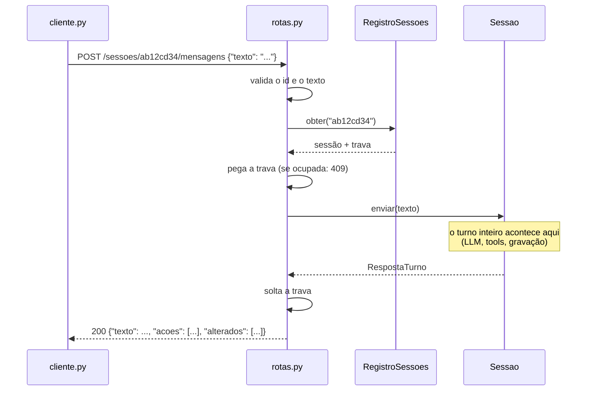
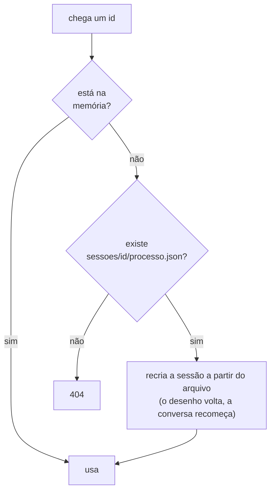

# `src/bpmn_agent/api/` — a API HTTP do backend

[Visão geral](../README.md) · [Glossário](../glossario.md)

## Em uma frase

É a porta do backend para o mundo de fora: a visão manda pedidos HTTP, a API os repassa à
[`Sessao`](sessao.md) e devolve a resposta em JSON.

## Responsabilidade

- Receber os pedidos da visão e validar o que chega.
- Guardar as sessões vivas e garantir uma requisição por vez em cada uma.
- Transformar falhas em respostas de erro com uma frase que a pessoa entende.
- Ler o `.env` (provedor, modelo e chave da LLM) ao subir.

Não tem regra de processo e não fala com a LLM: só traduz HTTP para chamadas à `Sessao`.

## Os quatro arquivos

| Arquivo | O que tem |
|---|---|
| `servidor.py` | O ponto de entrada. Lê o `.env`, cria a aplicação e sobe o servidor. |
| `rotas.py` | `criar_app()`: as rotas, o tratamento de erros e o limite de tamanho. |
| `esquemas.py` | O formato de cada entrada e de cada saída. É o contrato com a visão. |
| `registro.py` | `RegistroSessoes`: as sessões vivas na memória do servidor. |



## Como subir

```bash
.venv/bin/python -m bpmn_agent.api.servidor
```

Fica em `http://127.0.0.1:8000`. Com o servidor no ar, `http://127.0.0.1:8000/docs` mostra
uma página gerada automaticamente com todas as rotas, onde dá para testá-las pelo
navegador.

Para desenvolver, com reinício automático a cada arquivo salvo:

```bash
.venv/bin/uvicorn bpmn_agent.api.servidor:aplicacao --reload
```

| Variável | Padrão | Para quê |
|---|---|---|
| `LLM_PROVEDOR`, `LLM_MODELO` e a chave do provedor | veja [llm.md](llm.md) | Qual LLM todas as sessões usam. |
| `BPMN_API_HOST` | `127.0.0.1` | Em que endereço escutar. |
| `BPMN_API_PORTA` | `8000` | Em que porta escutar. |

## As rotas

| Método e caminho | Envia | Recebe | Para quê |
|---|---|---|---|
| `GET /saude` | — | `Saude` | Saber se o serviço está no ar e qual LLM está configurada. |
| `POST /sessoes` | `CriarSessao` (opcional) | 201 `EstadoSessao` | Começar uma conversa, do zero ou a partir de um `processo.json`. |
| `GET /sessoes/{id}` | — | `EstadoSessao` | Tudo o que a tela precisa para se desenhar. |
| `POST /sessoes/{id}/mensagens` | `EnviarMensagem` | `RespostaTurno` | Um turno da conversa. |
| `POST /sessoes/{id}/desfazer` | — | `Desfeito` | Desfazer a última alteração, sem chamar a LLM. |
| `GET /sessoes/{id}/arquivos/{nome}` | — | o arquivo | Baixar `processo.bpmn`, `processo.json` ou `processo.md`. |

O `{id}` é sempre 8 caracteres de `0-9` e `a-f`. Qualquer outra coisa é recusada antes de
tocar o disco.

### O caminho de uma mensagem dentro da API



## Os formatos (`esquemas.py`)

### O que a visão envia

| Esquema | Campos |
|---|---|
| `CriarSessao` | `processo` (opcional): o conteúdo de um `processo.json` salvo antes. |
| `EnviarMensagem` | `texto`: de 1 a 8000 caracteres. |

### O que a visão recebe

| Esquema | Campos |
|---|---|
| `Saude` | `status` (`"ok"`), `provedor`, `modelo`. |
| `RespostaTurno` | `texto` (a fala do agente), `acoes` (uma linha por tool executada), `alterados` (ids a destacar no desenho). |
| `Desfeito` | `mensagem`. |
| `Erro` | `codigo`, `mensagem` (para a pessoa), `detalhe` (para quem desenvolve). |

`EstadoSessao` traz tudo o que a tela mostra, em uma resposta só:

| Campo | Conteúdo | Onde a tela usa |
|---|---|---|
| `id` | O id da sessão. | Nas chamadas seguintes. |
| `nome` | O nome do processo. | Título. |
| `vazio` | `true` se ainda não há elementos. | Mostrar o desenho ou o aviso de "vai aparecer aqui". |
| `historico` | Lista de `{papel, texto}`, só as falas. | O chat. |
| `narrativa` | A descrição em texto. | Aba "Descrição" e download `.md`. |
| `em_aberto` | Os pontos em aberto do diagrama. | Aba "Em aberto". |
| `pendencias` | Os lembretes anotados pelo agente. | Aba "Em aberto". |
| `bpmn_xml` | O diagrama. | O desenho e o download `.bpmn`. |
| `processo` | O `processo.json`. | Download `.json`. |
| `pasta` | Onde o servidor gravou os arquivos. | Só informativo. |

A tela pede esse estado inteiro de uma vez porque o Streamlit refaz a página toda a cada
clique: uma chamada é mais simples e mais rápida que cinco.

## Erros

Toda resposta de erro tem o mesmo formato: `{"codigo", "mensagem", "detalhe"}`.

| Status | `codigo` | Quando |
|---|---|---|
| 404 | `sessao_nao_encontrada` | O id não existe na memória nem em disco. |
| 409 | `sessao_ocupada` | Chegou uma mensagem enquanto a anterior ainda era respondida. |
| 413 | `corpo_grande` | O pedido passou de 1 MB. |
| 422 | `entrada_invalida` | Id fora do formato, texto vazio ou longo demais, nome de arquivo desconhecido. |
| 422 | `processo_invalido` | O `processo.json` enviado não pôde ser aberto. |
| 502 | `llm_limite` | O provedor recusou por limite de uso. |
| 502 | `llm_chave_invalida` | O provedor recusou a chave. |
| 502 | `llm_falha` | Qualquer outra falha durante o turno. |
| 503 | `llm_nao_configurada` | Falta a chave no `.env` do servidor, ou o provedor não existe. |

O `detalhe` dos erros 502 traz até 300 caracteres da mensagem original do provedor.

## As sessões no servidor (`registro.py`)



- **Onde ficam:** em um dicionário na memória do servidor (`id → sessão`).
- **Se o servidor reiniciar:** a conversa e o desfazer se perdem; o desenho está em disco e
  é retomado sozinho quando o id é pedido de novo. A saudação vira "Oi de novo! Carreguei
  o processo...".
- **Sessão sem nenhuma alteração:** não tem arquivo em disco, então some de vez num
  reinício. A visão trata o 404 começando outra conversa.
- **Limite:** 50 sessões na memória (`MAX_SESSOES`). Ao criar a 51ª, a que está parada há
  mais tempo sai da memória. Ela continua em disco e pode ser retomada.
- **Uma requisição por vez em cada sessão:** cada sessão tem uma trava. Uma segunda
  mensagem para a mesma sessão durante um turno recebe 409; as outras rotas esperam o
  turno acabar, para nunca ler o processo no meio de uma alteração.

## Segurança

| Cuidado | Como é feito |
|---|---|
| A API **não tem autenticação**. | Por isso escuta só em `127.0.0.1`. Se `BPMN_API_HOST` for outro, o servidor avisa ao subir. |
| A chave da LLM nunca trafega. | Fica só no `.env` do servidor. Nenhuma rota a recebe nem devolve. |
| Nenhum caminho de arquivo vem do cliente. | O id é validado por formato, e os arquivos baixados são gerados da memória. Para continuar um processo, o cliente envia o **conteúdo** do `.json`. |
| Entradas com tamanho limitado. | Texto até 8000 caracteres; pedido até 1 MB. |
| Sem acesso por páginas de outros sites. | Não há liberação de CORS. |

## Quem usa e quem é usado

- **Usado por**: `visao/cliente.py` (e por qualquer programa que fale HTTP).
- **Usa**: `app/sessao.py`, `app/persistencia.py`, `app/dominio`, `app/exportacao` e
  `app/agente/llm.py`.

## Cuidados ao alterar

- **Um worker só.** As sessões ficam na memória de um processo. Nunca rode com
  `--workers` maior que 1.
- **Rotas são `def`, não `async def`.** Um turno é síncrono e demora segundos; como `def`,
  ele roda em uma thread separada e não trava as outras requisições.
- **Mudou uma rota ou um esquema?** Atualize junto `visao/cliente.py`, os testes
  (`test_api.py`, `test_cliente.py`) e esta página.
- A `api` não pode importar `visao`. E `app` não pode importar `api`, nem `fastapi`.
  O teste `test_camadas.py` confere isso.
- O objeto da aplicação se chama `aplicacao`, não `app`, para não se confundir com a
  pasta `bpmn_agent/app`.
- Com `--reload`, cada arquivo salvo reinicia o servidor e as conversas recomeçam.
