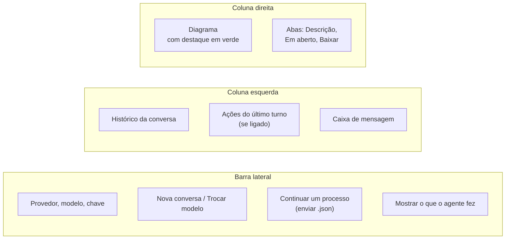
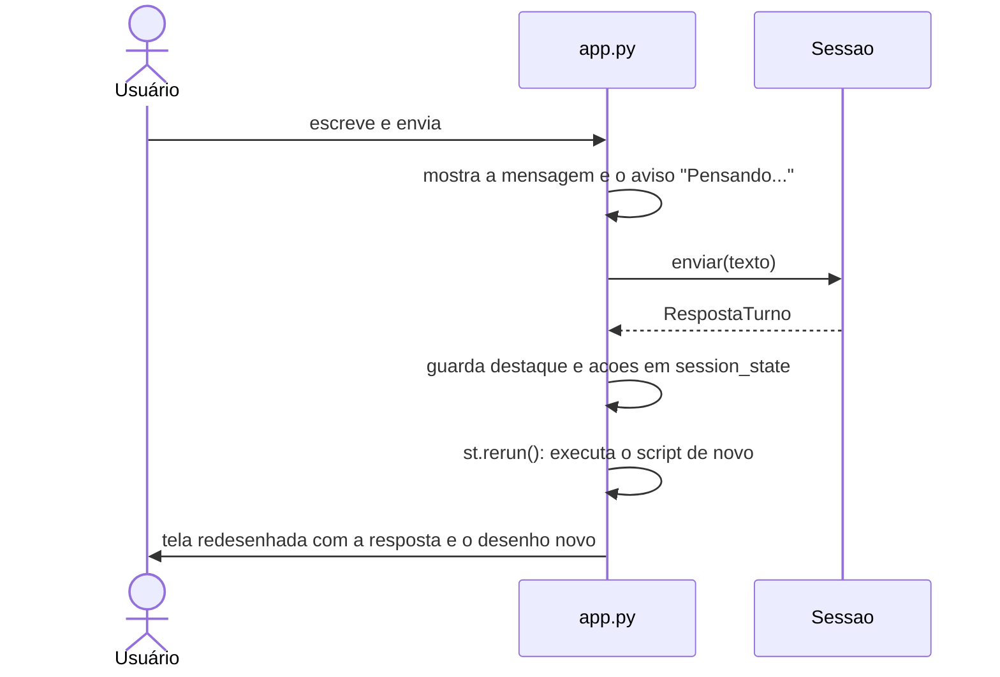

# `app.py` — a página web

[Visão geral](../README.md) · [Glossário](../glossario.md)

## Em uma frase

A tela que o usuário final usa: chat à esquerda, desenho ao vivo à direita.

## Responsabilidade

- Mostrar a conversa e receber as mensagens.
- Mostrar o desenho, a descrição em texto, os pontos em aberto e os botões de download.
- Deixar escolher provedor, modelo e chave.
- Criar, trocar e recarregar a `Sessao`.

Não tem regra de processo nem fala com a LLM diretamente: tudo passa pela
[`Sessao`](agente.md).

## A tela

| Elemento da tela | De onde vem o conteúdo |
|---|---|
| Histórico da conversa | `sessao.historico_visivel()` |
| Ações do último turno | `RespostaTurno.acoes` do último envio |
| Diagrama | `html_visualizador(sessao.bpmn_xml(), destacar=...)` |
| Aba "Descrição" | `modelo.narrativa()` |
| Aba "Em aberto" | `modelo.problemas()` + pendências anotadas |
| Aba "Baixar" | O `.bpmn`, o `.json` (para continuar depois) e o `.md` |

## Como o Streamlit funciona (e por que isso importa)

O Streamlit **executa o arquivo inteiro de novo** a cada interação: cada clique, cada
mensagem. Variáveis comuns se perdem entre uma execução e outra. O que precisa durar fica
em `st.session_state`:

| Chave | O que guarda |
|---|---|
| `sessao` | A `Sessao` da conversa atual. |
| `destaque` | Ids alterados no último turno. |
| `acoes` | Ações do último turno. |
| `arquivo_carregado` | Identificador do último `.json` enviado, para não recarregá-lo a cada execução. |

## O que acontece quando o usuário envia uma mensagem

O `st.rerun()` no fim é o que faz o desenho e as abas se atualizarem: na nova execução,
tudo é lido de novo da `Sessao`.

## Erros ao falar com a LLM

Se `enviar` falhar, a tela mostra uma dica conforme o texto do erro:

| O erro contém | Dica mostrada |
|---|---|
| `429`, `rate` ou `quota` | O limite gratuito do provedor foi atingido. |
| `401`, `auth` ou `api key` | A chave da API parece inválida. |
| Outro | Algo deu errado ao falar com o modelo. |

Os primeiros 300 caracteres do erro original aparecem abaixo da dica.

## Os botões da barra lateral

| Botão | Efeito |
|---|---|
| **Nova conversa** | Descarta a `Sessao`; uma nova é criada na mesma execução. |
| **Trocar modelo** | Chama `sessao.trocar_llm()`: muda a LLM, mantém conversa e desenho. |
| **Enviar `.json`** | Cria uma `Sessao` nova já com o processo carregado. |

Atenção: mudar o provedor na lista **não** troca o modelo da conversa em andamento. É
preciso clicar em "Trocar modelo" ou "Nova conversa".

Se não houver chave para o provedor escolhido, a criação da `Sessao` falha e a tela mostra
um aviso pedindo a chave, em vez do chat.

## Quem usa e quem é usado

- **Usa**: `Sessao` (`agente.py`), `PROVEDORES` e `criar_llm` (`llm.py`), `ModeloProcesso`
  (para carregar o `.json`) e `html_visualizador`.
- **Usado por**: ninguém; é o ponto de entrada. Rode com `streamlit run app.py`.

## Cuidados ao alterar

- Textos da tela são para leigos: nada de BPMN, raia, gateway ou evento.
- Não guarde em variável comum nada que precise sobreviver a um clique.
- A resposta só aparece quando o turno inteiro termina (não há exibição letra a letra).
  Com modelos lentos, o aviso "Pensando..." pode ficar vários segundos na tela.
