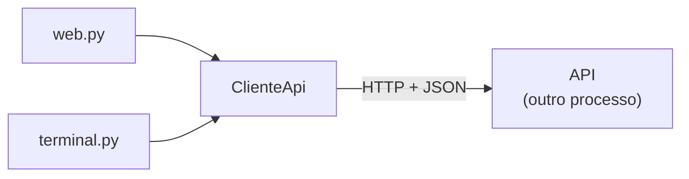
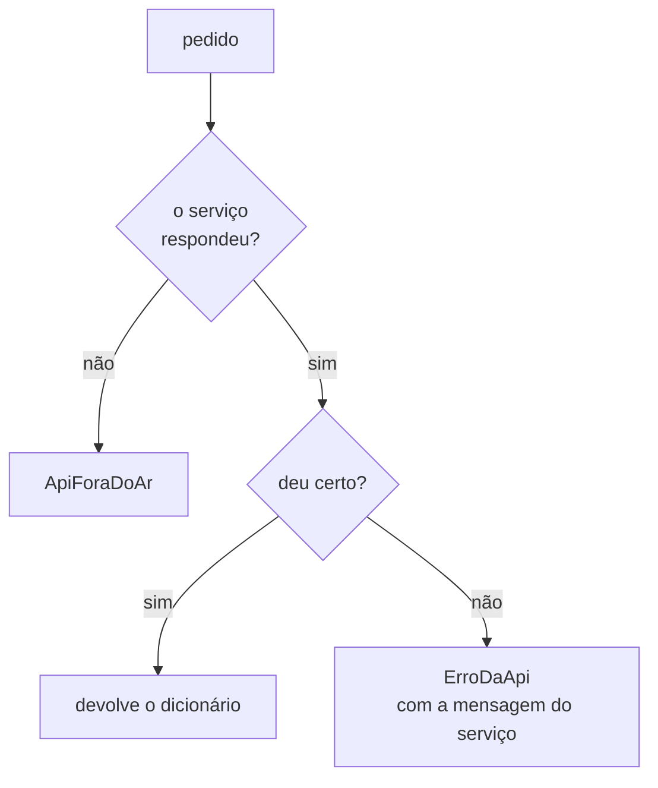

# `src/bpmn_agent/visao/cliente.py` — o cliente da API

[Visão geral](../README.md) · [Glossário](../glossario.md)

## Em uma frase

É o único jeito de a visão falar com o backend: cada método faz um pedido HTTP à
[API](api.md) e devolve a resposta como dicionário.

## Responsabilidade

- Saber o endereço do serviço.
- Fazer os pedidos e esperar o tempo certo por cada um.
- Transformar problemas em dois tipos de exceção fáceis de tratar na tela.

A página web e o terminal não montam endereços nem leem códigos de status: só chamam os
métodos daqui.



## Os métodos

| Método | Rota chamada | Devolve |
|---|---|---|
| `saude()` | `GET /saude` | `{"status", "provedor", "modelo"}` |
| `criar_sessao(processo=None)` | `POST /sessoes` | O estado da sessão nova. Com `processo`, continua um `processo.json` salvo antes. |
| `estado(id)` | `GET /sessoes/{id}` | O estado completo: histórico, descrição, pontos em aberto, XML do desenho. |
| `enviar(id, texto)` | `POST /sessoes/{id}/mensagens` | `{"texto", "acoes", "alterados"}` |
| `desfazer(id)` | `POST /sessoes/{id}/desfazer` | `{"mensagem"}` |

O formato exato de cada resposta está em [api.md](api.md).

Exemplo de uso:

```python
cliente = ClienteApi()
estado = cliente.criar_sessao()
resposta = cliente.enviar(estado["id"], "reembolso de despesas")
print(resposta["texto"])
```

## O endereço do serviço

Vale o primeiro que existir:

1. o `base_url` passado ao criar o `ClienteApi`;
2. a variável `BPMN_API_URL` (pode ficar no `.env`);
3. `http://127.0.0.1:8000`.

## Quando algo dá errado

| Exceção | Quando acontece | O que a tela faz |
|---|---|---|
| `ApiForaDoAr` | O serviço não respondeu: desligado, endereço errado ou demorou demais. | Mostra `MENSAGEM_FORA_DO_AR` e como ligar o serviço. |
| `ErroDaApi` | O serviço respondeu com um erro. Traz `status`, `codigo`, `mensagem` e `detalhe`. | Mostra `mensagem` (escrita para a pessoa) e, se houver, `detalhe`. |



## Quanto tempo espera

| Situação | Espera |
|---|---|
| Conectar ao serviço | 3 segundos |
| Qualquer pedido, menos enviar mensagem | 10 segundos |
| Enviar mensagem (`enviar`) | 180 segundos |

Um turno pode levar várias idas à LLM, por isso a espera longa. Passou do tempo, vira
`ApiForaDoAr`.

## Quem usa e quem é usado

- **Usado por**: `web.py` e `terminal.py`.
- **Usa**: a biblioteca `httpx`. Não importa nada do backend.

## Cuidados ao alterar

- Este arquivo não pode importar `bpmn_agent.app` nem `bpmn_agent.api`, nem mesmo os
  esquemas. O contrato entre os dois lados é o JSON, não o código.
- Por isso o formato das respostas existe em dois lugares: nos esquemas da API e no uso
  que a visão faz dos dicionários. Quem garante que continuam combinando é
  `tests/test_cliente.py`, que roda este cliente contra a API de verdade.
- O parâmetro `http` do `ClienteApi` existe para os testes injetarem um cliente que fala
  com a API em memória, sem rede.
