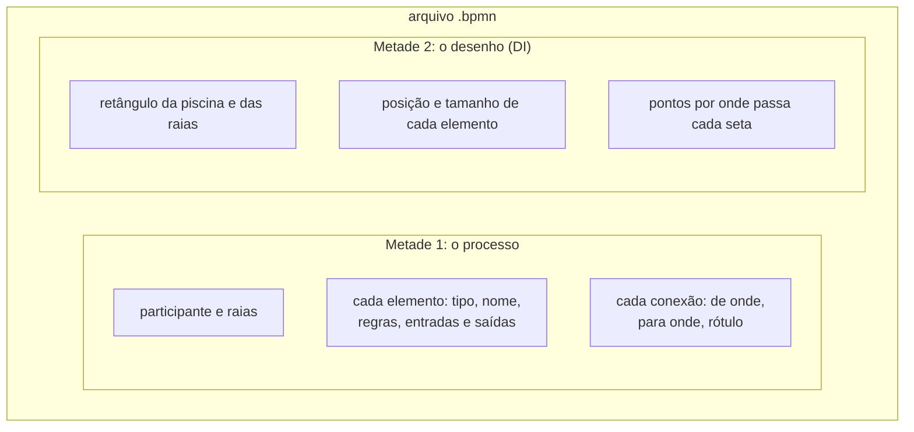
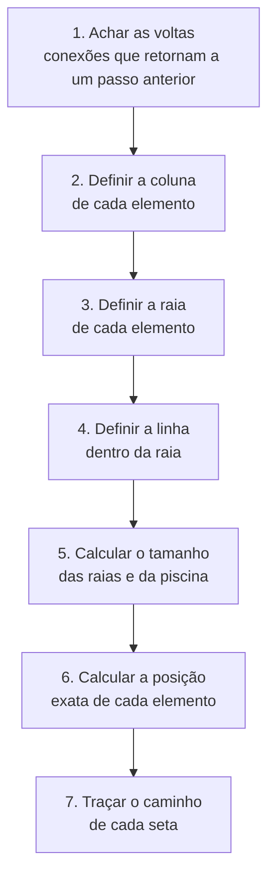

# `src/bpmn_agent/app/exportacao/exportar_bpmn.py` — posições e arquivo `.bpmn`

[Visão geral](../README.md) · [Glossário](../glossario.md)

## Em uma frase

Transforma o processo guardado no [modelo](modelo.md) em um arquivo BPMN 2.0 completo,
decidindo sozinho onde cada coisa fica no desenho.

## Responsabilidade

Duas funções, uma para cada metade do trabalho:

| Função | O que faz |
|---|---|
| `calcular_layout(m)` | Decide a posição de cada elemento, o tamanho das raias e o caminho de cada seta. Devolve só números. |
| `gerar_bpmn_xml(m)` | Chama `calcular_layout` e escreve o XML: primeiro a descrição do processo, depois as posições. |

Não usa LLM. O mesmo processo gera sempre o mesmo arquivo.

## As duas metades do arquivo `.bpmn`



A primeira metade diz **o que** o processo é. A segunda diz **onde** desenhar cada coisa.
Uma ferramenta de processos precisa das duas para abrir o arquivo já arrumado.

Descrições e regras de um elemento vão para o campo de documentação dele no arquivo, uma
regra por linha, com o prefixo `Regra:`.

## Como o layout é calculado

O desenho é uma grade: **colunas** da esquerda para a direita (a ordem em que as coisas
acontecem) e **raias** de cima para baixo (quem faz).



### 1. Achar as voltas

Percorre o processo a partir dos inícios, seguindo um caminho até o fim antes de tentar o
próximo (busca em profundidade). Quando uma conexão chega em um elemento que ainda está no
caminho sendo percorrido, ela é uma **volta**: retrabalho, um ciclo.

As voltas são separadas porque atrapalhariam o passo seguinte: em um ciclo, não existe
"quem vem primeiro".

### 2. Coluna

Ignorando as voltas, a coluna de um elemento é o tamanho do **caminho mais longo** desde o
início até ele. Se dá para chegar em "Conferir notas" por um caminho de 4 passos e por
outro de 6, ele fica na coluna 6. Isso garante que toda seta normal aponte para a direita.

### 3. Raia

Uma raia por participante, na ordem em que foram cadastrados. A raia de cada elemento vem
de `modelo.raia_de()`: o responsável do passo, ou, para início, fim, decisão, paralelo e
espera sem responsável, o do passo vizinho mais próximo.

Se sobrar algum elemento sem raia, é criada uma raia extra no fim, chamada
"(sem responsável)". Se o processo não tem nenhum participante, não há raias: tudo vai em
uma piscina simples.

### 4. Linha dentro da raia

Dois elementos da mesma raia e da mesma coluna não cabem no mesmo lugar; o segundo desce
uma linha. Para o caminho principal ficar reto, cada elemento tenta ficar na mesma linha
do elemento que leva até ele (se estiverem na mesma raia).

### 5 e 6. Tamanhos e posições

| Constante | Valor | Significado |
|---|---|---|
| `COL_W` | 170 | Largura de uma coluna |
| `ROW_H` | 130 | Altura de uma linha |
| `TAM["task"]` | 110 × 80 | Tamanho de uma tarefa |
| `TAM["event"]` | 36 × 36 | Tamanho de início, fim e espera |
| `TAM["gateway"]` | 50 × 50 | Tamanho de decisão e paralelo |
| `POOL_X`, `POOL_Y` | 100, 60 | Canto superior esquerdo da piscina |
| `POOL_HEADER`, `LANE_HEADER` | 30, 30 | Largura das faixas com os nomes |
| `MARGEM_X` | 40 | Folga nas laterais |

A altura de uma raia é o número de linhas que ela precisa vezes `ROW_H`. Cada elemento é
centralizado na sua célula da grade.

### 7. Caminho das setas

Todas as setas são feitas de trechos horizontais e verticais. A regra depende da situação:

| Situação | Caminho |
|---|---|
| Destino à direita, na mesma altura | Linha reta. |
| Sai de uma decisão para outra altura | Sai por cima ou por baixo do losango, depois vira para a direita. |
| Sai de um passo para outra altura | Sai pela direita, dobra no meio do caminho, entra pela esquerda. |
| Volta, na mesma altura | Contorna por baixo dos dois elementos. |
| Volta, para cima ou para baixo | Usa um corredor logo acima ou abaixo da origem. |

**Desvio de elementos.** Depois de traçar o caminho padrão, o layout confere se algum segmento passa por dentro
de outro elemento (`_cruza`). Se passar, tenta descer ou subir pelo vão entre duas colunas (onde nunca há
elemento); para dois elementos na mesma linha com um terceiro no meio, contorna por baixo (ou por cima).

**Saídas da mesma decisão.** Se duas ou mais setas saem de uma decisão para o mesmo lado (cima ou baixo), a
primeira sai pelo vértice e as outras pela direita, cada uma num corredor próprio (22 px de distância), para
não irem juntas.

**Rótulos das setas.** Cada rótulo ("Sim", "Não", "Acima de R$ 1 milhão") procura um lugar encostado na SUA
linha, em vários pontos de cada trecho, de um lado ou do outro, e só aceita um lugar que não toque em nenhuma
outra seta (nem nas pontilhadas dos sistemas de terceiros), em nenhum elemento e em nenhum outro rótulo. A
caixa do rótulo tem a largura do texto, porque o texto fica centrado nela. O nome de uma decisão fica acima e
à esquerda do losango.

**Sistemas de terceiros.** Cada um tem a sua cor (`bioc:stroke`, que o bpmn-js entende) na caixa e em todas as
setas de mensagem dele; os corredores horizontais do rodapé ficam a 16 px uns dos outros.

## O que `calcular_layout` devolve

| Chave | Conteúdo |
|---|---|
| `pos` | Para cada elemento: `(x, y, largura, altura)`. |
| `rotas` | Para cada conexão: lista de pontos `(x, y)`. |
| `lanes` | Para cada raia: `(x, y, largura, altura)`. |
| `pool` | O retângulo da piscina. |
| `raia_de` | Em que raia cada elemento ficou. |
| `usar_raias` | Se o desenho tem raias. |

## Limitações conhecidas

- O desvio só considera elementos: uma seta pode cruzar OUTRA seta (normal em BPMN), e as pontilhadas dos
  sistemas de terceiros atravessam as raias na vertical.
- Uma volta longa ainda usa a regra antiga e pode passar por cima de elementos de colunas intermediárias.
- Se não houver lugar livre para um rótulo, ele fica no começo da seta, mesmo que toque em algo.
- O nome de uma decisão (o texto ao lado do losango) não passa pela busca de lugar livre.

## Quem usa

- `Sessao.bpmn_xml()`, em `sessao.py`.
- `salvar_artefatos()`, em `persistencia.py`.
- `scripts/gerar_exemplo.py`.

## Cuidados ao alterar

Depois de qualquer mudança aqui, faça as três conferências, nesta ordem:

```bash
.venv/bin/python -m pytest -q
```

```bash
.venv/bin/python scripts/gerar_exemplo.py exemplos/reembolso.bpmn && node scripts/validar_bpmn.mjs exemplos/reembolso.bpmn
```

```bash
.venv/bin/python scripts/renderizar.py exemplos/reembolso.bpmn exemplos/reembolso.png
```

O validador precisa dar 0 avisos. E é preciso **olhar** a imagem: um layout ruim passa em
todos os testes automáticos.
