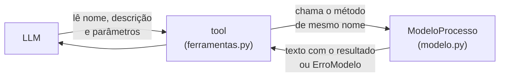

# `src/bpmn_agent/app/agente/ferramentas.py` — as tools que a LLM pode chamar

[Visão geral](../README.md) · [Glossário](../glossario.md)

## Em uma frase

Apresenta as operações do [modelo](modelo.md) para a LLM, com nomes e descrições que ela
consegue entender.

## Responsabilidade

É uma camada fina de tradução. Cada tool:

1. tem um nome, uma descrição e parâmetros descritos em português (é isso que a LLM lê
   para decidir o que chamar);
2. repassa a chamada para o método de mesmo nome em `ModeloProcesso`;
3. devolve o texto que o modelo devolveu.

Não há regra de negócio aqui. Se uma tool se comporta de modo estranho, o lugar para olhar
é o método correspondente em `modelo.py`.

## Como as tools são criadas

`criar_ferramentas(sessao)` devolve a lista das 21 tools. Elas são funções definidas
**dentro** dessa função, então cada uma "lembra" a sessão que recebeu (isso se chama
closure). Resultado: duas conversas abertas ao mesmo tempo têm cada uma o seu conjunto de
tools, mexendo cada uma no seu processo.

O decorador `@tool` do LangChain transforma a função em tool: o nome da função vira o nome
da tool, o texto logo abaixo (a docstring) vira a descrição, e os parâmetros com
`Annotated[tipo, "explicação"]` viram a descrição de cada parâmetro.

## As 21 tools

### Sobre o processo e os participantes

| Tool | Parâmetros | Para que a LLM usa |
|---|---|---|
| `definir_processo` | `nome`, `descricao` | Registrar nome e objetivo do processo. |
| `adicionar_participante` | `nome` | Cadastrar quem participa. |
| `renomear_participante` | `atual`, `novo` | "Na verdade o setor chama Controladoria." |
| `remover_participante` | `nome` | Tirar um participante. |

### Sobre os sistemas

Sistemas (Core Bancário, SAP, Serasa...) ficam num catálogo próprio e **não são participantes**: quem faz o
passo é `responsavel`; o sistema usado é `sistema`.

| Tool | Parâmetros | Para que a LLM usa |
|---|---|---|
| `cadastrar_sistema` | `nome`, `descricao`, `integracao`, `operacoes`, `externo` | Cadastrar um sistema (para que serve, como se acessa, telas/chamadas separadas por `;`) ou completar um que já existe. Campos vazios não mudam. |
| `renomear_sistema` | `atual`, `novo` | "Na verdade o Serasa chama Bureau de Crédito." Troca o nome no catálogo e em todos os passos; recusa nome já usado por outro sistema ou por um participante. |
| `remover_sistema` | `nome` | Tirar do catálogo; os passos que o usavam ficam sem sistema. |

### Sobre os elementos

| Tool | Parâmetros | Para que a LLM usa |
|---|---|---|
| `adicionar_elemento` | `tipo`, `nome`, `responsavel`, `depois_de`, `rotulo_conexao`, `descricao`, `sistema`, `operacao`, `chama` | Criar passo, decisão, espera, início ou fim, já ligado ao anterior. |
| `atualizar_elemento` | `id`, `nome`, `tipo`, `responsavel`, `descricao`, `sistema`, `operacao`, `chama` | "Quem faz isso é o financeiro", "muda o nome para...". |
| `remover_elemento` | `id`, `reconectar` | "Tira esse passo." |
| `mover_elemento` | `id`, `depois_de` | "Isso acontece antes da aprovação." |

### Sobre as conexões

| Tool | Parâmetros | Para que a LLM usa |
|---|---|---|
| `conectar` | `origem`, `destino`, `rotulo` | Voltas (retrabalho) e junção de caminhos. |
| `desconectar` | `origem`, `destino` | Desfazer uma ligação antes de refazer um trecho. |
| `rotular_conexao` | `origem`, `destino`, `rotulo` | Dar ou corrigir a resposta de um caminho. |

### Regras, pendências e histórico

| Tool | Parâmetros | Para que a LLM usa |
|---|---|---|
| `adicionar_regra` | `id`, `regra`, `campo`, `op`, `valor`, `acao` | Prazos, limites, documentos exigidos. Quando a regra é um se-então claro, os quatro últimos guardam a condição estruturada (juntos; ver [modelo.md](modelo.md)). |
| `remover_regra` | `id`, `numero` | Tirar uma regra (numeração começa em 1). |
| `anotar_pendencia` | `texto` | Guardar uma pergunta para depois. |
| `resolver_pendencia` | `numero` | Riscar a pendência quando for respondida. |
| `desfazer` | nenhum | "Volta como estava." |
| `recomecar_diagrama` | nenhum | Apagar tudo e começar de novo. |
| `pedir_confirmacao` | `motivo`, `pedido` | Segurar um pedido que não bate com o desenho (cita algo que não existe, contradiz o que já está desenhado). **Não altera o diagrama**: guarda o pedido na `Sessao` até a pessoa confirmar ou cancelar. Ver [sessao.md](sessao.md). |

O parâmetro `tipo` de `adicionar_elemento` só aceita os dez valores da lista
`TipoElemento` (`inicio`, `fim`, `tarefa`, `tarefa_pessoa`, `tarefa_sistema`,
`tarefa_manual`, `envio`, `decisao`, `paralelo`, `espera`). A explicação de cada um vai na
descrição do parâmetro, para a LLM escolher o tipo certo.

## Por que os parâmetros são tão simples

Quase todos os parâmetros são textos com valor padrão `""` (vazio). Não se usa "valor
opcional que pode ser nulo". A razão é prática: modelos baratos erram menos quando o
formato é simples, e os três formatos de API usados (OpenAI, Anthropic e Gemini) aceitam
esse desenho sem ajustes. No modelo, texto vazio significa "não informado" ou "não mude".

## O que a LLM recebe de volta

Sempre um texto curto. Exemplos reais:

| Chamada | Resultado |
|---|---|
| `adicionar_elemento(tipo="decisao", nome="Notas estão completas?", depois_de="Passo_5")` | `Criado Decisao_2 'Notas estão completas?' depois de Passo_5.` |
| `conectar(origem="Decisao_2", destino="Passo_3", rotulo="Sim")` | `Conectado Decisao_2 -> Passo_3 ('Sim').` |
| `adicionar_participante(nome="Financeiro")` (já existente) | `'Financeiro' já existe.` |
| `conectar(origem="Nao_existe", destino="Passo_1")` | `ERRO: Não encontrei nenhum elemento 'Nao_existe'. Consulte os ids no estado atual.` |

Os resultados trazem os ids criados, e a LLM usa esses ids nas chamadas seguintes do mesmo
turno. O prefixo `ERRO:` é colocado pelo nó `ferramentas` de [grafo.py](grafo.md), não
aqui.

## Quem usa

Só `construir_grafo`, em `grafo.py`, que entrega a lista à LLM (`bind_tools`) e a usa
para executar os pedidos.

## Cuidados ao alterar

- Nova tool = método novo no modelo + tool aqui + teste. Não coloque lógica na tool.
- Escreva a descrição pensando em quem vai ler: uma LLM que precisa decidir, só com esse
  texto, quando usar a tool.
- Algumas tools têm um parâmetro chamado `id`, que esconde a função `id()` do Python
  dentro delas. É inofensivo, mas não use `id()` nessas funções.
