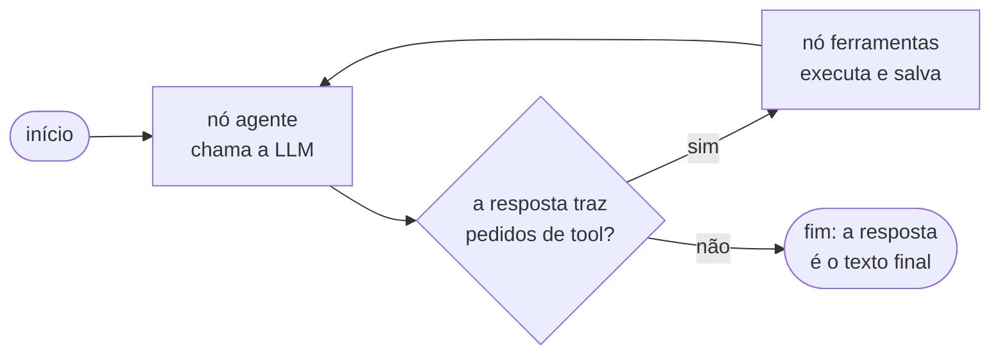

# `src/bpmn_agent/app/agente/grafo.py` — o laço de um turno

[Visão geral](../README.md) · [Glossário](../glossario.md)

## Em uma frase

Faz a LLM e as tools trabalharem em laço até sair uma resposta em texto.

## Responsabilidade

- Montar o grafo do LangGraph com dois nós (`construir_grafo`).
- Cortar o histórico que vai para a LLM (`cortar_historico`) e tirar dele o resumo "O que mudou de fato" (`sem_resumo_de_mudancas`).
- Extrair o texto de uma mensagem (`texto_de`).

Não contém regras de processo (isso é do [domínio](modelo.md)), nem texto de instruções
(isso é do [prompt](prompt.md)), nem a conversa em si (isso é da [`Sessao`](sessao.md)).

## O grafo

O que circula entre os nós é só a lista de mensagens da conversa (`MessagesState`). Cada
nó devolve mensagens novas, que o LangGraph acrescenta ao fim da lista.

`construir_grafo(llm, sessao, checkpointer)` recebe a LLM pronta e a sessão. Da sessão ele
usa só duas coisas: `sessao.modelo` (o processo) e `sessao.salvar()`.

### Nó `agente`

A cada vez que roda:

1. Pede `sessao.modelo.resumo()` e encaixa o texto no `SYSTEM_PROMPT`. Isso gera as
   instruções já com o estado atual do processo.
2. Corta o histórico com `cortar_historico`, ficando com os últimos 14 turnos do usuário.
3. Se a primeira mensagem que sobrou não for do usuário (acontece no começo, porque a
   conversa abre com a saudação do agente), coloca na frente uma mensagem
   `"(início da conversa)"`. Anthropic e Gemini recusam conversas que não comecem pelo
   usuário.
4. Chama a LLM com instruções + histórico e devolve a resposta.

### Nó `ferramentas`

Pega a última mensagem (a resposta da LLM) e, para cada pedido de tool, **na ordem**:

1. procura a tool pelo nome;
2. executa com os argumentos pedidos;
3. guarda o resultado em uma `ToolMessage`.

Se algo falhar, o resultado vira um texto de erro em vez de interromper o turno:

| O que aconteceu | Texto devolvido à LLM |
|---|---|
| Tool com nome que não existe | `ERRO: Ferramenta 'x' não existe.` |
| O modelo recusou o pedido (`ErroModelo`) | `ERRO: ` + a mensagem do modelo |
| Qualquer outro problema (argumento faltando, tipo errado) | `ERRO ao chamar x: ...` |

No fim, chama `sessao.salvar()` uma vez, gravando os três arquivos.

Este nó é escrito à mão, em vez de usar o `ToolNode` pronto do LangGraph, justamente para
garantir a execução em sequência e esse tratamento de erro.

### `rotear`

Decide a seta que sai do nó `agente`: se a resposta da LLM tem pedidos de tool, vai para
`ferramentas`; se não, o turno acabou.

### Estado no fim (`estado_no_fim`)

Opção de `construir_grafo` e de `Sessao` (padrão: desligada). Em vez de colocar o diagrama dentro do
prompt de sistema, manda o prompt **sem** o diagrama (`SYSTEM_PROMPT_BASE`) e acrescenta o diagrama como
**última mensagem** (`ESTADO_NO_FIM`), a cada chamada, sem gravá-lo no histórico. O começo da conversa
(ferramentas, instruções, histórico) fica igual entre as chamadas de um turno, e o cache de prompt da API
acerta mais. Medido com o `gpt-5.6-luna` em 5 turnos (2 execuções por variante): cache de ~11% para
~40% e custo ~25% menor, sem erros de ferramenta a mais.

### `cortar_historico`

Mantém as mensagens a partir do 14º turno mais recente do usuário
(`MAX_TURNOS_HISTORICO`). O corte sempre cai em uma mensagem do usuário, nunca no meio de
um par "pedido de tool / resultado", porque os provedores recusam um resultado sem o
pedido correspondente.

Cortar é seguro porque o processo inteiro vai no resumo a cada chamada. O que se perde são
só as falas antigas.

### `texto_de`

Alguns provedores devolvem o conteúdo de uma mensagem como texto simples; outros, como uma
lista de blocos. Esta função devolve sempre o texto, nos dois casos.

## Constantes

| Nome | Valor | Para que serve |
|---|---|---|
| `MAX_TURNOS_HISTORICO` | 14 | Quantos turnos do usuário vão para a LLM. |
| `LIMITE_PASSOS_GRAFO` | 60 | Máximo de execuções de nós em um turno. Passou disso, o LangGraph interrompe com erro. |

## Quem usa e quem é usado

- **Usado por**: `app/sessao.py` (que chama `construir_grafo`) e os testes.
- **Usa**: `ferramentas.py` (para criar as tools), `prompt.py` (as instruções) e
  `ErroModelo`, do domínio.

## Cuidados ao alterar

- Este arquivo não pode importar `sessao.py`, `persistencia.py`, `exportacao` nem `visao`.
  Ele recebe a sessão como parâmetro, sem conhecer a classe. É isso que evita uma
  dependência circular com `sessao.py`.
- Não há limite de erros seguidos de tool além do `LIMITE_PASSOS_GRAFO`.
