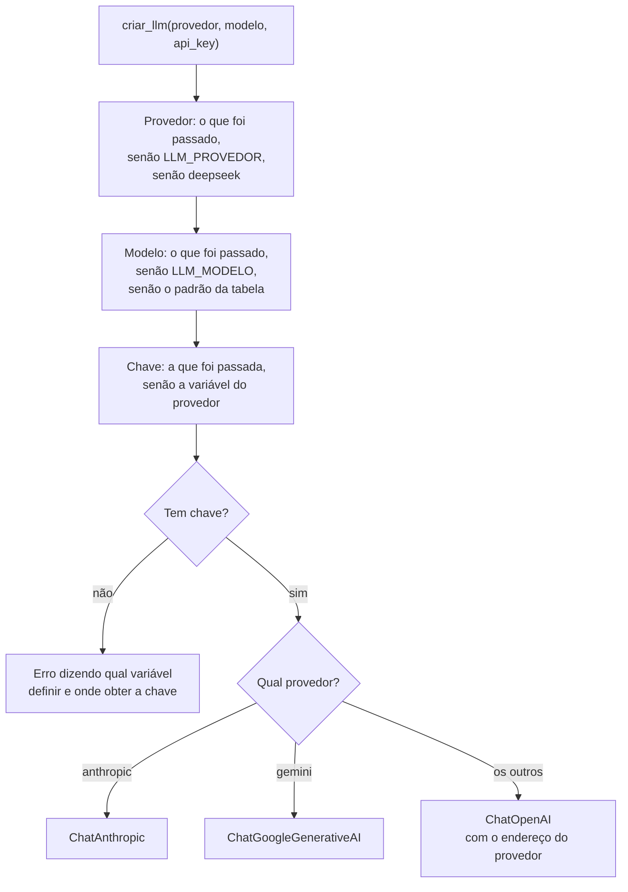

# `src/bpmn_agent/app/agente/llm.py` — a conexão com o provedor

[Visão geral](../README.md) · [Glossário](../glossario.md)

## Em uma frase

Cria o objeto que fala com a LLM do provedor escolhido, escondendo as diferenças entre
eles.

## Responsabilidade

- Manter a tabela de provedores e o modelo padrão de cada um (`PROVEDORES`).
- Ler provedor, modelo e chave do ambiente (`.env`).
- Devolver um objeto do LangChain pronto para uso (`criar_llm`).

O restante da aplicação não sabe qual provedor está em uso: recebe um objeto com a mesma
"cara" em todos os casos.

## Os provedores

| Provedor | Modelo padrão | Variável da chave | Observação |
|---|---|---|---|
| `deepseek` | `deepseek-flash` | `DEEPSEEK_API_KEY` | Muito barato. |
| `gemini` | `gemini-3.8-flash` | `GEMINI_API_KEY` | Tem camada gratuita. |
| `groq` | `openai/gpt-oss-120b` | `GROQ_API_KEY` | Camada gratuita, rápido. |
| `openrouter` | `openrouter/free` | `OPENROUTER_API_KEY` | Encaminha para um modelo gratuito. |
| `anthropic` | `claude-haiku-5-5` | `ANTHROPIC_API_KEY` | Claude. Testado em conversa real. |
| `ollama` | `qwen3:8b` | nenhuma | Roda na própria máquina. |

Nomes de modelos mudam com frequência. Eles ficam **só** nesta tabela e podem ser trocados
sem mexer no código, pela variável `LLM_MODELO`.

## Como `criar_llm` decide

DeepSeek, Groq, OpenRouter e Ollama usam a mesma classe (`ChatOpenAI`) porque oferecem uma
API no mesmo formato da OpenAI; só muda o endereço (`base_url`).

## Particularidades de cada provedor

Cada uma destas linhas existe porque, sem ela, o provedor devolve erro:

| Provedor | O que o código faz | Por quê |
|---|---|---|
| Anthropic | Não envia `temperature`. | Os modelos Claude 5 recusam o parâmetro (erro 400). |
| Anthropic | `max_tokens=2048`. | A API exige um limite de tamanho da resposta. |
| Gemini | Usa a integração própria do Google, não o formato OpenAI. | O Gemini exige que certas marcas internas sejam devolvidas entre uma chamada de tool e a seguinte; só a integração própria faz isso. |
| Gemini | Não envia `temperature`. | Recomendação do Google para esses modelos. |
| DeepSeek | Desliga o modo "pensamento". | Com esse modo ligado e uso de tools, a API exige reenviar o raciocínio de todos os turnos, o que a classe `ChatOpenAI` não faz. |
| Todos | `max_retries=3`. | Tenta de novo sozinho em falhas passageiras de rede. |

A `temperatura` (padrão 0,3) controla o quanto as respostas variam: perto de 0, mais
previsíveis. Só é enviada aos provedores que usam `ChatOpenAI`.

## Quem usa

- `web.py`: lê `PROVEDORES` para montar a barra lateral e chama `criar_llm` com o que o
  usuário escolheu.
- `terminal.py`: chama `criar_llm` com as opções `--provedor` e `--modelo`.

O objeto criado é entregue à `Sessao`, que o passa para `construir_grafo`.

## Cuidados ao alterar

- Antes de trocar um modelo padrão, confira o nome na documentação do provedor.
- As bibliotecas de cada provedor são importadas só dentro do `if` correspondente. Assim,
  um problema na biblioteca de um provedor não impede o uso dos outros.
- Não há teste automático que chame um provedor de verdade. Depois de mexer aqui, rode uma
  conversa real.
