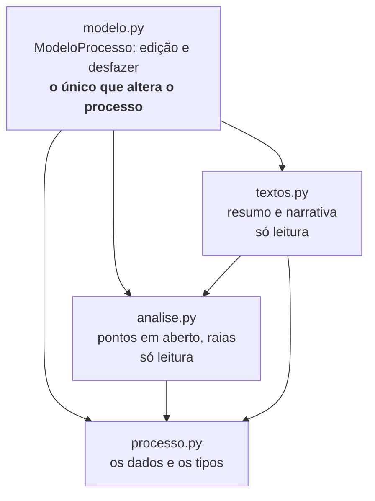
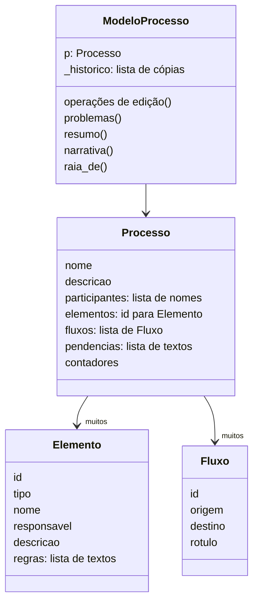
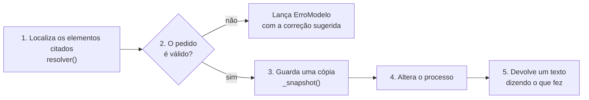
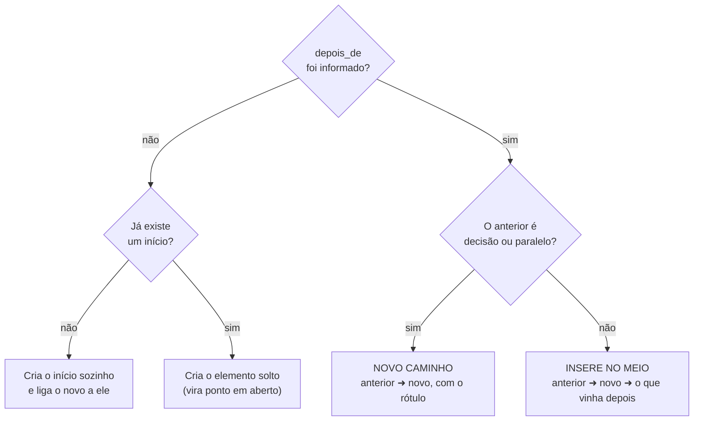

# `src/bpmn_agent/app/dominio/` — o processo e suas regras

[Visão geral](../README.md) · [Glossário](../glossario.md)

## Em uma frase

Guarda o processo que está sendo desenhado e é o **único lugar** que pode alterá-lo.

## Responsabilidade

- Guardar elementos, conexões, participantes, regras e pendências.
- Oferecer as operações de edição (adicionar, alterar, remover, mover, conectar...).
- Recusar operações inválidas com uma mensagem que ensina a corrigir.
- Permitir desfazer.
- Apontar o que ainda falta no processo ("pontos em aberto").
- Descrever o processo em texto, para a LLM (`resumo`) e para pessoas (`narrativa`).
- Salvar e carregar em JSON.

Não sabe nada de LLM, de tela, de XML nem de arquivos. Pode ser usado sozinho em um
script (veja `scripts/gerar_exemplo.py`).

## Os quatro arquivos

| Arquivo | O que tem |
|---|---|
| `processo.py` | As estruturas de dados (`Processo`, `Elemento`, `Fluxo`), a tabela de tipos e o `ErroModelo`. Nenhuma operação. |
| `modelo.py` | A classe `ModeloProcesso`: todas as operações de edição, o desfazer e a conversão de/para dicionário. |
| `analise.py` | Funções que avaliam o processo sem alterá-lo: `problemas` e `raia_de`. |
| `textos.py` | Funções que descrevem o processo sem alterá-lo: `resumo`, `narrativa` e `resumo_mudancas`. |

Quem usa o domínio importa de `bpmn_agent.app.dominio` e chama tudo pela classe:
`modelo.problemas()`, `modelo.resumo()` etc. Esses métodos são atalhos de uma linha para
as funções de `analise.py` e `textos.py`. A divisão existe para deixar claro o que muda o
processo (só `modelo.py`) e o que apenas lê.

## Os dados

- **`Processo`** é o dado puro. **`ModeloProcesso`** é o `Processo` mais a pilha do
  desfazer e os métodos.
- **`contadores`** guarda o último número usado por prefixo, para gerar ids que nunca se
  repetem: `Passo_3`, `Decisao_1`, `Fluxo_7`. Um id removido não é reaproveitado.

### Tipos de elemento

O agente usa nomes simples; o modelo guarda o nome oficial do padrão BPMN.

| Nome simples | Nome BPMN guardado | Significado | Prefixo do id |
|---|---|---|---|
| `inicio` | `startEvent` | O que dispara o processo | `Inicio` |
| `fim` | `endEvent` | Um jeito de o processo terminar | `Fim` |
| `tarefa` | `task` | Passo genérico | `Passo` |
| `tarefa_pessoa` | `userTask` | Alguém faz usando um sistema | `Passo` |
| `tarefa_sistema` | `serviceTask` | O sistema faz sozinho | `Passo` |
| `tarefa_manual` | `manualTask` | Feito à mão, fora de sistema | `Passo` |
| `envio` | `sendTask` | Mandar e-mail, mensagem, documento | `Passo` |
| `decisao` | `exclusiveGateway` | Um caminho ou outro | `Decisao` |
| `paralelo` | `parallelGateway` | Vários caminhos ao mesmo tempo | `Paralelo` |
| `espera` | `intermediateCatchEvent` | Aguardar um prazo | `Espera` |

## Como uma operação funciona por dentro

Todas seguem o mesmo roteiro:

A ordem importa: a cópia (passo 3) só é tirada depois da validação, então um pedido
recusado não gasta uma posição do desfazer.

### `resolver(ref)`: achar um elemento

Recebe um id ou um nome e devolve o `Elemento`. Tenta, nesta ordem:

1. id exato (`Passo_3`);
2. nome igual, ignorando acentos e maiúsculas (`analisar pedido` acha "Analisar pedido");
3. nome que contém o texto, se só um elemento contiver.

Se nada servir, lança `ErroModelo`. Se mais de um servir, o erro lista os candidatos com
seus ids, para a LLM escolher.

### `ErroModelo`

É o único tipo de erro que o modelo lança de propósito. A mensagem é escrita para a LLM
ler e se corrigir, por exemplo:
`'pedido' é ambíguo. Use o id de um destes: Passo_1 (Enviar pedido); Passo_2 (Analisar pedido).`

## As operações

| Operação | O que faz |
|---|---|
| `definir_processo(nome, descricao)` | Dá nome e objetivo ao processo. |
| `adicionar_participante(nome)` | Cadastra quem participa. Se já existe, só avisa. |
| `renomear_participante(atual, novo)` | Troca o nome e atualiza todos os passos dele. |
| `remover_participante(nome)` | Remove; os passos dele ficam sem responsável. |
| `adicionar_elemento(...)` | Cria um elemento já ligado ao anterior. Veja abaixo. |
| `atualizar_elemento(ref, ...)` | Muda nome, tipo, responsável ou descrição. Campo vazio não muda. Responsável `nenhum` tira o responsável. |
| `remover_elemento(ref, reconectar)` | Remove e, se der, liga quem vinha antes a quem vinha depois. |
| `mover_elemento(ref, depois_de)` | Tira do lugar (fechando o buraco) e insere depois de outro. Não move decisões. |
| `conectar(origem, destino, rotulo)` | Liga dois elementos existentes. Usada para voltas e para juntar caminhos. |
| `desconectar(origem, destino)` | Remove uma conexão. |
| `rotular_conexao(origem, destino, rotulo)` | Muda o texto de uma conexão. |
| `adicionar_regra(ref, regra)` / `remover_regra(ref, numero)` | Regras de um elemento. A numeração começa em 1. |
| `anotar_pendencia(texto)` / `resolver_pendencia(numero)` | Lembretes do agente. |
| `desfazer()` | Volta à cópia anterior. |
| `recomecar()` | Apaga tudo (e dá para desfazer). |

### `adicionar_elemento`: a operação mais usada

O comportamento muda conforme o que vem em `depois_de`:

Exemplo de "insere no meio". Antes: `A ➜ C`. Pedido: adicionar `B` depois de `A`.
Depois: `A ➜ B ➜ C`. A conexão antiga não é apagada; ela passa a sair de `B`.

Casos especiais:

- Depois de um **fim** nada pode vir: erro.
- Um **início** não pode vir depois de outro elemento: erro.
- Adicionar um **fim** depois de um passo que já tem saída cria um ramo extra, e a
  resposta avisa que o passo ficou com duas saídas sem uma decisão.
- Um `responsavel` que ainda não existe é cadastrado como participante automaticamente.

### `remover_elemento` com reconexão

Com `reconectar=True` (o padrão), se o elemento tinha **uma só entrada ou uma só saída**,
quem vinha antes é ligado a quem vinha depois. Se tinha várias entradas **e** várias
saídas, não há como adivinhar as ligações: o modelo remove, deixa as pontas soltas e avisa.

## Desfazer

Antes de cada alteração, `_snapshot()` guarda uma cópia completa do `Processo` em
`_historico`. `desfazer()` devolve a última cópia. O limite é de 100 cópias; a mais antiga
é descartada.

Atenção: um turno do agente costuma fazer várias operações, e cada uma gera uma cópia.
"Desfazer" volta **uma operação**, não um turno inteiro.

## Pontos em aberto: `problemas()` (em `analise.py`)

Devolve uma lista de frases em linguagem simples. A LLM lê essa lista no resumo e a usa
para decidir o que perguntar. O que é verificado:

| Situação | Frase gerada |
|---|---|
| Não há início | "O processo ainda não tem início." |
| Não há fim | "Ainda não sabemos como o processo termina." |
| Elemento sem nada chegando nele | "... não tem nada levando até ele." |
| Elemento sem saída (e não é fim) | "...: não sabemos o que acontece depois." |
| Decisão com um caminho só | "... só tem um caminho; falta a(s) outra(s) resposta(s)." |
| Decisão com caminhos sem rótulo | "...: caminhos sem resposta/condição indicada." |
| Passo comum com várias saídas | "... tem várias saídas sem uma decisão." |
| Passo sem responsável, havendo participantes | "... está sem responsável." |

Início, fim, decisão, paralelo e espera **não** são cobrados por responsável: não são
trabalho de alguém.

## Em que raia cada coisa aparece: `raia_de(id)` (em `analise.py`)

Um passo aparece na raia do seu responsável. Início, fim, decisão, paralelo e espera que
não têm responsável próprio **herdam** a raia do passo mais próximo: o método procura
primeiro para trás (quem leva até ele) e, se não achar, para frente (para onde ele leva).

Exemplo: a decisão "Pedido aprovado?" vem logo depois de "Analisar pedido" (Gestor), então
é desenhada na raia do Gestor.

Um passo comum sem responsável não herda nada: vai para a raia "(sem responsável)" e
aparece como ponto em aberto, porque aí falta mesmo uma informação.

## `resumo_mudancas` (em `textos.py`)

Compara uma "foto" do processo tirada antes do turno com o processo depois e devolve uma frase como
`O que mudou de fato no desenho: 3 item(ns) novo(s): ...; alterado(s): Pagar imposto (a descrição); ligações: +2 / -0.`
Sem mudança, diz `nada`. É calculada pelo código, sem a LLM. Quem a usa é a `Sessao` (ver [sessao.md](sessao.md)).

## Duas descrições em texto (em `textos.py`)

| Método | Para quem | Como é |
|---|---|---|
| `resumo()` | A LLM | Compacto, com ids: lista de elementos, lista de conexões, pontos em aberto e pendências. Vai dentro das instruções a cada chamada. |
| `narrativa()` | Pessoas | Lista numerada em markdown, sem ids, na ordem do fluxo. Aparece na aba "Descrição" da página web e é salva em `processo.md`. |

## Conversão para gravar

`para_dict()` devolve o `Processo` como um dicionário comum, e `de_dict(dados)` faz o
caminho de volta. O domínio para aí: quem transforma o dicionário em arquivo é
`app/persistencia.py` (veja [sessao.md](sessao.md)). A pilha do desfazer não entra no
dicionário.

## Quem usa

- `ferramentas.py` chama as operações de edição.
- `agente/grafo.py` chama `resumo()`.
- `persistencia.py` chama `para_dict()`, `de_dict()` e `narrativa()`.
- `exportar_bpmn.py` lê `p` e chama `raia_de()`, `entradas()` e `saidas()`.
- `web.py` e `terminal.py` chamam `narrativa()`, `problemas()`, `desfazer()` e `de_dict()`.

## Cuidados ao alterar

- Toda operação que muda dados precisa chamar `self._snapshot()` **antes** de mudar e
  **depois** de validar.
- Erro de uso é sempre `ErroModelo`, com mensagem que diga como corrigir.
- `analise.py` e `textos.py` só leem. Se uma função nova precisa alterar o processo, o
  lugar dela é um método de `ModeloProcesso`.
- Nada aqui pode importar LLM, tela ou arquivos (`json`, `pathlib`).
- Nova operação de edição só fica disponível para a LLM depois de ganhar uma tool em
  `ferramentas.py`. E precisa de teste em `tests/test_modelo.py`.
