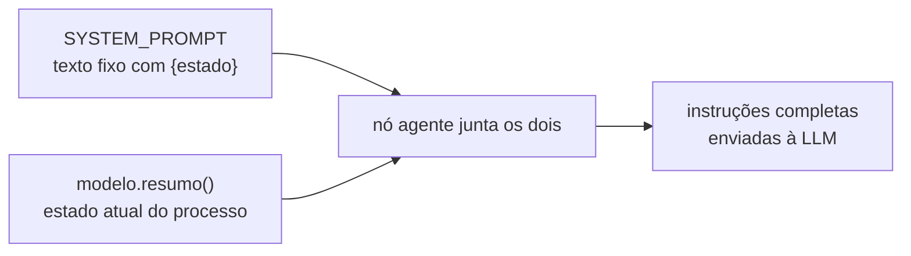
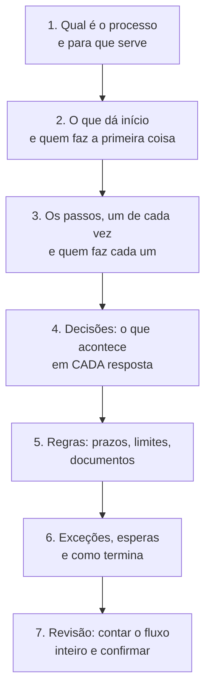

# `src/bpmn_agent/app/agente/prompt.py` — as instruções do entrevistador

[Visão geral](../README.md) · [Glossário](../glossario.md)

## Em uma frase

Guarda os dois textos que definem o comportamento do agente: a saudação e as instruções
de sistema.

## Responsabilidade

Este arquivo não tem lógica, só texto. Mas é o que mais influencia a experiência de quem
conversa: tom, quantidade de perguntas, vocabulário e a ordem da entrevista saem daqui.

| Constante | O que é | Quem vê |
|---|---|---|
| `SAUDACAO` | A primeira fala do agente. É fixa: nenhuma LLM é chamada para produzi-la. | O usuário |
| `SYSTEM_PROMPT` | As instruções completas, com um espaço reservado `{estado}`. | Só a LLM |

## Como o `SYSTEM_PROMPT` é usado

A junção acontece em [grafo.py](grafo.md), **a cada chamada à LLM**, inclusive nas
voltas do laço dentro de um mesmo turno. É por isso que a LLM sempre enxerga o processo
atualizado.

## As partes das instruções

| Parte | O que diz à LLM |
|---|---|
| **Abertura** | Quem ela é (analista paciente) e com quem fala (alguém que conhece o próprio trabalho, mas não conhece notação de processos). |
| **Como conversar** | Português simples, mensagens curtas, uma pergunta por vez, confirmar o que entendeu antes de perguntar, não inventar passos, não mostrar ids, confirmar quando a resposta a "A ou B?" não disser qual. Traz a lista de palavras a evitar. |
| **Roteiro** | A ordem da entrevista em sete etapas (abaixo). |
| **Como usar as ferramentas** | Atualizar o desenho assim que souber de algo, como usar `depois_de` e `rotulo_conexao`, quando usar `conectar`, padrão de nomes, como atender pedidos de mudança, o que fazer quando uma tool devolve erro, que pedido de ordem, caminhos ou paralelo exige elementos novos (descrição não substitui estrutura), e quando chamar `pedir_confirmacao` (pedido que cita algo inexistente, contradiz o desenho ou traz assunto alheio ao objetivo, como "todo mundo come pizza": não editar, perguntar antes), e que sistemas nunca são participantes nem `responsavel`: vão no catálogo (`cadastrar_sistema`) e em `sistema`/`operacao` de cada passo, com o nome já cadastrado (sistema de terceiros = `externo="sim"`, vira caixa separada no desenho; trocar nome = `renomear_sistema`), e a divisão `sistema` (executa) / `chama` (aciona, de fora), e só ligar passo a sistema que a pessoa disse: se não disse qual, perguntar. |
| **Estado atual** | O espaço `{estado}`, preenchido com o resumo do processo. |

### O roteiro da entrevista

O roteiro é uma orientação, não uma sequência rígida: a LLM pode voltar a etapas
anteriores quando o usuário lembra de algo. A lista de "Pontos em aberto" que vem no
estado é o que ela usa para decidir a próxima pergunta.

### Palavras proibidas para o usuário

BPMN, gateway, raia, lane, pool, evento, fluxo de sequência, instância, token. No lugar:
"passo", "etapa", "quem faz", "decisão", "caminho", "o que acontece se...", "como termina".

Esses termos existem no código e nesta documentação, mas não devem aparecer nas falas do
agente nem nos textos da interface.

`CONFIRMACAO_RECEBIDA` não faz parte do `SYSTEM_PROMPT`: `grafo.py` a acrescenta ao final só no
turno em que a pessoa confirmou um pedido guardado, com o pedido original dentro.

## Quem usa

A `SAUDACAO` é usada por `sessao.py`, ao criar a `Sessao`. O `SYSTEM_PROMPT` é usado por
`grafo.py`, no nó `agente`.

## Cuidados ao alterar

- **Chaves no texto.** O `SYSTEM_PROMPT` passa por `.format(estado=...)`. Qualquer `{` ou
  `}` literal que você acrescentar precisa ser dobrado (`{{` e `}}`), senão o programa
  quebra ao montar as instruções.
- **Teste com uma LLM de verdade.** Os testes automáticos usam uma LLM roteirizada e não
  percebem mudanças de comportamento causadas pelo texto. Depois de mexer, conduza uma
  conversa real e observe: fez uma pergunta por vez? usou alguma palavra proibida? chamou
  as tools certas? sobrou ponto em aberto?
- **Texto mais longo custa mais.** As instruções são enviadas a cada chamada, e há várias
  chamadas por turno.
