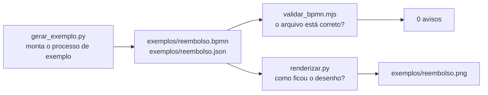

# `scripts/` — utilitários de conferência

[Visão geral](../README.md) · [Glossário](../glossario.md)

## Em uma frase

Três programas pequenos para gerar um diagrama de exemplo, validar o arquivo e ver como
ele fica desenhado, tudo sem LLM.

## Para que servem

A aplicação não precisa deles para funcionar. Eles existem para quem mexe no
[exportador](exportar_bpmn.md): formam o circuito de conferência depois de cada mudança.



## Os três scripts

### `gerar_exemplo.py`

Monta o processo "Reembolso de despesas" chamando direto os métodos do
[modelo](modelo.md), sem agente e sem LLM. Confere que não sobrou ponto em aberto e grava
o `.bpmn` e o `.json`.

```bash
.venv/bin/python scripts/gerar_exemplo.py exemplos/reembolso.bpmn
```

É também o melhor exemplo de como usar o `ModeloProcesso` sozinho: cada linha é uma
operação, na ordem em que o agente as faria.

### `validar_bpmn.mjs`

Lê um `.bpmn` com o bpmn-moddle, o leitor oficial do projeto bpmn.io, e lista os avisos.
Termina com código de erro se houver algum.

```bash
node scripts/validar_bpmn.mjs exemplos/reembolso.bpmn
```

Saída esperada: `OK root: bpmn:Definitions | warnings: 0`.

É escrito em JavaScript porque o leitor oficial só existe nessa linguagem. Precisa do
Node.js instalado.

### `renderizar.py`

Abre a página do [visualizador](visualizador.md) em um navegador controlado por código
(Playwright) e salva uma imagem PNG. Usa a cópia local do bpmn-js, então funciona sem
internet. Aceita ids extras no fim do comando, para destacar em verde.

```bash
.venv/bin/python scripts/renderizar.py exemplos/reembolso.bpmn exemplos/reembolso.png
```

O script espera o sinal `window.__pronto` da página antes de tirar a foto e falha com
mensagem clara se o bpmn-js não conseguir desenhar.

## Instalação (uma vez)

Para o validador e para a cópia local do bpmn-js:

```bash
cd scripts && npm install
```

Para o `renderizar.py`:

```bash
.venv/bin/pip install playwright && .venv/bin/python -m playwright install chromium
```

`scripts/package.json` lista as duas dependências JavaScript: `bpmn-js` e `bpmn-moddle`.
A pasta `scripts/node_modules` não vai para o git.

## Cuidados

- Mantenha a versão do `bpmn-js` em `package.json` igual à `BPMN_JS_VERSAO` do
  visualizador.
- `gerar_exemplo.py` sobrescreve os arquivos em `exemplos/`, que estão no git. Se o
  `git diff` mostrar mudança em `exemplos/reembolso.bpmn` depois de uma alteração no
  exportador, é o efeito da sua alteração no layout: confira o PNG antes de commitar.
