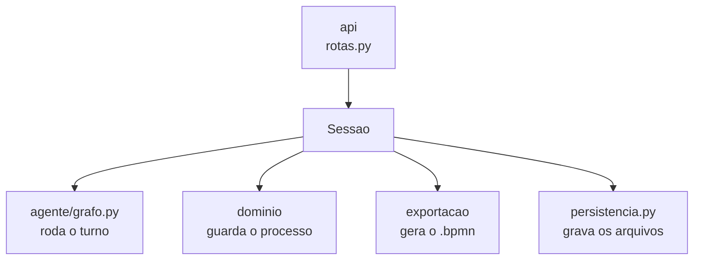
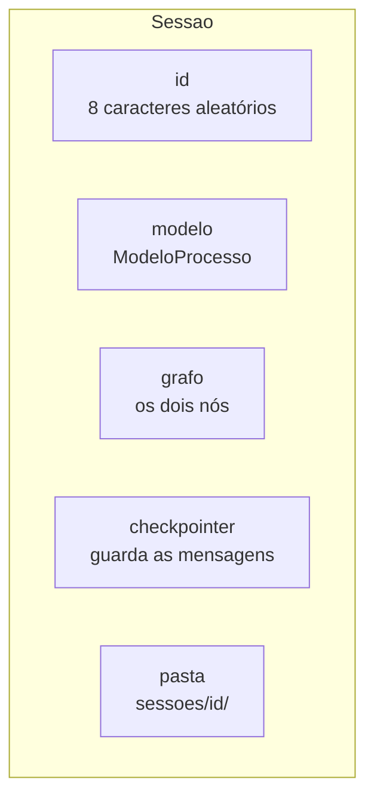
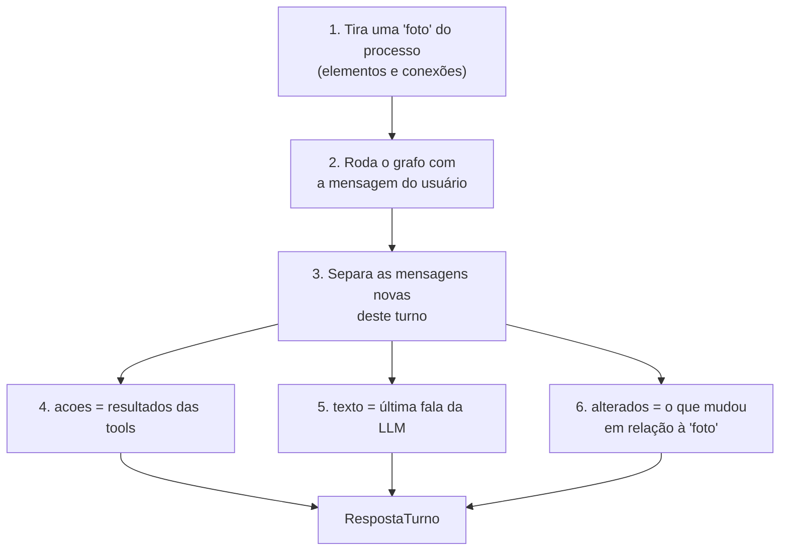

# `src/bpmn_agent/app/sessao.py` e `persistencia.py` — a conversa e seus arquivos

[Visão geral](../README.md) · [Glossário](../glossario.md)

## Em uma frase

`Sessao` é uma conversa completa: a [API](api.md) entrega o texto do usuário e recebe a
resposta pronta. `persistencia.py` é o único lugar do backend que grava e lê arquivos.

## Responsabilidade

| Arquivo | Responsabilidade |
|---|---|
| `sessao.py` | Representar uma conversa completa (`Sessao`) e entregar o resultado de cada turno (`RespostaTurno`). |
| `persistencia.py` | Gravar e ler o processo em disco. |

A `Sessao` não tem regra de processo e não fala com a LLM diretamente. Ela **junta** as
outras partes do backend:

## A classe `Sessao`

Uma `Sessao` = uma conversa = um processo.

| Método | O que faz |
|---|---|
| `__init__(llm, pasta, modelo, id)` | Cria o grafo e registra a saudação como primeira mensagem. Se veio um `modelo` já preenchido, a saudação é "Oi de novo! Carreguei o processo...". |
| `enviar(texto)` | Roda um turno. Devolve `RespostaTurno`. |
| `desfazer()` | Desfaz a última alteração do processo, sem passar pela LLM, e regrava os arquivos. |
| `mensagens()` | Todas as mensagens guardadas, incluindo pedidos e resultados de tools. |
| `historico_visivel()` | Só as falas, como pares `(papel, texto)`. É o que a interface mostra. |
| `bpmn_xml()` | O `.bpmn` do processo atual. |
| `salvar()` | Pede a `persistencia.salvar_artefatos` que grave os três arquivos na pasta da sessão. |

### `enviar` por dentro

O passo 2 é onde tudo acontece; o detalhe está em [grafo.md](grafo.md).

### `RespostaTurno`

| Campo | Conteúdo |
|---|---|
| `texto` | A última fala da LLM com conteúdo. Se ela só chamou tools e não escreveu nada, entra um texto padrão ("Pronto, atualizei o desenho. O que acontece em seguida?"). |
| `acoes` | Uma linha por tool executada, no formato `nome_da_tool: resultado`. É o que o modo de depuração mostra. |
| `alterados` | Ids de elementos novos ou modificados e de conexões novas. A interface usa essa lista para destacar em verde o que mudou. |

## `persistencia.py`

Três funções:

| Função | O que faz |
|---|---|
| `salvar_modelo(modelo, caminho)` | Grava o processo como JSON. |
| `carregar_modelo(caminho)` | Lê um JSON e devolve um `ModeloProcesso`. |
| `salvar_artefatos(modelo, pasta)` | Grava os três arquivos de uma sessão. |

Os três arquivos:

| Arquivo | Conteúdo | De onde vem |
|---|---|---|
| `processo.json` | O processo completo. É o que se carrega para continuar depois. | `modelo.para_dict()` |
| `processo.bpmn` | O diagrama, para abrir em outras ferramentas. | `gerar_bpmn_xml(modelo)` |
| `processo.md` | A descrição em texto. | `modelo.narrativa()` |

A pilha do desfazer e as mensagens da conversa **não** são gravadas.

O domínio não sabe gravar a si mesmo: `ModeloProcesso` só converte para dicionário
(`para_dict`) e de volta (`de_dict`). Quem transforma isso em arquivo é este módulo.

## Quem usa e quem é usado

- **Usado por**: `api/rotas.py` e `api/registro.py` (que cria e guarda as sessões),
  `scripts/gerar_exemplo.py` (só a persistência) e os testes.
- **`sessao.py` usa**: `agente/grafo.py`, `agente/prompt.py` (a saudação), `dominio`,
  `exportacao` e `persistencia.py`.
- **`persistencia.py` usa**: `dominio` e `exportacao`.

## Cuidados ao alterar

- A `Sessao` não pode importar nada de `api` nem de `visao`.
- A pasta padrão (`sessoes`) é relativa à pasta de onde o servidor foi iniciado. Suba o
  servidor sempre da raiz do projeto.
- A LLM é a mesma do começo ao fim da sessão: vem do `.env` do servidor.
- O checkpointer é o `MemorySaver`: a conversa some ao reiniciar o programa.
- As tools recebem a `sessao` e buscam `sessao.modelo` a cada chamada, em vez de guardar
  o modelo. Assim cada sessão mexe só no próprio processo, mesmo com várias no ar.
