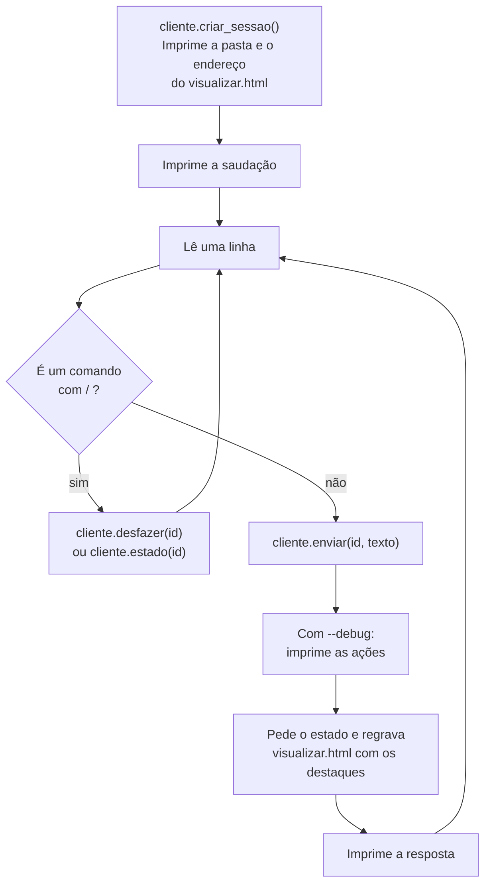

# `src/bpmn_agent/visao/terminal.py` — a conversa no terminal

[Visão geral](../README.md) · [Glossário](../glossario.md)

## Em uma frase

A mesma entrevista da página web, em modo texto. É a forma mais rápida de testar o agente
e de ver exatamente o que ele fez.

## Responsabilidade

- Ler as opções da linha de comando e começar a conversa.
- Repetir: ler uma linha, enviar, imprimir a resposta.
- Manter um arquivo `visualizar.html` atualizado, para acompanhar o desenho no navegador.
- Atender alguns comandos que começam com `/`.

Como a página web, **não importa o backend**: fala com a [API](api.md) pelo
[`ClienteApi`](cliente.md). O serviço precisa estar ligado antes.

## Como usar

Em um terminal, o serviço:

```bash
.venv/bin/python -m bpmn_agent.api.servidor
```

Em outro, a conversa:

```bash
.venv/bin/python -m bpmn_agent.visao.terminal --debug
```

| Opção | Efeito |
|---|---|
| `--continuar <arquivo>` | Lê um `processo.json` salvo antes e envia o conteúdo ao serviço. |
| `--debug` | Depois de cada resposta, imprime cada tool executada e seu resultado. |

O provedor e o modelo não são escolhidos aqui: ficam no `.env` do servidor.

| Comando durante a conversa | Efeito | Chama a LLM? |
|---|---|---|
| `/desfazer` | Desfaz a última alteração. | Não |
| `/resumo` | Imprime a descrição em texto do processo. | Não |
| `/pendencias` | Lista pontos em aberto e pendências anotadas. | Não |
| `/sair` | Encerra. `Ctrl+C` e `Ctrl+D` também. | Não |

Esses comandos usam rotas que não passam pelo agente. São úteis para conferir o estado do
processo sem gastar uma chamada à LLM.

## O laço principal



Se um pedido falhar (serviço desligado, chave inválida, limite atingido), a frase do erro
é impressa e o laço continua: a conversa não é perdida.

Se o serviço estiver desligado logo no começo, o programa avisa, mostra o endereço tentado
e o comando para ligá-lo, e encerra.

## Acompanhando o desenho

No início, o programa imprime um endereço `file://.../bpmn-agent/<id>/visualizar.html`.
Abra no navegador e recarregue a página depois de cada resposta. A página é a mesma gerada
pelo [visualizador](visualizador.md), com os elementos alterados destacados em verde.

Esse arquivo fica na pasta temporária do computador onde o terminal roda, não em
`sessoes/`. A pasta `sessoes/<id>/` pertence ao servidor; o terminal só mostra o caminho
dela.

## Exemplo de saída com `--debug`

```text
você › aí o gestor dele analisa
   🔧 adicionar_elemento: Criado Passo_2 'Analisar pedido de reembolso' depois de Passo_1.

🧭 Entendi: o gestor analisa o pedido logo depois do envio. Já coloquei isso no desenho.
```

As linhas com 🔧 são o campo `acoes` da resposta: o nome da tool e o texto que ela devolveu.

## Quem usa e quem é usado

- **Usa**: `ClienteApi` e as exceções de `cliente.py`, e `html_visualizador`.
- **Usado por**: ninguém; é um ponto de entrada.

## Cuidados ao alterar

- Não importe nada de `bpmn_agent.app` nem de `bpmn_agent.api`. O teste `test_camadas.py`
  confere.
- O endereço do serviço vem de `BPMN_API_URL`, que pode ficar no `.env` da raiz.
- `/desfazer` volta uma operação, não um turno inteiro (veja "Desfazer" em
  [modelo.md](modelo.md)).
