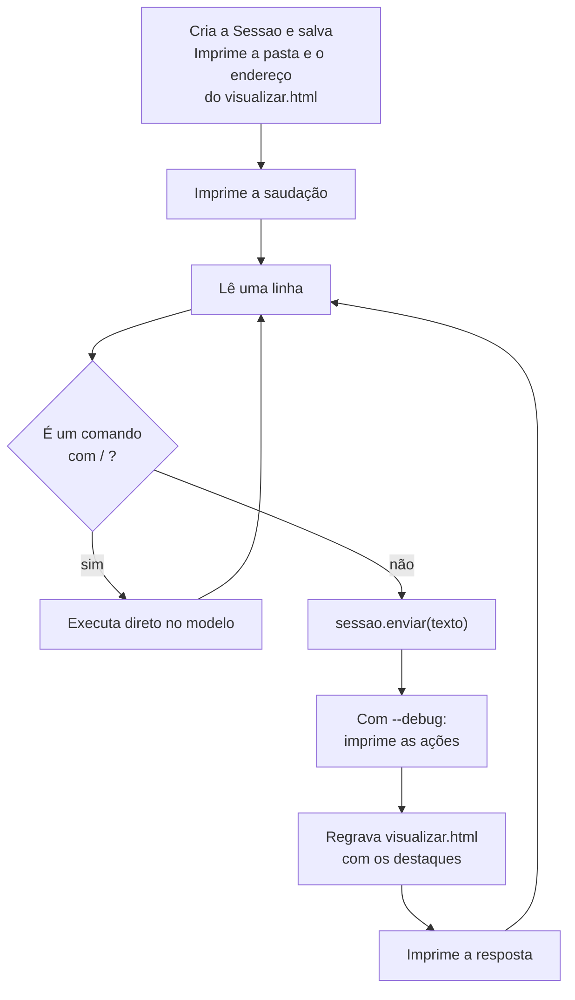

# `src/bpmn_agent/visao/terminal.py` — a conversa no terminal

[Visão geral](../README.md) · [Glossário](../glossario.md)

## Em uma frase

A mesma entrevista da página web, em modo texto. É a forma mais rápida de testar o agente e
de ver exatamente o que ele fez.

## Responsabilidade

- Ler as opções da linha de comando e criar a `Sessao`.
- Repetir: ler uma linha, enviar, imprimir a resposta.
- Manter um arquivo `visualizar.html` atualizado, para acompanhar o desenho no navegador.
- Atender alguns comandos que começam com `/`.

## Como usar

```bash
.venv/bin/python -m bpmn_agent.visao.terminal --debug
```

| Opção | Efeito |
|---|---|
| `--provedor <nome>` | Usa esse provedor em vez do `LLM_PROVEDOR` do `.env`. |
| `--modelo <nome>` | Usa esse modelo em vez do padrão do provedor. |
| `--continuar <arquivo>` | Carrega um `processo.json` salvo antes. |
| `--debug` | Depois de cada resposta, imprime cada tool executada e seu resultado. |

| Comando durante a conversa | Efeito | Chama a LLM? |
|---|---|---|
| `/desfazer` | Desfaz a última alteração. | Não |
| `/resumo` | Imprime a descrição em texto do processo. | Não |
| `/pendencias` | Lista pontos em aberto e pendências anotadas. | Não |
| `/sair` | Encerra. `Ctrl+C` e `Ctrl+D` também. | Não |

Esses comandos agem direto sobre o modelo, sem passar pelo agente. São úteis para
conferir o estado do processo sem gastar uma chamada.

## O laço principal



Se `enviar` falhar (chave inválida, sem rede), o erro é impresso e o laço continua: a
conversa não é perdida.

## Acompanhando o desenho

No início, o programa imprime um endereço `file://.../sessoes/<id>/visualizar.html`. Abra
no navegador e recarregue a página depois de cada resposta. A página é a mesma gerada pelo
[visualizador](visualizador.md), com os elementos alterados destacados em verde.

## Exemplo de saída com `--debug`

```text
você › aí o gestor dele analisa
   🔧 adicionar_participante: Participante 'Gestor' adicionado.
   🔧 adicionar_elemento: Criado Passo_2 'Analisar pedido de reembolso' depois de Passo_1.

🧭 Entendi: o gestor analisa o pedido logo depois do envio. Já coloquei isso no desenho.
```

As linhas com 🔧 são `RespostaTurno.acoes`: o nome da tool e o texto que ela devolveu.

## Quem usa e quem é usado

- **Usa**: `Sessao`, `criar_llm`, `carregar_modelo` e `html_visualizador`.
- **Usado por**: ninguém; é um ponto de entrada.

## Cuidados ao alterar

- O `.env` é procurado a partir da pasta onde está o `terminal.py`, subindo pelas pastas
  acima até achar o da raiz do projeto.
- `/desfazer` volta uma operação, não um turno inteiro (veja "Desfazer" em
  [modelo.md](modelo.md)).
