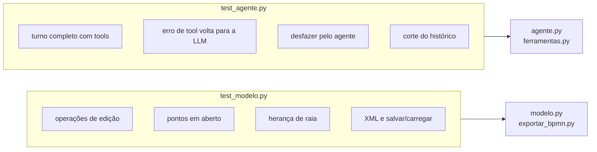

# `tests/` — os testes automáticos

[Visão geral](../README.md) · [Glossário](../glossario.md)

## Em uma frase

Conferem o modelo, o exportador e o laço do agente sem internet, sem chave e sem custo.

## Como rodar

```bash
.venv/bin/python -m pytest -q
```

## O que cada arquivo cobre



### `test_modelo.py`

| Teste | O que garante |
|---|---|
| `test_primeiro_passo_cria_inicio_automaticamente` | Criar o primeiro passo sem `depois_de` cria o início sozinho. |
| `test_inserir_no_meio_religa_o_fluxo` | `A ➜ C` vira `A ➜ B ➜ C`. |
| `test_decisao_com_caminhos_rotulados_e_volta` | Decisão com dois caminhos e uma volta. |
| `test_remover_reconecta_e_desfazer_restaura` | Remover fecha o buraco; desfazer traz de volta. |
| `test_mover_elemento_troca_ordem` | Mover muda a ordem sem deixar pontas soltas. |
| `test_resolver_por_nome_sem_acento_e_ambiguidade` | Achar por nome sem acento; erro com candidatos quando ambíguo. |
| `test_fim_nao_tem_saida` | Nada pode vir depois de um fim. |
| `test_renomear_participante_atualiza_passos` | Renomear atualiza os passos do participante. |
| `test_problemas_apontam_pontas_soltas` | `problemas()` detecta o que falta. |
| `test_xml_estrutura_e_persistencia` | O XML tem a estrutura esperada; salvar e carregar preserva o processo. |
| `test_xml_sem_participantes_nao_cria_raias` | Sem participantes, não há raias. |
| `test_decisao_inicio_e_fim_sem_responsavel_herdam_a_raia` | Início, decisão e fim herdam a raia do vizinho e não viram ponto em aberto; passo comum sem responsável continua sendo cobrado. |

### `test_agente.py`

Estes testes usam a **LLM roteirizada**: a classe `LLMRoteirizado`, uma LLM falsa que
devolve, uma a uma, as respostas escritas no próprio teste. Ela também guarda em `vistos`
tudo o que recebeu, o que permite conferir o que o nó `agente` enviou.

| Teste | O que garante |
|---|---|
| `test_turno_com_ferramentas_atualiza_diagrama` | Um turno com quatro tools (uma com erro proposital) altera o processo, devolve o erro em `acoes`, marca os `alterados`, grava os arquivos, envia o estado **atualizado** na segunda chamada e começa a conversa pelo usuário. |
| `test_desfazer_pelo_agente` | A tool `desfazer` reverte a alteração do turno anterior. |
| `test_cortar_historico_comeca_em_mensagem_do_usuario` | O corte do histórico sempre começa em uma mensagem do usuário. |

## Como escrever um teste novo do agente

```python
llm = LLMRoteirizado(respostas=[
    AIMessage(content="", tool_calls=[chamada("adicionar_elemento", {"tipo": "tarefa", "nome": "A"}, 1)]),
    AIMessage(content="Pronto. E depois?"),
])
s = Sessao(llm, pasta=tmp_path)
r = s.enviar("o primeiro passo é A")
assert "Passo_1" in s.modelo.p.elementos
```

Cada item de `respostas` é uma resposta da LLM, na ordem em que será pedida. Um turno com
tools consome pelo menos duas: a que pede as tools e a que responde em texto. Use
`tmp_path` como pasta, para o teste não escrever em `sessoes/`.

## O que os testes não cobrem

| Não coberto | Como conferir hoje |
|---|---|
| O comportamento de uma LLM de verdade (tom, quantidade de perguntas, escolha das tools) | Conduzir uma conversa real pelo `cli.py --debug`. |
| A conexão com cada provedor (`llm.py`) | Idem. |
| A qualidade visual do layout | Gerar o PNG com `scripts/renderizar.py` e olhar. |
| A validade do `.bpmn` segundo o leitor oficial | `node scripts/validar_bpmn.mjs <arquivo>`. |
| A tela do Streamlit | Abrir o app e usar. |
