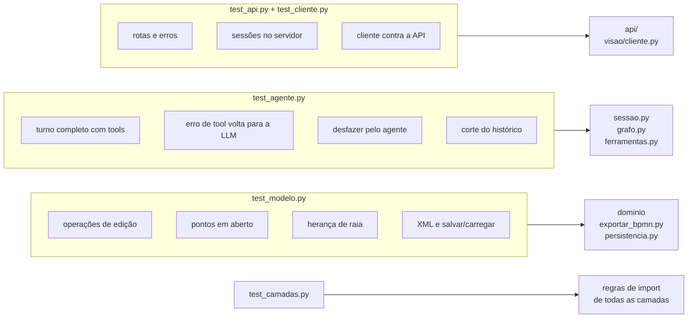

# `tests/` — os testes automáticos

[Visão geral](../README.md) · [Glossário](../glossario.md)

## Em uma frase

Conferem o modelo, o exportador, o laço do agente, a API e o cliente sem internet, sem
chave e sem custo.

## Como rodar

```bash
.venv/bin/python -m pytest -q
```

## O que cada arquivo cobre



### `test_modelo.py`

| Teste | O que garante |
|---|---|
| `test_primeiro_passo_cria_inicio_automaticamente` | Criar o primeiro passo sem `depois_de` cria o início sozinho. |
| `test_inserir_no_meio_religa_o_fluxo` | `A ➜ C` vira `A ➜ B ➜ C`. |
| `test_decisao_com_caminhos_rotulados_e_volta` | Decisão com dois caminhos e uma volta. |
| `test_remover_reconecta_e_desfazer_restaura` | Remover fecha o buraco; desfazer traz de volta. |
| `test_mover_elemento_troca_ordem` | Mover muda a ordem sem deixar pontas soltas. |
| `test_resolver_por_nome_sem_acento_e_ambiguidade` | Achar por nome sem acento; erro com candidatos quando ambíguo. |
| `test_fim_nao_tem_saida` | Nada pode vir depois de um fim. |
| `test_renomear_participante_atualiza_passos` | Renomear atualiza os passos do participante. |
| `test_problemas_apontam_pontas_soltas` | `problemas()` detecta o que falta. |
| `test_xml_estrutura_e_persistencia` | O XML tem a estrutura esperada; salvar e carregar preserva o processo. |
| `test_xml_sem_participantes_nao_cria_raias` | Sem participantes, não há raias. |
| `test_decisao_inicio_e_fim_sem_responsavel_herdam_a_raia` | Início, decisão e fim herdam a raia do vizinho e não viram ponto em aberto; passo comum sem responsável continua sendo cobrado. |

### `test_agente.py`

Estes testes usam a **LLM roteirizada**: a classe `LLMRoteirizado`, uma LLM falsa que
devolve, uma a uma, as respostas escritas no próprio teste. Ela também guarda em `vistos`
tudo o que recebeu, o que permite conferir o que o nó `agente` enviou.

| Teste | O que garante |
|---|---|
| `test_turno_com_ferramentas_atualiza_diagrama` | Um turno com quatro tools (uma com erro proposital) altera o processo, devolve o erro em `acoes`, marca os `alterados`, grava os arquivos, envia o estado **atualizado** na segunda chamada e começa a conversa pelo usuário. |
| `test_desfazer_pelo_agente` | A tool `desfazer` reverte a alteração do turno anterior. |
| `test_pedido_incoerente_fica_pendente_e_nao_altera_o_desenho` | `pedir_confirmacao` guarda o pedido, uma tool de edição chamada junto é barrada pelo grafo e o diagrama não muda. |
| `test_confirmar_aplica_o_pedido_guardado` | "Sim!" libera o pedido: o prompt do turno traz o pedido original e a edição é aplicada. |
| `test_cancelar_descarta_sem_chamar_o_llm` | "não" descarta a pendência sem chamar a LLM. |
| `test_outra_mensagem_descarta_a_pendencia_e_vira_pedido_novo` | Qualquer outra resposta descarta a pendência e segue como pedido novo. |
| `test_nao_pede_confirmacao_de_novo_depois_de_confirmado` | No turno da confirmação, `pedir_confirmacao` é recusada. |
| `test_resumo_mostra_que_so_a_descricao_mudou_mesmo_se_a_llm_diz_que_detalhou` | A fala ganha "O que mudou de fato" mostrando só a descrição alterada, e a tela (histórico) a exibe. |
| `test_resumo_lista_itens_novos_e_ligacoes` | O resumo cita os itens novos e a contagem de ligações. |
| `test_turno_sem_ferramentas_nao_ganha_resumo_e_a_llm_nao_ve_o_resumo` | Turno só de conversa não tem resumo, e a LLM não recebe o resumo de turnos anteriores. |
| `test_fala_sem_pergunta_com_pontos_em_aberto_ganha_aviso_do_codigo_e_a_llm_nao_o_ve` | Fala que encerra sem pergunta, com pontos em aberto, ganha o aviso ⚠️ (sem ids) e a LLM não o vê. |
| `test_fala_com_pergunta_ou_diagrama_completo_nao_ganha_aviso` | Se o agente está perguntando, ou o diagrama está completo, não há aviso. |
| `test_pedido_em_duvida_mostra_que_nada_mudou` | Ao segurar um pedido, o resumo diz `nada`. |
| `test_estado_no_fim_deixa_o_comeco_estavel_e_manda_o_diagrama_na_ultima_mensagem` | Com `estado_no_fim`, o prompt não tem o diagrama, o começo é idêntico entre chamadas, o diagrama vai na última mensagem (atualizado a cada chamada) e não entra no histórico. |
| `test_cortar_historico_comeca_em_mensagem_do_usuario` | O corte do histórico sempre começa em uma mensagem do usuário. |

## Como escrever um teste novo do agente

```python
llm = LLMRoteirizado(respostas=[
    AIMessage(content="", tool_calls=[chamada("adicionar_elemento", {"tipo": "tarefa", "nome": "A"}, 1)]),
    AIMessage(content="Pronto. E depois?"),
])
s = Sessao(llm, pasta=tmp_path)
r = s.enviar("o primeiro passo é A")
assert "Passo_1" in s.modelo.p.elementos
```

Cada item de `respostas` é uma resposta da LLM, na ordem em que será pedida. Um turno com
tools consome pelo menos duas: a que pede as tools e a que responde em texto. Use
`tmp_path` como pasta, para o teste não escrever em `sessoes/`.

### `test_sistemas.py`

Catálogo de sistemas: cadastrar e completar sem duplicar, nome canônico e operação aprendida,
cadastro automático ao citar no passo, separação entre sistema e participante (nos dois sentidos),
trocar/tirar o sistema do passo, passo que executa num sistema e chama outro (raia + seta), duas chamadas repetidas, renomear (e recusar conflitos), remover com desfazer, aviso de sistema deduzido, pontos em aberto, resumo/narrativa/`.bpmn`
leitura de JSON antigo, raia por sistema da empresa e caixa separada com seta de mensagem para sistema de terceiros.

### `test_api.py`

Testa as rotas com o `TestClient` do FastAPI, que chama a API em memória, sem abrir porta
nenhuma. A LLM roteirizada entra pelo parâmetro `fabrica_llm` de `criar_app`, e a pasta de
sessões é o `tmp_path` do teste.

| O que garante |
|---|
| `/saude` informa provedor e modelo, e nunca a chave. |
| Criar sessão devolve o estado com a saudação e não grava nada em disco. |
| Um turno atualiza o estado, devolve ações e alterados, e grava os arquivos. |
| Desfazer e baixar os três arquivos funcionam; nome de arquivo desconhecido é recusado. |
| Continuar a partir de um `processo.json` enviado; arquivo inválido dá 422. |
| Sessão inexistente dá 404 com frase para leigo. |
| Id fora do formato, texto vazio ou longo demais e pedido grande demais são recusados. |
| Falha da LLM vira 502 com dica; LLM não configurada vira 503. |
| Segunda mensagem durante um turno dá 409. |
| Servidor reiniciado retoma o desenho do disco. |
| O registro descarta a sessão parada há mais tempo ao passar do limite. |

### `test_cliente.py`

Roda o `ClienteApi` de verdade contra a API em memória: um roteiro completo (criar,
enviar, consultar, continuar, desfazer), um erro 404 e um serviço desligado. É este teste
que garante que o cliente e a API continuam combinando.

### `test_camadas.py`

Lê os `import` de cada arquivo de `src/bpmn_agent/` e falha se uma camada importar o que
não pode (por exemplo, `visao` importando `app`, ou `app` importando `fastapi`). A lista
das proibições está no próprio teste e reflete a tabela de [../README.md](../README.md).

## O que os testes não cobrem

| Não coberto | Como conferir hoje |
|---|---|
| O comportamento de uma LLM de verdade (tom, quantidade de perguntas, escolha das tools) | Conduzir uma conversa real pelo `python -m bpmn_agent.visao.terminal --debug`. |
| A conexão com cada provedor (`llm.py`) | Idem. |
| A qualidade visual do layout | Gerar o PNG com `scripts/renderizar.py` e olhar. |
| A validade do `.bpmn` segundo o leitor oficial | `node scripts/validar_bpmn.mjs <arquivo>`. |
| A tela do Streamlit e o laço do terminal | Subir o serviço, abrir a página web ou o terminal e usar. |
