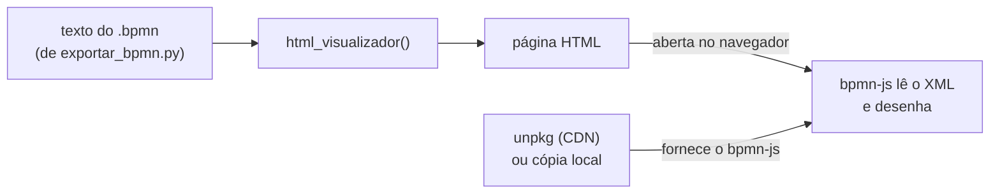

# `bpmn_agent/visualizador.py` — a página que desenha o diagrama

[Visão geral](../README.md) · [Glossário](../glossario.md)

## Em uma frase

Recebe o texto de um arquivo `.bpmn` e devolve uma página HTML completa que desenha esse
diagrama no navegador.

## Responsabilidade

Uma única função: `html_visualizador(xml, altura, base, destacar)`. Ela não desenha nada
por conta própria. Monta uma página que carrega a biblioteca bpmn-js e entrega o XML a
ela. Quem desenha é o bpmn-js, dentro do navegador.

## Parâmetros

| Parâmetro | Padrão | Significado |
|---|---|---|
| `xml` | obrigatório | O conteúdo do `.bpmn`. |
| `altura` | 600 | Altura da área de desenho, em pixels. |
| `base` | endereço do unpkg | De onde carregar o bpmn-js. Pode ser uma pasta local, para funcionar sem internet. |
| `destacar` | lista vazia | Ids dos elementos a destacar em verde. |

## O que a página gerada contém

| Parte | Função |
|---|---|
| Três folhas de estilo do bpmn-js | Aparência padrão dos símbolos. |
| Barra com três botões | Aproximar (`+`), afastar (`−`) e ajustar à tela (`⤢`). |
| Área `#canvas` | Onde o diagrama aparece. |
| Área `#erro` | Mostra "Não foi possível desenhar: ..." se o bpmn-js recusar o XML. |
| Script | Cria o visualizador, importa o XML, ajusta o zoom e aplica os destaques. |

A versão do bpmn-js usada é a "navigated viewer": só mostra, com zoom e arrasto. Não
permite editar o diagrama com o mouse.

O XML e a lista de destaques entram no script passando por `json.dumps`, que cuida de
aspas e quebras de linha. Sem isso, um nome de passo com aspas quebraria a página.

## O destaque em verde

Para cada id da lista `destacar`, o script pede ao bpmn-js que marque o elemento com a
classe `novo`. O estilo da página pinta de verde e engrossa o contorno de quem tem essa
classe. Se um id não existir no desenho, é ignorado em silêncio.

A lista vem de `RespostaTurno.alterados` (veja [agente.md](agente.md)): é assim que o
usuário percebe o que mudou depois de cada resposta.

## O sinal `window.__pronto`

Quando termina de desenhar (ou quando falha), o script define `window.__pronto = true`.
O `scripts/renderizar.py` espera por esse sinal antes de tirar a foto da página.

## Quem usa

| Quem | Como |
|---|---|
| `app.py` | Coloca a página dentro da tela do Streamlit, à direita do chat. |
| `cli.py` | Grava a página em `sessoes/<id>/visualizar.html`, para abrir no navegador. |
| `scripts/renderizar.py` | Abre a página em um navegador controlado por código e salva um PNG, usando a cópia local do bpmn-js. |

## Cuidados ao alterar

- A página inteira é uma f-string do Python. Toda chave literal de CSS ou JavaScript
  precisa ser dobrada (`{{` e `}}`).
- A versão do bpmn-js fica em `BPMN_JS_VERSAO`. Mantenha a mesma versão em
  `scripts/package.json`, para o PNG de conferência ficar igual ao que o usuário vê.
- Em redes que bloqueiam o unpkg, o desenho não aparece. A saída é servir os arquivos do
  bpmn-js localmente e passar o endereço em `base`.
