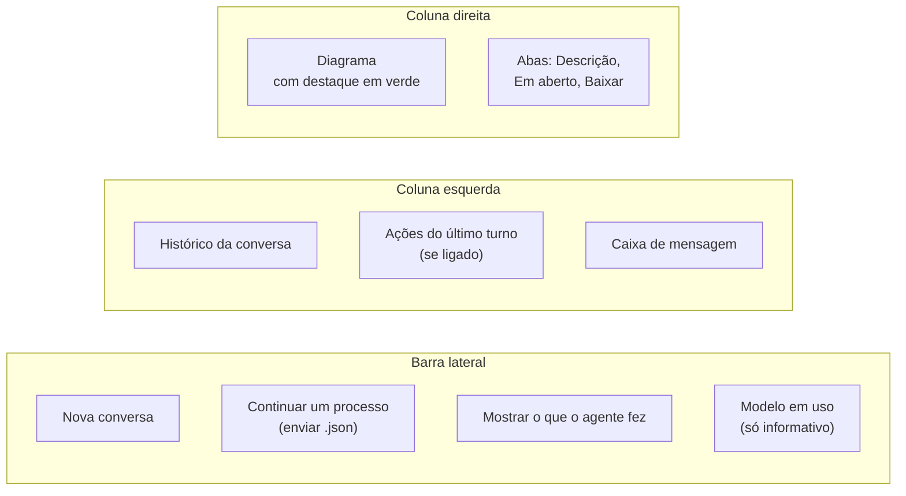
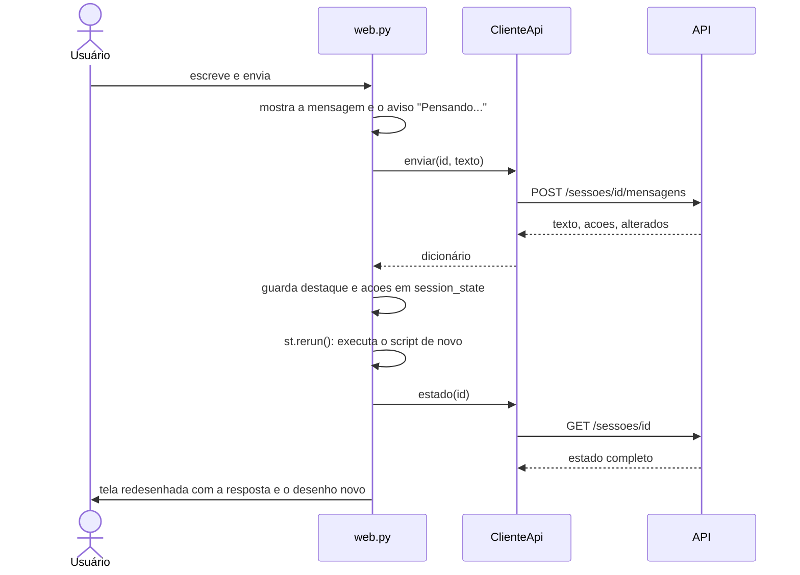

# `src/bpmn_agent/visao/web.py` — a página web

[Visão geral](../README.md) · [Glossário](../glossario.md)

## Em uma frase

A tela que o usuário final usa: chat à esquerda, desenho ao vivo à direita.

## Responsabilidade

- Mostrar a conversa e receber as mensagens.
- Mostrar o desenho, a descrição em texto, os pontos em aberto e os botões de download.
- Começar uma conversa nova ou continuar um processo salvo.

Não tem regra de processo, não fala com a LLM e **não importa o backend**: tudo o que
mostra vem da [API](api.md), pelo [`ClienteApi`](cliente.md). O serviço precisa estar
ligado antes.

## Como rodar

Em um terminal, o serviço:

```bash
.venv/bin/python -m bpmn_agent.api.servidor
```

Em outro, a página:

```bash
.venv/bin/streamlit run src/bpmn_agent/visao/web.py
```

## A tela



| Elemento da tela | De onde vem o conteúdo |
|---|---|
| Histórico da conversa | `estado["historico"]` |
| Ações do último turno | `acoes` da resposta do último envio |
| Diagrama | `html_visualizador(estado["bpmn_xml"], destacar=...)` |
| Aba "Descrição" | `estado["narrativa"]` |
| Aba "Em aberto" | `estado["em_aberto"]` + `estado["pendencias"]` |
| Aba "Baixar" | `estado["bpmn_xml"]`, `estado["processo"]` e `estado["narrativa"]` |
| "Modelo em uso" | `cliente.saude()` |

`estado` é a resposta de `cliente.estado(id)`: um dicionário com tudo o que a tela mostra.

## Como o Streamlit funciona (e por que isso importa)

O Streamlit **executa o arquivo inteiro de novo** a cada interação: cada clique, cada
mensagem. Variáveis comuns se perdem entre uma execução e outra. O que precisa durar fica
em `st.session_state`:

| Chave | O que guarda |
|---|---|
| `sessao_id` | O id da conversa atual. A conversa em si mora no servidor. |
| `destaque` | Ids alterados no último turno. |
| `acoes` | Ações do último turno. |
| `arquivo_carregado` | Identificador do último `.json` enviado, para não recarregá-lo a cada execução. |

A cada execução, a página faz duas chamadas à API: `estado(id)` e `saude()`. O
`ClienteApi` é criado uma vez só e reaproveitado (`st.cache_resource`).

## O que acontece quando o usuário envia uma mensagem



O `st.rerun()` é o que faz o desenho e as abas se atualizarem: na nova execução, o estado
é pedido de novo ao serviço.

## Quando algo dá errado

| Situação | O que a tela mostra |
|---|---|
| O serviço está desligado | No lugar do chat: "Não consegui falar com o serviço do Desenhista...", o endereço tentado, o comando para ligar e um botão "Tentar de novo". |
| O serviço não tem modelo configurado | O aviso devolvido pelo serviço, com o detalhe (qual variável falta). |
| Falha da LLM durante um turno | A frase devolvida pelo serviço (limite atingido, chave inválida ou falha geral) e o detalhe técnico. |
| O serviço não conhece mais a conversa (reiniciou e ela estava vazia) | Começa uma conversa nova e avisa: "A conversa anterior foi encerrada." |

As frases vêm prontas do serviço; a página só as exibe.

## A barra lateral

| Item | Efeito |
|---|---|
| **Nova conversa** | Esquece o id atual; uma conversa nova é criada na mesma execução. |
| **Enviar `.json`** | Lê o arquivo no navegador e envia o conteúdo ao serviço, que cria uma conversa já com o processo carregado. |
| **Mostrar o que o agente fez** | Mostra, abaixo do chat, cada tool executada no último turno. |
| **Modelo em uso** | Informa o provedor e o modelo configurados no servidor. Não dá para trocar pela tela: isso fica no `.env` do servidor. |

## Quem usa e quem é usado

- **Usa**: `ClienteApi` e as exceções de `cliente.py`, e `html_visualizador`.
- **Usado por**: ninguém; é um ponto de entrada.

## Cuidados ao alterar

- Textos da tela são para leigos: nada de BPMN, raia, gateway ou evento.
- Não importe nada de `bpmn_agent.app` nem de `bpmn_agent.api`. Se a tela precisa de um
  dado novo, ele entra no `EstadoSessao` da API. O teste `test_camadas.py` confere.
- Não guarde em variável comum nada que precise sobreviver a um clique.
- A resposta só aparece quando o turno inteiro termina (não há exibição letra a letra).
  Com modelos lentos, o aviso "Pensando..." pode ficar vários segundos na tela.
